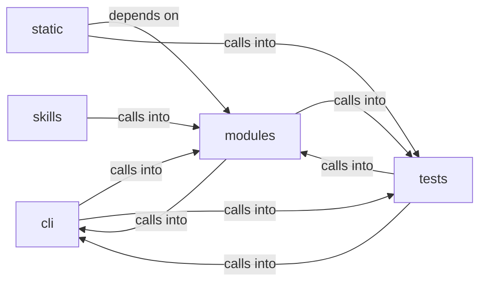

# modules: chain_runner

modules: chain_runner groups 100 files (c, js, py) around skip_pending, ChainStep, identifier, Chain, resolve. Parsing, printing and replanning support for the ``apt_chain`` CLI.

## cli (7.1)

cli groups 3 files (py) around _parse_admin_flags, _token_name_ok, ChainArgs, parse_chain_args, _set_value. Parsing, printing and replanning support for the ``apt_chain`` CLI.

## modules (7.2)

modules groups 50 files (c, py) around skip_pending, ChainStep, identifier, Chain, resolve. APT Playbook Engine — map public APT reports to executable Atomic Red Team chains.

## skills (7.3)

skills groups 3 files (py) around handle, handle, handle. MCP tool ``lazyown_apt_chain`` (migrated from the call_tool dispatch chain).

## static (7.4)

static groups 1 files (js) around d, e, t. !

## tests (7.5)

tests groups 43 files (py) around _make_shell, _Set, _Shell, __init__, _write_chain. apt_chain admin & run options BDD contract.

**Files**:

- cli/apt_chain_support.py
- cli/commands/command_and_control_migrated.py
- cli/retry_support.py
- modules/apt_playbooks.py
- modules/atomic_resolver.py
- modules/auto_registry.py
- modules/chain_approval.py
- modules/chain_distill.py
- modules/chain_facts.py
- modules/chain_family.py
- modules/chain_loop.py
- modules/chain_match.py
- modules/chain_registry.py
- modules/chain_runner.py
- modules/chain_state.py
- modules/chain_synth.py
- modules/chain_tokens.py
- modules/custom_tools.py
- modules/emulation_runner.py
- modules/gym_matrix_runner.py
- modules/gym_winbox_runner.py
- modules/lazy_autofire.py
- modules/lazy_deviations.py
- modules/lazy_finalizer.py
- modules/lazy_scope.py
- modules/lazypoophish.py
- modules/lazyshortener.py
- modules/listener_manager.py
- modules/loop/worker_execution.py
- modules/notify.py
- modules/playbook_admin.py
- modules/playbook_chain.py
- modules/retry_session.py
- modules/reverse-shell.c
- modules/rootkit/rootkit.c
- modules/selection/__init__.py
- modules/selection/adversary.py
- modules/selection/atomic.py
- modules/selection/base.py
- modules/selection/chain.py
- modules/selection/cred_spray.py
- modules/selection/edb.py
- modules/selection/intel.py
- modules/selection/lazyscript.py
- modules/selection/module.py
- modules/selection/playbook.py
- modules/selection/poc.py
- modules/selection/registry.py
- modules/selection/technique.py
- modules/selection/technique_chain.py
- modules/ttpscope_bridge.py
- modules/verb_manifest.py
- modules/workspace.py
- skills/mcp_tools/apt_chain.py
- skills/mcp_tools/lazy_addon.py
- skills/mcp_tools/ttp_chain.py
- static/js/select2-4.1.0.min.js
- tests/test_apt_chain_admin.py
- tests/test_apt_chain_integration.py
- tests/test_atomic_loop.py
- tests/test_atomic_resolver.py
- tests/test_auto_registry.py
- tests/test_chain_approval_c2.py
- tests/test_chain_approval_cli_wiring.py
- tests/test_chain_distill.py
- tests/test_chain_distill_custody.py
- tests/test_chain_distill_scope.py
- tests/test_chain_evidence.py
- tests/test_chain_family.py
- tests/test_chain_finalizer.py
- tests/test_chain_freshness_guard.py
- tests/test_chain_loop.py
- tests/test_chain_parallel_fallback.py
- tests/test_chain_registry.py
- tests/test_chain_runner.py
- tests/test_chain_step_streaming.py
- tests/test_chain_synth.py
- tests/test_chain_token_hardening.py
- tests/test_chain_v24_core.py
- tests/test_codeql_alert_fixes.py
- tests/test_command_control_agent.py
- tests/test_emulation_runner.py
- tests/test_f4_hardening.py
- tests/test_intel_selector.py
- tests/test_lazy_adaptive_replan.py
- tests/test_lazy_deviations.py
- tests/test_lazy_loop.py
- tests/test_loop_fire_pending.py
- tests/test_playbook_admin.py
- tests/test_playbook_chain.py
- tests/test_poc_registry.py
- tests/test_retry_session.py
- tests/test_selection_lazyscript.py
- tests/test_selection_module.py
- tests/test_selection_technique.py
- tests/test_selection_technique_chain.py
- tests/test_selection_wiring.py
- tests/test_selectors_base.py
- tests/test_selectors_capabilities.py
- tests/test_verb_manifest.py
