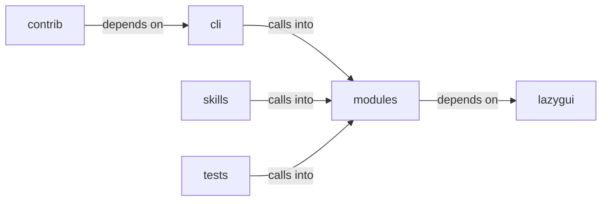

# modules: dashboard_engine

modules: dashboard_engine groups 17 files (py) around PwnCommandSet, do_auto_pwn, do_rich_tui, do_exploit_chain, do_lolbas_list. Autonomous exploitation and LOLBAS command set.

## cli (13.1)

cli groups 1 files (py) around PwnCommandSet, do_auto_pwn, do_rich_tui, do_exploit_chain, do_lolbas_list. Autonomous exploitation and LOLBAS command set.

## contrib (13.2)

contrib groups 3 files (py) around BinaryFinder, __init__, find_suid_binaries, find_capabilities_binaries, find_executable_binaries.

## lazygui (13.3)

lazygui groups 2 files (py). LazyOwn Operator Console.

## modules (13.4)

modules groups 5 files (py) around _parse_nmap_xml_services, DashboardNode, DashboardEdge, DashboardEngine, __init__. Live Network Map Dashboard for LazyOwn.

## skills (13.5)

skills groups 4 files (py) around handle, _has_data, handle, handle, handle. MCP tool ``lazyown_dashboard_snapshot``: render the live network map.

## tests (13.6)

tests groups 2 files (py) around _world, test_empty_world_is_well_formed, test_none_world_is_tolerated, test_hosts_and_services_become_nodes, test_owned_host_pulses_and_counts_as_compromised. Tests for modules/live_surface.py.

**Files**:

- cli/commands/pwn.py
- contrib/legacy/lazypwn.py
- contrib/legacy/lazyvsftp.py
- contrib/legacy/sql.py
- lazygui/__init__.py
- lazygui/version.py
- modules/dashboard_engine.py
- modules/exploit_recommender.py
- modules/live_surface.py
- modules/rich_tui.py
- modules/unified_dashboard.py
- skills/mcp_tools/dashboard_snapshot.py
- skills/mcp_tools/exploit_recommend.py
- skills/mcp_tools/rich_tui_snapshot.py
- skills/mcp_tools/unified_dashboard.py
- tests/test_live_surface.py
- tests/test_unified_dashboard.py
