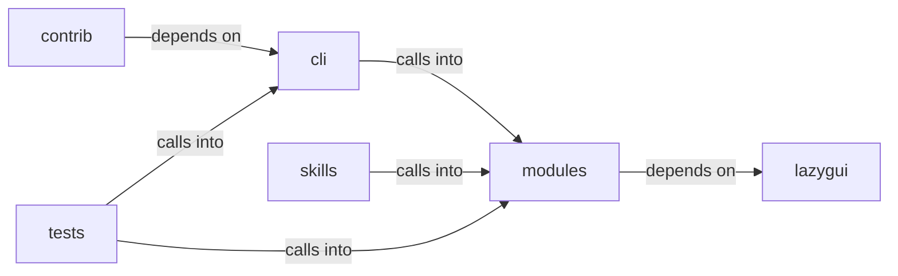

# modules: dashboard_tui

modules: dashboard_tui groups 38 files (py) around _derive_crypto_key, _master_password, read_state_dict, write_state_dict, HostState. exploit commands migrated from lazyown.py.

## cli (9.1)

cli groups 6 files (py) around PwnCommandSet, do_auto_pwn, do_rich_tui, do_exploit_chain, do_lolbas_list. exploit commands migrated from lazyown.py.

## contrib (9.2)

contrib groups 3 files (py) around BinaryFinder, __init__, find_suid_binaries, find_capabilities_binaries, find_executable_binaries.

## lazygui (9.3)

lazygui groups 2 files (py). LazyOwn Operator Console.

## modules (9.4)

modules groups 10 files (py) around _derive_crypto_key, _master_password, read_state_dict, write_state_dict, HostState. Active Directory Certificate Services (AD CS) attack module.

## skills (9.5)

skills groups 7 files (py) around ConfigKeys, EnvKeys, Defaults, PhaseNames, Paths. Dynamic Claude.md rule generator for the Hermes-LazyOwn integration.

## tests (9.6)

tests groups 10 files (py) around _reset_world_model_singleton, TestReadJson, test_reads_valid_file, test_missing_file_returns_empty_dict, test_invalid_json_returns_empty_dict. Global pytest isolation hooks.

**Files**:

- cli/commands/exploit_migrated.py
- cli/commands/pwn.py
- cli/dashboard_layout.py
- cli/dashboard_tui.py
- cli/killchain.py
- cli/ops_commands.py
- contrib/legacy/lazypwn.py
- contrib/legacy/lazyvsftp.py
- contrib/legacy/sql.py
- lazygui/__init__.py
- lazygui/version.py
- modules/adcs_attacks.py
- modules/dashboard_engine.py
- modules/exploit_chain.py
- modules/exploit_recommender.py
- modules/kill_chain_viz.py
- modules/killchain.py
- modules/live_surface.py
- modules/rich_tui.py
- modules/unified_dashboard.py
- modules/world_model.py
- skills/hermes-lazyown/claudemd_rules.py
- skills/hermes-lazyown/config_bridge.py
- skills/hermes-lazyown/constants.py
- skills/hermes-lazyown/executor.py
- skills/hermes-lazyown/hermes_sync.py
- skills/hermes-lazyown/mcp_server.py
- skills/hermes-lazyown/output_compactor.py
- tests/conftest.py
- tests/test_dashboard_tui.py
- tests/test_killchain.py
- tests/test_killchain_snapshot.py
- tests/test_killchain_unified.py
- tests/test_killchain_unified_v2.py
- tests/test_live_surface.py
- tests/test_ops_loot_phase.py
- tests/test_unified_dashboard.py
- tests/test_world_model_extended.py
