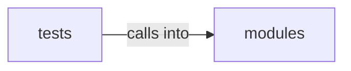

# modules: defense_eval

modules: defense_eval groups 8 files (py) around RuleEvaluationError, Condition, Evaluation, to_dict, DatasetSummary. Closed-loop detection rule tuning: baseline vs candidate comparison.

## modules (14.1)

modules groups 4 files (py) around RuleEvaluationError, Condition, Evaluation, to_dict, DatasetSummary. Closed-loop detection rule tuning: baseline vs candidate comparison.

## tests (14.2)

tests groups 4 files (py) around test_candidate_with_false_positive_regresses, test_both_pass_is_equivalent, test_both_fail_is_equivalent_fail, test_inconclusive_datasets, test_candidate_fixes_baseline_failure. Closed-loop tuning: baseline vs candidate comparison and suggestions.

**Files**:

- modules/closedloop.py
- modules/defense_eval.py
- modules/defense_stages.py
- modules/hunt_verify.py
- tests/test_closedloop.py
- tests/test_defense_eval.py
- tests/test_defense_stages.py
- tests/test_hunt_verify.py
