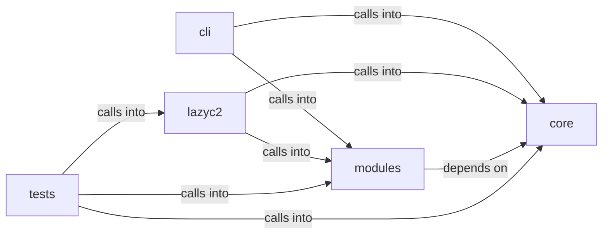

# modules: estorides_importer

modules: estorides_importer groups 50 files (c, py) around generate_salt, derive_key, xor_encrypt_decrypt, generate_xor_key, AESencrypt. Estorides integration commands — bidirectional feedback loop with passive OSINT.

## cli (7.1)

cli groups 3 files (py) around _yellow, _green, EstoridesCommandSet, _check_estorides, do_estorides_seed. Estorides integration commands — bidirectional feedback loop with passive OSINT.

## core (7.2)

core groups 4 files (py) around generate_salt, derive_key, xor_encrypt_decrypt, generate_xor_key, AESencrypt. Tenant-bound API authorization for the LazyOwn C2 dashboard.

## lazyc2 (7.3)

lazyc2 groups 12 files (py) around CSRFPolicy, __init__, header, cookie_name, issue. LazyAddon creator contract for the LazyOwn C2 web interface.

## modules (7.4)

modules groups 14 files (c, py) around LazyOwnDB, __init__, _get_conn, db_path, _init_schema. Persistent beacon command/result history storage.

## tests (7.5)

tests groups 17 files (py) around _valid_draft, TestConfig, test_name_pattern_rejects_traversal, test_patterns_accept_canonical_values, test_os_options_cover_mitre_platforms. Tests for the LazyAddon creator contract and C2 blueprint.

**Files**:

- cli/commands/estorides.py
- cli/commands/opsec_cleanup.py
- cli/commands/security.py
- core/api_authz.py
- core/credential_vault.py
- core/crypto.py
- core/protocols.py
- lazyc2/addon_creator.py
- lazyc2/app_factory.py
- lazyc2/blueprints/__init__.py
- lazyc2/blueprints/addons.py
- lazyc2/blueprints/api.py
- lazyc2/blueprints/api_v1.py
- lazyc2/blueprints/operations.py
- lazyc2/blueprints/session_auth.py
- lazyc2/extensions/__init__.py
- lazyc2/extensions/decoy.py
- lazyc2/extensions/storage.py
- lazyc2/security/csrf.py
- modules/beacon_history.py
- modules/db.py
- modules/estorides_importer.py
- modules/forensic_cleaner.py
- modules/hash_cracker.py
- modules/integrations/nuclei_bridge.py
- modules/integrations/nuclei_parser.py
- modules/intelligence_engine.py
- modules/log_tamper.py
- modules/memory_cleaner.py
- modules/network_opsec.py
- modules/opsec_scorer.py
- modules/rootkit/rootkit.c
- modules/timestomper.py
- tests/test_addon_creator.py
- tests/test_api_authz.py
- tests/test_api_v1.py
- tests/test_beacon_history.py
- tests/test_core.py
- tests/test_core_defaults.py
- tests/test_credential_vault.py
- tests/test_csrf_behavior.py
- tests/test_csrf_policy.py
- tests/test_db.py
- tests/test_hash_cracker.py
- tests/test_intelligence_engine.py
- tests/test_mutation_verification.py
- tests/test_nuclei_parser.py
- tests/test_opsec_scorer.py
- tests/test_opsec_scorer_consolidated.py
- tests/test_placeholder_coverage.py
