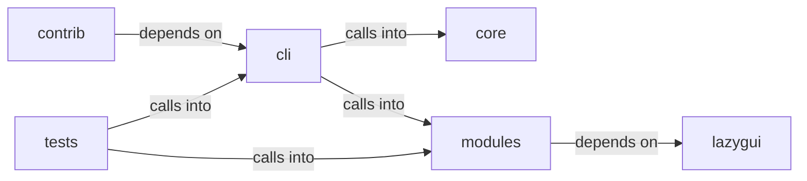

# modules: exploit_migrated

modules: exploit_migrated groups 18 files (py) around PwnCommandSet, do_auto_pwn, do_rich_tui, do_exploit_chain, do_lolbas_list. exploit commands migrated from lazyown.py.

## cli (12.1)

cli groups 2 files (py) around PwnCommandSet, do_auto_pwn, do_rich_tui, do_exploit_chain, do_lolbas_list. exploit commands migrated from lazyown.py.

## contrib (12.2)

contrib groups 3 files (py) around BinaryFinder, __init__, find_suid_binaries, find_capabilities_binaries, find_executable_binaries.

## core (12.3)

core groups 1 files (py) around is_autonomous, autonomous_mode, _guarded_input. Autonomous-run mode for the loop engine.

## lazygui (12.4)

lazygui groups 2 files (py). LazyOwn Operator Console.

## modules (12.5)

modules groups 7 files (py) around _parse_nmap_xml_services, DashboardNode, DashboardEdge, DashboardEngine, __init__. Active Directory Certificate Services (AD CS) attack module.

## tests (12.6)

tests groups 3 files (py) around test_chain_list_lists_registry, test_chain_list_filters, _world, test_empty_world_is_well_formed, test_none_world_is_tolerated. BDD: chain list exposes the YAML chain registry.

**Files**:

- cli/commands/exploit_migrated.py
- cli/commands/pwn.py
- contrib/legacy/lazypwn.py
- contrib/legacy/lazyvsftp.py
- contrib/legacy/sql.py
- core/autonomous.py
- lazygui/__init__.py
- lazygui/version.py
- modules/adcs_attacks.py
- modules/dashboard_engine.py
- modules/exploit_chain.py
- modules/exploit_recommender.py
- modules/live_surface.py
- modules/rich_tui.py
- modules/unified_dashboard.py
- tests/test_chain_list_command.py
- tests/test_live_surface.py
- tests/test_unified_dashboard.py
