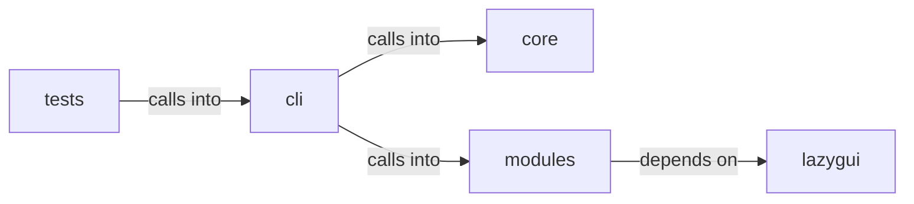

# modules: exploit_migrated

modules: exploit_migrated groups 8 files (py) around ExploitMigratedCommandSet, do_cp, do_createcookie, do_py3ttyup, do_pyautomate. exploit commands migrated from lazyown.py.

## cli (13.1)

cli groups 1 files (py) around ExploitMigratedCommandSet, do_cp, do_createcookie, do_py3ttyup, do_pyautomate. exploit commands migrated from lazyown.py.

## core (13.2)

core groups 1 files (py) around is_autonomous, autonomous_mode, _guarded_input. Autonomous-run mode for the loop engine.

## lazygui (13.3)

lazygui groups 2 files (py). LazyOwn Operator Console.

## modules (13.4)

modules groups 3 files (py) around parse_version, ExploitMatch, ExploitRecommender, __init__, set_world_model. Active Directory Certificate Services (AD CS) attack module.

## tests (13.5)

tests groups 1 files (py) around test_chain_list_lists_registry, test_chain_list_filters. BDD: chain list exposes the YAML chain registry.

**Files**:

- cli/commands/exploit_migrated.py
- core/autonomous.py
- lazygui/__init__.py
- lazygui/version.py
- modules/adcs_attacks.py
- modules/exploit_chain.py
- modules/exploit_recommender.py
- tests/test_chain_list_command.py
