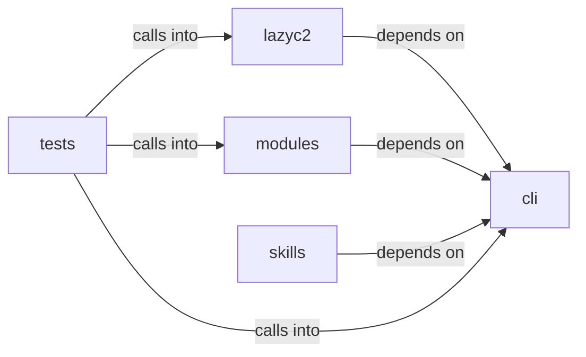

# modules/guardrails

modules/guardrails groups 22 files (py) around EnumCommandSet, do_smbclient, do_smbclient_impacket, do_smbclient_py, do_smbmap. Enumeration command set.

## cli (12.1)

cli groups 2 files (py) around EnumCommandSet, do_smbclient, do_smbclient_impacket, do_smbclient_py, do_smbmap. Enumeration command set.

## lazyc2 (12.2)

lazyc2 groups 1 files (py) around CommandRejectionReason, CommandDecision, to_dict, CommandAllowlist, __init__. Command allowlist policy for the LazyOwn C2 ``/api/run`` endpoint.

## modules (12.3)

modules groups 9 files (py) around TaskClass, is_known, RunTicket, GuardrailContract, describe. Beacon Object File (BOF) registry and marketplace for LazyOwn.

## skills (12.4)

skills groups 4 files (py) around HookEvent, HookRegistry, __init__, register, run. LazyOwn CLAUDE.md Hierarchical Loader (Claude Code style)  4-level hierarchy (highest...

## tests (12.5)

tests groups 6 files (py) around catalog, tmp_sessions, TestBofEntry, test_construction_and_properties, test_immutability. Tests for modules/bof_registry.py — BofEntry, BofCatalog, BofRegistry, BofMarketplace...

**Files**:

- cli/commands/enum.py
- cli/scope_guard.py
- lazyc2/security/command_allowlist.py
- modules/bof_registry.py
- modules/guardrails/__init__.py
- modules/guardrails/advisories.py
- modules/guardrails/budget.py
- modules/guardrails/checkpoints.py
- modules/guardrails/contracts.py
- modules/guardrails/harness.py
- modules/sleep_obfuscation.py
- modules/socks_proxy.py
- skills/lazyown_claudemd.py
- skills/lazyown_hooks.py
- skills/lazyown_permissions.py
- skills/tests/test_harness_e2e.py
- tests/test_bof_registry.py
- tests/test_command_allowlist.py
- tests/test_command_allowlist_behavior.py
- tests/test_scope_guard.py
- tests/test_sleep_obfuscation.py
- tests/test_socks_proxy.py
