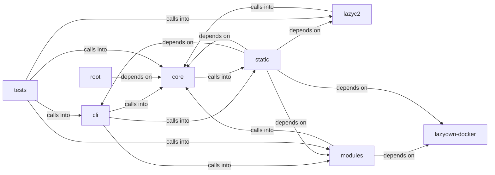

# modules: html2pdf.bundle.min

modules: html2pdf.bundle.min groups 74 files (c, js, py, sh) around _apply_env_overrides, _coerce_env_value, _mask_if_sensitive, _log_config_change, _calling_frame. ``assign`` business logic.

## cli (6.1)

cli groups 11 files (py) around apply_assign, format_payload, style, active_tokens, paint. ``assign`` business logic.

## core (6.2)

core groups 7 files (py) around _apply_env_overrides, _coerce_env_value, _mask_if_sensitive, _log_config_change, _calling_frame. Configuration loader and Config wrapper.

## lazyc2 (6.3)

lazyc2 groups 3 files (py) around AddonCreatorConfig, live_placeholders, ParamSpec, to_dict, AddonDraft. LazyAddon creator contract for the LazyOwn C2 web interface.

## lazyown-docker (6.4)

lazyown-docker groups 1 files (sh).

## modules (6.5)

modules groups 17 files (c, py) around Migration, _docker_exec, _core_services_apply, build_migrations, apply_migrations. Purple Team Closed-Loop — honest measurement of offensive detection.

## root (6.6)

root groups 1 files (py) around main.

## static (6.7)

static groups 14 files (js) around As, Be, Cs, Do, Ds. Version 1.73.4 3d-force-graph - https://github.com/vasturiano/3d-force-graph...

## tests (6.8)

tests groups 20 files (py) around TestHexSource, test_valid_hex_decodes_to_32_bytes, test_wrong_length_raises, test_non_hex_raises, TestDiskSource. TDD tests for the AES key resolution contract.

**Files**:

- cli/assign.py
- cli/commands/defaults.py
- cli/commands/opsec_cleanup.py
- cli/commands/params_ops.py
- cli/commands/purple_team.py
- cli/commands/security.py
- cli/commands/session_ops.py
- cli/purple_tui.py
- cli/session_resumer.py
- cli/show.py
- cli/style.py
- core/config.py
- core/credential_vault.py
- core/defaults.py
- core/param_registry.py
- core/payload_schema.py
- core/prompt.py
- core/session_secrets.py
- key.py
- lazyc2/addon_creator.py
- lazyc2/blueprints/api.py
- lazyc2/state.py
- lazyown-docker/init.sh
- modules/auto_purple.py
- modules/c2_builder.py
- modules/exp.c
- modules/forensic_cleaner.py
- modules/gym_cleanup.py
- modules/hash_cracker.py
- modules/lab_runtime.py
- modules/log_tamper.py
- modules/memory_cleaner.py
- modules/metasploitable_migrations.py
- modules/network_opsec.py
- modules/opsec_scorer.py
- modules/professional_report.py
- modules/rootkit/rootkit.c
- modules/search.py
- modules/session_cleanup.py
- modules/timestomper.py
- static/js/3d-force-graph-1.73.4.min.js
- static/js/bootstrap-4.5.2.min.js
- static/js/bootstrap-5.3.0.bundle.min.js
- static/js/chart.min.js
- static/js/force-graph-1.43.5.min.js
- static/js/html2pdf.bundle.min.js
- static/js/jquery-3.5.1.slim.min.js
- static/js/particles.js
- static/js/popper-2.5.4.min.js
- static/js/quill-2.0.3.js
- static/js/showdown-2.1.0.min.js
- static/js/tippy-6.js
- static/js/vis-network-9.1.2.min.js
- static/js/vis-network.min.js
- tests/test_aes_key_propagation.py
- tests/test_audit_remediation.py
- tests/test_bdd_infra_range_report.py
- tests/test_cli_assign.py
- tests/test_core_config.py
- tests/test_core_defaults.py
- tests/test_credential_vault.py
- tests/test_gym_lifecycle.py
- tests/test_gym_matrix_ctf.py
- tests/test_hash_cracker.py
- tests/test_implant_session_secrets.py
- tests/test_infra_disposable.py
- tests/test_metasploitable_migrations.py
- tests/test_opsec_scorer.py
- tests/test_opsec_scorer_consolidated.py
- tests/test_param_registry.py
- tests/test_payload_schema.py
- tests/test_php2shell_addon.py
- tests/test_placeholder_coverage.py
- tests/test_session_secrets.py
