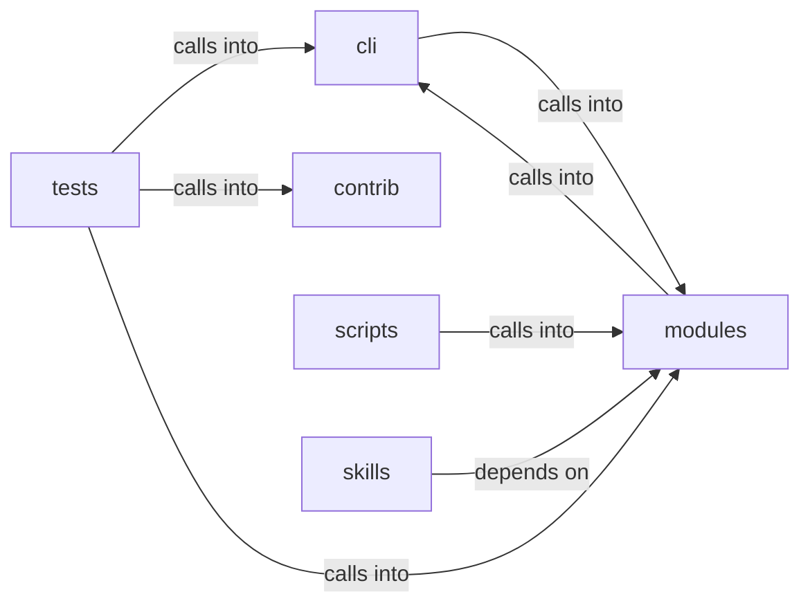

# modules: intel_fusion

modules: intel_fusion groups 66 files (py) around OutcomeEvent, host_value, key, to_dict, OutcomeBus. Attack-surface operations: confirmed discovery scans, estorides fusion.

## cli (8.1)

cli groups 3 files (py) around _slug_host, _slug_port, SurfaceNode, to_dict, SurfaceEdge. Attack-surface operations: confirmed discovery scans, estorides fusion.

## contrib (8.2)

contrib groups 1 files (py) around truncate_message, configure_logging, _load_payload_kv, _load_report_context, _prompt_redteam. Unified Ollama/DeepSeek client for LazyOwn — merges lazydeepseekcli_local +...

## modules (8.3)

modules groups 34 files (py) around OutcomeEvent, host_value, key, to_dict, OutcomeBus. Attack-surface 3D intel module: C2-centred campaign graph.

## scripts (8.4)

scripts groups 1 files (py) around SmokeConfig, check_surfaces, check_calls, main. Smoke check for the public surfaces documented in CORE.md.

## skills (8.5)

skills groups 3 files (py) around handle, handle, handle. MCP tool ``lazyown_lazy_intel`` (migrated from the call_tool dispatch chain).

## tests (8.6)

tests groups 24 files (py) around gate_env, test_gate_exact_and_fuzzy_match, test_gate_cidr_match, test_gate_task_allow_is_closed_whitelist, test_gate_blocks_asset_insert. Asset gate + un-nerfed outputs + IntelGraph CSP regression tests.

**Files**:

- cli/commands/surface.py
- cli/surface_graph.py
- cli/surface_tui.py
- contrib/legacy/lazydeepseekcli.py
- modules/attack_surface3d.py
- modules/beacon_recon.py
- modules/c2_surfaces.py
- modules/estorides_fusion.py
- modules/finding_lifecycle.py
- modules/intel_fusion.py
- modules/lazy_bridge.py
- modules/lazy_checks.py
- modules/lazy_cve_feed.py
- modules/lazy_exposure.py
- modules/lazy_feedmatch.py
- modules/lazy_heat.py
- modules/lazy_hostscore.py
- modules/lazy_inventory.py
- modules/lazy_ledger.py
- modules/lazy_match_policy.py
- modules/lazy_probes.py
- modules/lazy_sentinel.py
- modules/lazy_world_diff.py
- modules/osint_enrich.py
- modules/outcome_bus.py
- modules/payload_factory.py
- modules/sinks/__init__.py
- modules/sinks/attack_graph.py
- modules/sinks/beacon_dispatch.py
- modules/sinks/c2_surfaces.py
- modules/sinks/intel_graph.py
- modules/sinks/killchain.py
- modules/sinks/lazy_intel.py
- modules/sinks/objectives.py
- modules/sinks/routing.py
- modules/sinks/world_diff.py
- modules/sinks/world_model.py
- modules/surface_ops.py
- scripts/devtools/core_smoke.py
- skills/mcp_tools/lazy_intel.py
- skills/mcp_tools/lazy_status.py
- skills/mcp_tools/lazy_sync.py
- tests/test_asset_gate.py
- tests/test_attack_surface3d.py
- tests/test_beacon_recon_sink.py
- tests/test_c2_surfaces.py
- tests/test_cve_pipeline.py
- tests/test_estorides_fusion.py
- tests/test_finding_lifecycle.py
- tests/test_gym_registry.py
- tests/test_intel_fusion.py
- tests/test_lazy_checks.py
- tests/test_lazy_exposure.py
- tests/test_lazy_feedmatch.py
- tests/test_lazy_hostscore.py
- tests/test_lazy_ledger.py
- tests/test_lazy_match_policy.py
- tests/test_lazy_probes.py
- tests/test_lazy_sentinel.py
- tests/test_lazy_world_diff.py
- tests/test_loop_evidence_wiring.py
- tests/test_outcome_bus.py
- tests/test_payload_factory.py
- tests/test_sink_lazy_intel.py
- tests/test_surface_graph.py
- tests/test_world_diff_retest.py
