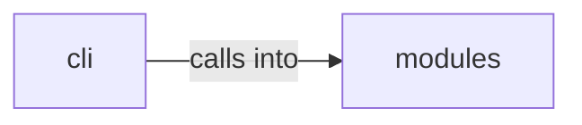

# modules: kerberos_core

modules: kerberos_core groups 7 files (py) around KerberosPrincipal, to_string, EncryptedData, KerberosTicket, has_flag. Active Directory attack commands — Kerberos, tickets, delegation, DACL, GPO...

## cli (13.1)

cli groups 1 files (py) around ActiveDirectoryCommandSet, do_kerberos_ticket, do_delegation_enum, do_delegation_attack, do_dacl_abuse. Active Directory attack commands — Kerberos, tickets, delegation, DACL, GPO...

## modules (13.2)

modules groups 6 files (py) around KerberosPrincipal, to_string, EncryptedData, KerberosTicket, has_flag. DACL/SACL abuse module — ACL manipulation for AD privilege escalation.

**Files**:

- cli/commands/active_directory.py
- modules/dacl_abuse.py
- modules/delegation_attacks.py
- modules/gpo_abuse.py
- modules/kerberoasting.py
- modules/kerberos_core.py
- modules/kerberos_tickets.py
