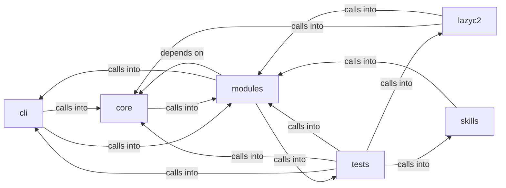

# modules: lazy_loop

modules: lazy_loop groups 126 files (py) around _apply_env_overrides, _coerce_env_value, _mask_if_sensitive, _log_config_change, _calling_frame. Container and Kubernetes attack command set.

## cli (4.1)

cli groups 14 files (py) around ContainerCommandSet, do_docker_enum, do_k8s_enum, do_container_escape, do_k8s_pods. Container and Kubernetes attack command set.

## core (4.2)

core groups 7 files (py) around _apply_env_overrides, _coerce_env_value, _mask_if_sensitive, _log_config_change, _calling_frame. Tenant-bound API authorization for the LazyOwn C2 dashboard.

## lazyc2 (4.3)

lazyc2 groups 3 files (py) around AddonCreatorConfig, live_placeholders, ParamSpec, to_dict, AddonDraft. LazyAddon creator contract for the LazyOwn C2 web interface.

## modules (4.4)

modules groups 45 files (py) around plausible_command, _sudo_unavailable, _is_ip_literal, _valid_nmap_port_spec, repair_worker_command. Purple Team Closed-Loop — honest measurement of offensive detection.

## skills (4.5)

skills groups 1 files (py) around _sync_harness, _harness_result, _call_harness_tool, list_tools, call_tool. LazyOwn MCP OpenCode bridge.

## tests (4.6)

tests groups 56 files (py) around TestHexSource, test_valid_hex_decodes_to_32_bytes, test_wrong_length_raises, test_non_hex_raises, TestDiskSource. TDD tests for the AES key resolution contract.

**Files**:

- cli/commands/containers.py
- cli/commands/defaults.py
- cli/commands/golden_paths.py
- cli/commands/gym_matrix.py
- cli/commands/lazyloop.py
- cli/commands/lazyops.py
- cli/commands/params_ops.py
- cli/commands/purple_team.py
- cli/lazy_monitor.py
- cli/lazy_orchestrator.py
- cli/orchestrator_assets_tabs.py
- cli/purple_tui.py
- cli/session_brief.py
- cli/tui_forms.py
- core/api_authz.py
- core/config.py
- core/defaults.py
- core/param_registry.py
- core/payload_schema.py
- core/process.py
- core/terminal_guard.py
- lazyc2/addon_creator.py
- lazyc2/blueprints/api.py
- lazyc2/blueprints/orchestrator.py
- modules/__init__.py
- modules/auto_purple.py
- modules/auto_registry.py
- modules/custom_tools.py
- modules/gym_cleanup.py
- modules/harness.py
- modules/jsonl_tail.py
- modules/lazy_cli_bridge.py
- modules/lazy_engine.py
- modules/lazy_installer.py
- modules/lazy_intel.py
- modules/lazy_loop.py
- modules/lazy_mentions.py
- modules/lazy_orchestrator_feedback.py
- modules/lazy_osinfer.py
- modules/lazy_proxy.py
- modules/lazy_roles.py
- modules/lazy_runner.py
- modules/lazy_sandbox.py
- modules/lazy_skill_mirror.py
- modules/lazy_skills.py
- modules/lazy_verify.py
- modules/lazyk8s.py
- modules/loop_guardrails.py
- modules/loop_progress.py
- modules/loop_triggers.py
- modules/mediation/__init__.py
- modules/mediation/chain_mediator.py
- modules/mediation/contracts.py
- modules/mediation/feedback_mediator.py
- modules/mediation/hub.py
- modules/mediation/intel_mediator.py
- modules/mediation/telemetry_mediator.py
- modules/notify.py
- modules/orchestrator_config.py
- modules/playbook_admin.py
- modules/reaction_bridge.py
- modules/selfupdate.py
- modules/tools/__init__.py
- modules/tools/loop_smoke.py
- modules/tools/monitor_smoke.py
- modules/traffic_recorder.py
- modules/trigger_policy.py
- modules/verb_catalog.py
- modules/workspace.py
- skills/lazyown_mcp_opencode.py
- tests/test_aes_key_propagation.py
- tests/test_api_authz.py
- tests/test_asset_gate.py
- tests/test_audit_remediation.py
- tests/test_auto_registry.py
- tests/test_c2_agent_dual.py
- tests/test_core_config.py
- tests/test_core_defaults.py
- tests/test_guardrails.py
- tests/test_gym_lifecycle.py
- tests/test_harness_mode.py
- tests/test_lazy_agent.py
- tests/test_lazy_bridge_traffic.py
- tests/test_lazy_engine.py
- tests/test_lazy_evidence.py
- tests/test_lazy_loop.py
- tests/test_lazy_orchestrator.py
- tests/test_lazy_proxy.py
- tests/test_lazy_runner.py
- tests/test_lazy_worker_safety.py
- tests/test_loop_auto_orchestrator.py
- tests/test_loop_broadcast.py
- tests/test_loop_budget.py
- tests/test_loop_cli_catalog.py
- tests/test_loop_cold_overview.py
- tests/test_loop_force_graph.py
- tests/test_loop_guard_audit.py
- tests/test_loop_guardrails.py
- tests/test_loop_intent_delete.py
- tests/test_loop_llm_resilience.py
- tests/test_loop_mentions.py
- tests/test_loop_multi_target.py
- tests/test_loop_nmap_guard.py
- tests/test_loop_progress.py
- tests/test_loop_scope_traffic_evidence.py
- tests/test_loop_spawn_side.py
- tests/test_loop_store_race.py
- tests/test_loop_supervision.py
- tests/test_loop_worker_traces.py
- tests/test_mediation.py
- tests/test_opencode_mcp_harness.py
- tests/test_orchestrator_api.py
- tests/test_orchestrator_triggers.py
- tests/test_orchestrator_yaml.py
- tests/test_param_registry.py
- tests/test_php2shell_addon.py
- tests/test_pi_leg.py
- tests/test_placeholder_coverage.py
- tests/test_playbook_admin.py
- tests/test_reaction_bridge.py
- tests/test_security_codeql_batch.py
- tests/test_session_brief.py
- tests/test_trigger_policy.py
- tests/test_ttpscope_bridge.py
- tests/test_unified_bridge_delegate.py
- tests/test_verb_catalog.py
