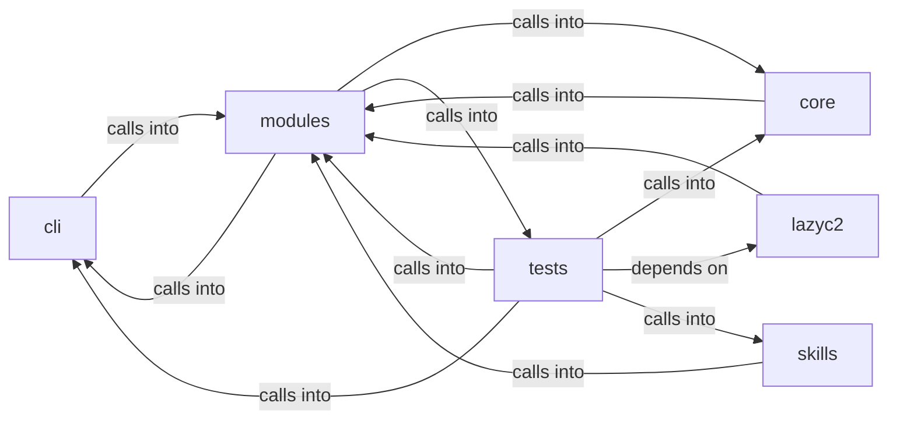

# modules: lazy_loop

modules: lazy_loop groups 132 files (py) around plausible_command, looks_like_prose, _is_host_like_target, _sudo_unavailable, _is_ip_literal. Lazy queue and misc command set.

## cli (3.1)

cli groups 5 files (py) around PromptModal, __init__, compose, on_input_submitted, action_dismiss. Lazy queue and misc command set.

## core (3.2)

core groups 1 files (py) around _tty_fd, emit_restore_sequences, apply_stty_sane, TerminalGuard, __init__. Terminal state guard for interactive automation.

## lazyc2 (3.3)

lazyc2 groups 1 files (py) around _error, _namespaced_path, _world_snapshot, _status_payload, status. Orchestrator REST + web panel for the LazyOwn C2 dashboard.

## modules (3.4)

modules groups 52 files (py) around plausible_command, looks_like_prose, _is_host_like_target, _sudo_unavailable, _is_ip_literal. Persistent memory for the auto loop.

## skills (3.5)

skills groups 1 files (py) around _sync_harness, _harness_result, _call_harness_tool, list_tools, call_tool. LazyOwn MCP OpenCode bridge.

## tests (3.6)

tests groups 72 files (py) around _isolated_llm_health, _isolated_path, _fast_llm_connect_backoff, _reset_world_model_singleton, _reset_guard_harness. Global pytest isolation hooks.

**Files**:

- cli/commands/exploitdb.py
- cli/commands/lazyloop.py
- cli/commands/lazyops.py
- cli/lazy_monitor.py
- cli/session_brief.py
- core/terminal_guard.py
- lazyc2/blueprints/orchestrator.py
- modules/__init__.py
- modules/auto_loop_memory.py
- modules/auto_registry.py
- modules/custom_tools.py
- modules/digest.py
- modules/gym_winbox_runner.py
- modules/harness.py
- modules/jsonl_tail.py
- modules/lazy_agent.py
- modules/lazy_bridge.py
- modules/lazy_cli_bridge.py
- modules/lazy_drafts.py
- modules/lazy_engine.py
- modules/lazy_installer.py
- modules/lazy_loop.py
- modules/lazy_mentions.py
- modules/lazy_objective_queue.py
- modules/lazy_osinfer.py
- modules/lazy_proxy.py
- modules/lazy_reaper.py
- modules/lazy_roles.py
- modules/lazy_runner.py
- modules/lazy_sandbox.py
- modules/lazy_skill_mirror.py
- modules/lazy_skills.py
- modules/lazy_timeline.py
- modules/lazypassgen.py
- modules/llm_orchestrator.py
- modules/llm_pool.py
- modules/loop/__init__.py
- modules/loop/worker_agentic.py
- modules/loop/worker_execution.py
- modules/loop/worker_gating.py
- modules/loop/worker_memory.py
- modules/loop_guardrails.py
- modules/loop_progress.py
- modules/loop_triggers.py
- modules/notify.py
- modules/orchestrator_config.py
- modules/progress_ledger.py
- modules/reaction_bridge.py
- modules/selector_manager.py
- modules/selfupdate.py
- modules/sinks/chain_feed.py
- modules/sinks/findings.py
- modules/tools/__init__.py
- modules/tools/loop_smoke.py
- modules/tools/monitor_smoke.py
- modules/traffic_recorder.py
- modules/trigger_policy.py
- modules/verb_catalog.py
- modules/workspace.py
- skills/lazyown_mcp_opencode.py
- tests/conftest.py
- tests/test_ad_lab_gym.py
- tests/test_asset_gate.py
- tests/test_auto_loop_memory.py
- tests/test_auto_registry.py
- tests/test_c2_agent.py
- tests/test_c2_agent_dual.py
- tests/test_failure_memory_veto.py
- tests/test_gym_matrix_ctf.py
- tests/test_harness_mode.py
- tests/test_lazy_agent.py
- tests/test_lazy_autofire.py
- tests/test_lazy_bridge_traffic.py
- tests/test_lazy_continuation.py
- tests/test_lazy_creds.py
- tests/test_lazy_engine.py
- tests/test_lazy_evidence.py
- tests/test_lazy_finalizer.py
- tests/test_lazy_intel_wiring.py
- tests/test_lazy_inventory.py
- tests/test_lazy_loop.py
- tests/test_lazy_oob.py
- tests/test_lazy_proxy.py
- tests/test_lazy_reaper.py
- tests/test_lazy_runner.py
- tests/test_lazy_runner_fallback.py
- tests/test_lazy_scope.py
- tests/test_lazy_timeline.py
- tests/test_lazy_worker_safety.py
- tests/test_lazydorks.py
- tests/test_lazypassgen.py
- tests/test_lazypoophish.py
- tests/test_lazyshortener.py
- tests/test_llm_orchestrator.py
- tests/test_loop_auto_orchestrator.py
- tests/test_loop_broadcast.py
- tests/test_loop_budget.py
- tests/test_loop_cli_catalog.py
- tests/test_loop_cold_overview.py
- tests/test_loop_force_graph.py
- tests/test_loop_guard_audit.py
- tests/test_loop_guardrails.py
- tests/test_loop_intent_delete.py
- tests/test_loop_llm_resilience.py
- tests/test_loop_mentions.py
- tests/test_loop_multi_target.py
- tests/test_loop_nmap_guard.py
- tests/test_loop_objective_wiring.py
- tests/test_loop_progress.py
- tests/test_loop_scope_traffic_evidence.py
- tests/test_loop_spawn_side.py
- tests/test_loop_store_race.py
- tests/test_loop_trigger_hints.py
- tests/test_loop_worker_traces.py
- tests/test_mcp_auto_loop_wrapper.py
- tests/test_module_registry_bridge.py
- tests/test_opencode_mcp_harness.py
- tests/test_orchestrator_api.py
- tests/test_orchestrator_triggers.py
- tests/test_pacing.py
- tests/test_pi_leg.py
- tests/test_policy_planner_signal.py
- tests/test_progress_ledger.py
- tests/test_reaction_bridge.py
- tests/test_repeat_shapes.py
- tests/test_security_codeql_batch.py
- tests/test_session_brief.py
- tests/test_sink_chain_feed.py
- tests/test_trigger_policy.py
- tests/test_ttpscope_bridge.py
- tests/test_unified_bridge_delegate.py
- tests/test_verb_catalog.py
