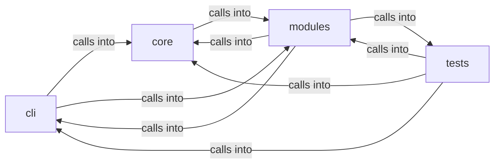

# modules: lazy_loop

modules: lazy_loop groups 70 files (py) around _apply_env_overrides, _coerce_env_value, _mask_if_sensitive, _log_config_change, _collect_validation_warnings. exploit commands migrated from lazyown.py.

## cli (5.1)

cli groups 6 files (py) around PromptModal, __init__, compose, on_input_submitted, action_dismiss. exploit commands migrated from lazyown.py.

## core (5.2)

core groups 3 files (py) around _apply_env_overrides, _coerce_env_value, _mask_if_sensitive, _log_config_change, _collect_validation_warnings. Autonomous-run mode for the loop engine.

## modules (5.3)

modules groups 31 files (py) around plausible_command, _sudo_unavailable, _is_ip_literal, _host_from_token, loop_exiting. Active Directory Certificate Services (AD CS) attack module.

## tests (5.4)

tests groups 30 files (py) around _isolated_llm_health, _isolated_path, _fast_llm_connect_backoff, _reset_world_model_singleton, _offline_llm_for_loop_tests. Global pytest isolation hooks.

**Files**:

- cli/commands/exploit_migrated.py
- cli/commands/lazyloop.py
- cli/commands/lazyops.py
- cli/commands/mcp_bridge.py
- cli/lazy_monitor.py
- cli/lazy_orchestrator.py
- core/autonomous.py
- core/config.py
- core/terminal_guard.py
- modules/__init__.py
- modules/adcs_attacks.py
- modules/auto_registry.py
- modules/custom_tools.py
- modules/exploit_chain.py
- modules/jsonl_tail.py
- modules/lazy_agent.py
- modules/lazy_bridge.py
- modules/lazy_cli_bridge.py
- modules/lazy_engine.py
- modules/lazy_installer.py
- modules/lazy_intel.py
- modules/lazy_loop.py
- modules/lazy_mentions.py
- modules/lazy_orchestrator_feedback.py
- modules/lazy_proxy.py
- modules/lazy_roles.py
- modules/lazy_runner.py
- modules/lazy_sandbox.py
- modules/lazy_skill_mirror.py
- modules/lazy_skills.py
- modules/loop_ai_bridge.py
- modules/loop_progress.py
- modules/notify.py
- modules/orchestrator_config.py
- modules/selfupdate.py
- modules/tools/__init__.py
- modules/tools/loop_smoke.py
- modules/tools/monitor_smoke.py
- modules/traffic_recorder.py
- modules/workspace.py
- tests/conftest.py
- tests/test_aes_key_propagation.py
- tests/test_asset_gate.py
- tests/test_auto_registry.py
- tests/test_lazy_agent.py
- tests/test_lazy_engine.py
- tests/test_lazy_evidence.py
- tests/test_lazy_loop.py
- tests/test_lazy_orchestrator.py
- tests/test_lazy_proxy.py
- tests/test_lazy_runner.py
- tests/test_lazy_worker_safety.py
- tests/test_loop_ai_bridge.py
- tests/test_loop_auto_orchestrator.py
- tests/test_loop_broadcast.py
- tests/test_loop_cold_overview.py
- tests/test_loop_force_graph.py
- tests/test_loop_guard_audit.py
- tests/test_loop_intent_delete.py
- tests/test_loop_llm_resilience.py
- tests/test_loop_mentions.py
- tests/test_loop_scope_traffic_evidence.py
- tests/test_loop_spawn_side.py
- tests/test_loop_store_race.py
- tests/test_loop_supervision.py
- tests/test_loop_worker_traces.py
- tests/test_pi_leg.py
- tests/test_safety_gates.py
- tests/test_security_codeql_batch.py
- tests/test_unified_bridge_delegate.py
