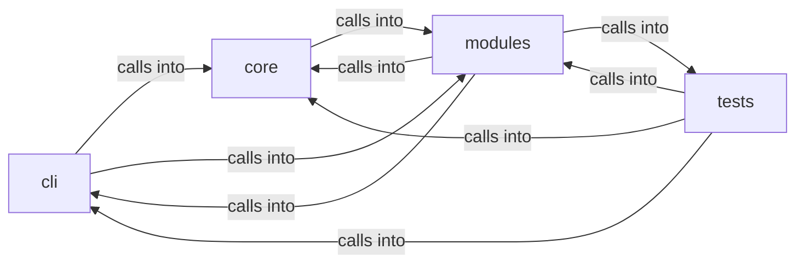

# modules: lazy_loop

modules: lazy_loop groups 99 files (py) around plausible_command, _sudo_unavailable, _is_ip_literal, _valid_nmap_port_spec, repair_worker_command. Container and Kubernetes attack command set.

## cli (5.1)

cli groups 9 files (py) around ContainerCommandSet, do_docker_enum, do_k8s_enum, do_container_escape, do_k8s_pods. Container and Kubernetes attack command set.

## core (5.2)

core groups 3 files (py) around load_defaults, clear_cache, get, default_lport, default_rport. Autonomous-run mode for the loop engine.

## modules (5.3)

modules groups 46 files (py) around plausible_command, _sudo_unavailable, _is_ip_literal, _valid_nmap_port_spec, repair_worker_command. Active Directory Certificate Services (AD CS) attack module.

## tests (5.4)

tests groups 41 files (py) around _isolated_llm_health, _isolated_path, _fast_llm_connect_backoff, _reset_world_model_singleton, _offline_llm_for_loop_tests. Global pytest isolation hooks.

**Files**:

- cli/commands/containers.py
- cli/commands/defaults.py
- cli/commands/exploit_migrated.py
- cli/commands/lazyloop.py
- cli/commands/lazyops.py
- cli/commands/redteam_gym.py
- cli/lazy_monitor.py
- cli/lazy_orchestrator.py
- cli/tui_forms.py
- core/autonomous.py
- core/defaults.py
- core/terminal_guard.py
- modules/__init__.py
- modules/adcs_attacks.py
- modules/atomic_exploit_bridge.py
- modules/auto_registry.py
- modules/custom_tools.py
- modules/exploit_chain.py
- modules/gym_registry.py
- modules/jsonl_tail.py
- modules/lazy_agent.py
- modules/lazy_bridge.py
- modules/lazy_cli_bridge.py
- modules/lazy_engine.py
- modules/lazy_installer.py
- modules/lazy_intel.py
- modules/lazy_loop.py
- modules/lazy_mentions.py
- modules/lazy_orchestrator_feedback.py
- modules/lazy_proxy.py
- modules/lazy_roles.py
- modules/lazy_runner.py
- modules/lazy_sandbox.py
- modules/lazy_skill_mirror.py
- modules/lazy_skills.py
- modules/lazyk8s.py
- modules/loop_progress.py
- modules/metasploitable_gym.py
- modules/notify.py
- modules/orchestrator_config.py
- modules/outcome_bus.py
- modules/playbook_admin.py
- modules/reaction_bridge.py
- modules/redteam_gym.py
- modules/selfupdate.py
- modules/sinks/attack_graph.py
- modules/sinks/c2_surfaces.py
- modules/sinks/intel_graph.py
- modules/sinks/killchain.py
- modules/sinks/objectives.py
- modules/sinks/routing.py
- modules/sinks/world_model.py
- modules/tools/__init__.py
- modules/tools/loop_smoke.py
- modules/tools/monitor_smoke.py
- modules/traffic_recorder.py
- modules/workspace.py
- modules/world_model.py
- tests/conftest.py
- tests/test_asset_gate.py
- tests/test_auto_registry.py
- tests/test_chain_list_command.py
- tests/test_gym_cli.py
- tests/test_gym_ms2_cli.py
- tests/test_gym_registry.py
- tests/test_lazy_agent.py
- tests/test_lazy_bridge_traffic.py
- tests/test_lazy_engine.py
- tests/test_lazy_evidence.py
- tests/test_lazy_loop.py
- tests/test_lazy_orchestrator.py
- tests/test_lazy_proxy.py
- tests/test_lazy_runner.py
- tests/test_lazy_worker_safety.py
- tests/test_loop_auto_orchestrator.py
- tests/test_loop_broadcast.py
- tests/test_loop_budget.py
- tests/test_loop_cold_overview.py
- tests/test_loop_force_graph.py
- tests/test_loop_guard_audit.py
- tests/test_loop_intent_delete.py
- tests/test_loop_llm_resilience.py
- tests/test_loop_mentions.py
- tests/test_loop_nmap_guard.py
- tests/test_loop_scope_traffic_evidence.py
- tests/test_loop_spawn_side.py
- tests/test_loop_store_race.py
- tests/test_loop_supervision.py
- tests/test_loop_worker_traces.py
- tests/test_metasploitable_gym.py
- tests/test_orchestrator_yaml.py
- tests/test_outcome_bus.py
- tests/test_pi_leg.py
- tests/test_playbook_admin.py
- tests/test_reaction_bridge.py
- tests/test_security_codeql_batch.py
- tests/test_ttpscope_bridge.py
- tests/test_unified_bridge_delegate.py
- tests/test_world_model_extended.py
