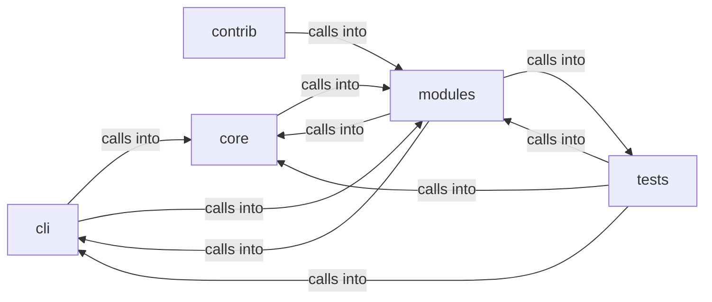

# modules: lazy_loop

modules: lazy_loop groups 79 files (py) around _apply_env_overrides, _coerce_env_value, _mask_if_sensitive, _log_config_change, _collect_validation_warnings. Artificial Intelligence command set.

## cli (5.1)

cli groups 7 files (py) around PromptModal, __init__, compose, on_input_submitted, action_dismiss. Artificial Intelligence command set.

## contrib (5.2)

contrib groups 1 files (py) around LazyOwnShellBridge, __init__, _load_shell, no_history_init, execute. _load_model: Load the configured LLM backend through the central factory.

## core (5.3)

core groups 5 files (py) around _apply_env_overrides, _coerce_env_value, _mask_if_sensitive, _log_config_change, _collect_validation_warnings. Autonomous-run mode for the loop engine.

## modules (5.4)

modules groups 33 files (py) around is_model_missing_error, groq_model_chain, LLMBackendUnavailableError, LLMBackendNotSupportedError, default_model_for. Active Directory Certificate Services (AD CS) attack module.

## tests (5.5)

tests groups 33 files (py) around _isolated_llm_health, _isolated_path, _fast_llm_connect_backoff, _reset_world_model_singleton, _offline_llm_for_loop_tests. Global pytest isolation hooks.

**Files**:

- cli/commands/ai.py
- cli/commands/exploit_migrated.py
- cli/commands/lazyloop.py
- cli/commands/lazyops.py
- cli/commands/mcp_bridge.py
- cli/lazy_monitor.py
- cli/lazy_orchestrator.py
- contrib/legacy/lazyllmchat.py
- core/autonomous.py
- core/config.py
- core/llm_budget.py
- core/payload_schema.py
- core/terminal_guard.py
- modules/__init__.py
- modules/adcs_attacks.py
- modules/agent_runner.py
- modules/ai_model.py
- modules/auto_registry.py
- modules/custom_tools.py
- modules/exploit_chain.py
- modules/jsonl_tail.py
- modules/lazy_agent.py
- modules/lazy_bridge.py
- modules/lazy_engine.py
- modules/lazy_loop.py
- modules/lazy_mentions.py
- modules/lazy_proxy.py
- modules/lazy_runner.py
- modules/lazy_skills.py
- modules/llm_factory.py
- modules/llm_pool.py
- modules/loop_ai_bridge.py
- modules/loop_progress.py
- modules/mcp_agent_bridge.py
- modules/notify.py
- modules/orchestrator_config.py
- modules/selfupdate.py
- modules/sidequestion.py
- modules/tools/__init__.py
- modules/tools/loop_smoke.py
- modules/tools/monitor_smoke.py
- modules/traffic_recorder.py
- modules/vuln_bot_cli.py
- modules/vulnbot.py
- modules/workspace.py
- modules/yaml_generator.py
- tests/conftest.py
- tests/test_aes_key_propagation.py
- tests/test_ai_commands_llm.py
- tests/test_asset_gate.py
- tests/test_auto_registry.py
- tests/test_autonomous_ops.py
- tests/test_core_config.py
- tests/test_lazy_agent.py
- tests/test_lazy_engine.py
- tests/test_lazy_evidence.py
- tests/test_lazy_loop.py
- tests/test_lazy_orchestrator.py
- tests/test_lazy_proxy.py
- tests/test_lazy_runner.py
- tests/test_lazy_streaming.py
- tests/test_lazy_worker_safety.py
- tests/test_llm_budget.py
- tests/test_loop_ai_bridge.py
- tests/test_loop_auto_orchestrator.py
- tests/test_loop_broadcast.py
- tests/test_loop_cold_overview.py
- tests/test_loop_force_graph.py
- tests/test_loop_guard_audit.py
- tests/test_loop_intent_delete.py
- tests/test_loop_llm_resilience.py
- tests/test_loop_mentions.py
- tests/test_loop_scope_traffic_evidence.py
- tests/test_loop_spawn_side.py
- tests/test_loop_store_race.py
- tests/test_loop_worker_traces.py
- tests/test_payload_schema.py
- tests/test_safety_gates.py
- tests/test_unified_bridge_delegate.py
