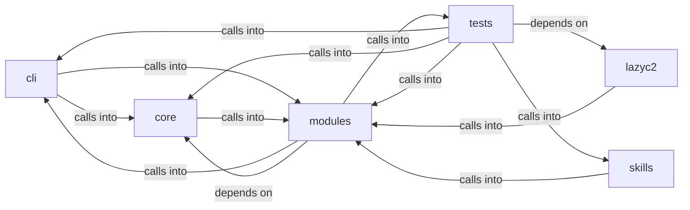

# modules: lazy_loop

modules: lazy_loop groups 119 files (py) around plausible_command, _sudo_unavailable, _is_ip_literal, _valid_nmap_port_spec, repair_worker_command. Container and Kubernetes attack command set.

## cli (3.1)

cli groups 14 files (py) around ContainerCommandSet, do_docker_enum, do_k8s_enum, do_container_escape, do_k8s_pods. Container and Kubernetes attack command set.

## core (3.2)

core groups 2 files (py) around check_go_tool_installed, is_binary_present, handle_multiple_rhosts, wrapper, check_sudo. Process and subprocess utilities for the LazyOwn framework.

## lazyc2 (3.3)

lazyc2 groups 1 files (py) around _error, _namespaced_path, _world_snapshot, _status_payload, status. Orchestrator REST + web panel for the LazyOwn C2 dashboard.

## modules (3.4)

modules groups 47 files (py) around plausible_command, _sudo_unavailable, _is_ip_literal, _valid_nmap_port_spec, repair_worker_command. Registry of loop-ready automation verbs (the ``auto_*`` family plus read-only staging...

## skills (3.5)

skills groups 1 files (py) around _sync_harness, _harness_result, _call_harness_tool, list_tools, call_tool. LazyOwn MCP OpenCode bridge.

## tests (3.6)

tests groups 54 files (py) around AdLabCatalogueSpec, test_matrix_validates, test_summary_shape, test_all_vectors_resolve, test_get_unknown_is_none. Contract tests for the AD lab gym (Docker Samba DC) matrix and capture.

**Files**:

- cli/commands/containers.py
- cli/commands/golden_paths.py
- cli/commands/gym_matrix.py
- cli/commands/lazy_creds.py
- cli/commands/lazy_oob.py
- cli/commands/lazyloop.py
- cli/commands/lazyops.py
- cli/commands/redteam_gym.py
- cli/commands/winbox_gym.py
- cli/lazy_monitor.py
- cli/lazy_orchestrator.py
- cli/orchestrator_assets_tabs.py
- cli/session_brief.py
- cli/tui_forms.py
- core/process.py
- core/terminal_guard.py
- lazyc2/blueprints/orchestrator.py
- modules/__init__.py
- modules/auto_registry.py
- modules/custom_tools.py
- modules/gym_registry.py
- modules/harness.py
- modules/jsonl_tail.py
- modules/lazy_bridge.py
- modules/lazy_cli_bridge.py
- modules/lazy_engine.py
- modules/lazy_installer.py
- modules/lazy_intel.py
- modules/lazy_loop.py
- modules/lazy_mentions.py
- modules/lazy_orchestrator_feedback.py
- modules/lazy_osinfer.py
- modules/lazy_proxy.py
- modules/lazy_roles.py
- modules/lazy_runner.py
- modules/lazy_sandbox.py
- modules/lazy_skill_mirror.py
- modules/lazy_skills.py
- modules/lazy_verify.py
- modules/lazyk8s.py
- modules/loop_guardrails.py
- modules/loop_progress.py
- modules/loop_triggers.py
- modules/mediation/__init__.py
- modules/mediation/chain_mediator.py
- modules/mediation/contracts.py
- modules/mediation/feedback_mediator.py
- modules/mediation/hub.py
- modules/mediation/intel_mediator.py
- modules/mediation/telemetry_mediator.py
- modules/notify.py
- modules/orchestrator_config.py
- modules/playbook_admin.py
- modules/reaction_bridge.py
- modules/redteam_gym.py
- modules/selfupdate.py
- modules/sinks/routing.py
- modules/tools/__init__.py
- modules/tools/loop_smoke.py
- modules/tools/monitor_smoke.py
- modules/traffic_recorder.py
- modules/trigger_policy.py
- modules/verb_catalog.py
- modules/workspace.py
- skills/lazyown_mcp_opencode.py
- tests/test_ad_lab_gym.py
- tests/test_asset_gate.py
- tests/test_auto_registry.py
- tests/test_c2_agent_dual.py
- tests/test_guardrails.py
- tests/test_gym_cli.py
- tests/test_gym_ms2_cli.py
- tests/test_harness_mode.py
- tests/test_lazy_agent.py
- tests/test_lazy_bridge_traffic.py
- tests/test_lazy_creds.py
- tests/test_lazy_engine.py
- tests/test_lazy_evidence.py
- tests/test_lazy_loop.py
- tests/test_lazy_oob.py
- tests/test_lazy_orchestrator.py
- tests/test_lazy_proxy.py
- tests/test_lazy_runner.py
- tests/test_lazy_scope.py
- tests/test_lazy_worker_safety.py
- tests/test_llm_orchestrator.py
- tests/test_loop_auto_orchestrator.py
- tests/test_loop_broadcast.py
- tests/test_loop_budget.py
- tests/test_loop_cli_catalog.py
- tests/test_loop_cold_overview.py
- tests/test_loop_force_graph.py
- tests/test_loop_guard_audit.py
- tests/test_loop_guardrails.py
- tests/test_loop_intent_delete.py
- tests/test_loop_llm_resilience.py
- tests/test_loop_mentions.py
- tests/test_loop_multi_target.py
- tests/test_loop_nmap_guard.py
- tests/test_loop_progress.py
- tests/test_loop_scope_traffic_evidence.py
- tests/test_loop_spawn_side.py
- tests/test_loop_store_race.py
- tests/test_loop_supervision.py
- tests/test_loop_worker_traces.py
- tests/test_mediation.py
- tests/test_opencode_mcp_harness.py
- tests/test_orchestrator_api.py
- tests/test_orchestrator_triggers.py
- tests/test_orchestrator_yaml.py
- tests/test_pi_leg.py
- tests/test_playbook_admin.py
- tests/test_reaction_bridge.py
- tests/test_security_codeql_batch.py
- tests/test_session_brief.py
- tests/test_trigger_policy.py
- tests/test_ttpscope_bridge.py
- tests/test_unified_bridge_delegate.py
- tests/test_verb_catalog.py
