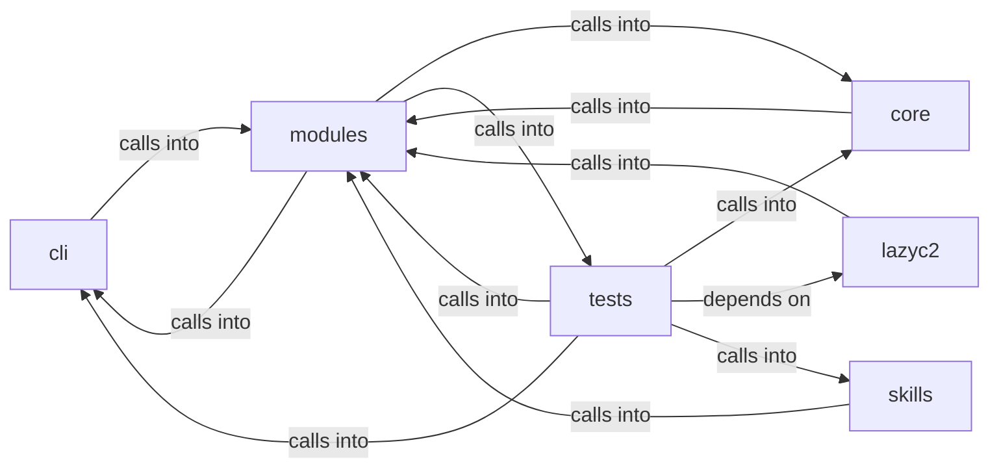

# modules: lazy_loop

modules: lazy_loop groups 184 files (py) around _derive_crypto_key, _machine_password, _master_password, _load_or_create_salt, _encrypt_payload. Lazy queue and misc command set.

## cli (1.1)

cli groups 11 files (py) around _slug_host, _slug_port, SurfaceNode, to_dict, SurfaceEdge. Lazy queue and misc command set.

## core (1.2)

core groups 1 files (py) around _tty_fd, emit_restore_sequences, apply_stty_sane, TerminalGuard, __init__. Terminal state guard for interactive automation.

## lazyc2 (1.3)

lazyc2 groups 1 files (py) around _error, _namespaced_path, _world_snapshot, _status_payload, status. Orchestrator REST + web panel for the LazyOwn C2 dashboard.

## modules (1.4)

modules groups 77 files (py) around _derive_crypto_key, _machine_password, _master_password, _load_or_create_salt, _encrypt_payload. Attack-surface 3D intel module: C2-centred campaign graph.

## skills (1.5)

skills groups 1 files (py) around _sync_harness, _harness_result, _call_harness_tool, list_tools, call_tool. LazyOwn MCP OpenCode bridge.

## tests (1.6)

tests groups 93 files (py) around AdLabCatalogueSpec, test_matrix_validates, test_summary_shape, test_all_vectors_resolve, test_get_unknown_is_none. Contract tests for the AD lab gym (Docker Samba DC) matrix and capture.

**Files**:

- cli/commands/lazyloop.py
- cli/commands/lazyops.py
- cli/commands/netattack.py
- cli/commands/redteam_gym.py
- cli/commands/surface.py
- cli/lazy_monitor.py
- cli/lazy_orchestrator.py
- cli/orchestrator_assets_tabs.py
- cli/session_brief.py
- cli/surface_graph.py
- cli/tui_forms.py
- core/terminal_guard.py
- lazyc2/blueprints/orchestrator.py
- modules/__init__.py
- modules/attack_surface3d.py
- modules/auto_loop_memory.py
- modules/auto_registry.py
- modules/custom_tools.py
- modules/digest.py
- modules/estorides_fusion.py
- modules/finding_lifecycle.py
- modules/gym_registry.py
- modules/harness.py
- modules/intel_fusion.py
- modules/intercept.py
- modules/jsonl_tail.py
- modules/lazy_autofire.py
- modules/lazy_bridge.py
- modules/lazy_checks.py
- modules/lazy_cli_bridge.py
- modules/lazy_cve_feed.py
- modules/lazy_engine.py
- modules/lazy_exposure.py
- modules/lazy_feedmatch.py
- modules/lazy_heat.py
- modules/lazy_hostscore.py
- modules/lazy_installer.py
- modules/lazy_intel.py
- modules/lazy_inventory.py
- modules/lazy_loop.py
- modules/lazy_match_policy.py
- modules/lazy_mentions.py
- modules/lazy_orchestrator_feedback.py
- modules/lazy_osinfer.py
- modules/lazy_probes.py
- modules/lazy_proxy.py
- modules/lazy_reaper.py
- modules/lazy_roles.py
- modules/lazy_runner.py
- modules/lazy_sandbox.py
- modules/lazy_sentinel.py
- modules/lazy_skill_mirror.py
- modules/lazy_skills.py
- modules/lazy_surface_diff.py
- modules/lazy_timeline.py
- modules/lazy_world_diff.py
- modules/lazypassgen.py
- modules/loop_guardrails.py
- modules/loop_progress.py
- modules/loop_triggers.py
- modules/mediation/__init__.py
- modules/mediation/chain_mediator.py
- modules/mediation/contracts.py
- modules/mediation/feedback_mediator.py
- modules/mediation/hub.py
- modules/mediation/intel_mediator.py
- modules/mediation/telemetry_mediator.py
- modules/module_registry.py
- modules/notify.py
- modules/orchestrator_config.py
- modules/osint_enrich.py
- modules/playbook_admin.py
- modules/progress_ledger.py
- modules/reaction_bridge.py
- modules/redteam_gym.py
- modules/selector_manager.py
- modules/selfupdate.py
- modules/sinks/chain_feed.py
- modules/sinks/findings.py
- modules/sinks/lazy_intel.py
- modules/sinks/world_diff.py
- modules/surface_ops.py
- modules/tools/__init__.py
- modules/tools/loop_smoke.py
- modules/tools/monitor_smoke.py
- modules/traffic_recorder.py
- modules/trigger_policy.py
- modules/verb_catalog.py
- modules/workspace.py
- modules/world_model.py
- skills/lazyown_mcp_opencode.py
- tests/test_ad_lab_gym.py
- tests/test_asset_gate.py
- tests/test_attack_surface3d.py
- tests/test_auto_loop_memory.py
- tests/test_auto_registry.py
- tests/test_c2_agent_dual.py
- tests/test_cve_pipeline.py
- tests/test_engage_gates.py
- tests/test_estorides_fusion.py
- tests/test_failure_memory_veto.py
- tests/test_finding_lifecycle.py
- tests/test_guardrails.py
- tests/test_gym_cli.py
- tests/test_gym_matrix_ctf.py
- tests/test_gym_ms2_cli.py
- tests/test_gym_registry.py
- tests/test_harness_mode.py
- tests/test_intel_fusion.py
- tests/test_lazy_agent.py
- tests/test_lazy_autofire.py
- tests/test_lazy_bridge_traffic.py
- tests/test_lazy_checks.py
- tests/test_lazy_creds.py
- tests/test_lazy_engine.py
- tests/test_lazy_evidence.py
- tests/test_lazy_exposure.py
- tests/test_lazy_feedmatch.py
- tests/test_lazy_hostscore.py
- tests/test_lazy_intel_wiring.py
- tests/test_lazy_inventory.py
- tests/test_lazy_loop.py
- tests/test_lazy_match_policy.py
- tests/test_lazy_oob.py
- tests/test_lazy_orchestrator.py
- tests/test_lazy_parity.py
- tests/test_lazy_probes.py
- tests/test_lazy_proxy.py
- tests/test_lazy_reaper.py
- tests/test_lazy_runner.py
- tests/test_lazy_runner_fallback.py
- tests/test_lazy_scope.py
- tests/test_lazy_sentinel.py
- tests/test_lazy_timeline.py
- tests/test_lazy_worker_safety.py
- tests/test_lazy_world_diff.py
- tests/test_lazydorks.py
- tests/test_lazypassgen.py
- tests/test_lazypoophish.py
- tests/test_lazyshortener.py
- tests/test_loop_auto_orchestrator.py
- tests/test_loop_broadcast.py
- tests/test_loop_budget.py
- tests/test_loop_cli_catalog.py
- tests/test_loop_cold_overview.py
- tests/test_loop_force_graph.py
- tests/test_loop_guard_audit.py
- tests/test_loop_guardrails.py
- tests/test_loop_intent_delete.py
- tests/test_loop_llm_resilience.py
- tests/test_loop_mentions.py
- tests/test_loop_multi_target.py
- tests/test_loop_nmap_guard.py
- tests/test_loop_progress.py
- tests/test_loop_scope_traffic_evidence.py
- tests/test_loop_spawn_side.py
- tests/test_loop_store_race.py
- tests/test_loop_supervision.py
- tests/test_loop_trigger_hints.py
- tests/test_loop_worker_traces.py
- tests/test_mediation.py
- tests/test_module_registry.py
- tests/test_module_registry_bridge.py
- tests/test_opencode_mcp_harness.py
- tests/test_orchestrator_api.py
- tests/test_orchestrator_triggers.py
- tests/test_orchestrator_yaml.py
- tests/test_pi_leg.py
- tests/test_playbook_admin.py
- tests/test_policy_planner_signal.py
- tests/test_progress_ledger.py
- tests/test_reaction_bridge.py
- tests/test_repeat_shapes.py
- tests/test_safety_gates.py
- tests/test_security_codeql_batch.py
- tests/test_session_brief.py
- tests/test_sink_chain_feed.py
- tests/test_surface_graph.py
- tests/test_trigger_policy.py
- tests/test_ttpscope_bridge.py
- tests/test_unified_bridge_delegate.py
- tests/test_verb_catalog.py
- tests/test_world_diff_retest.py
- tests/test_world_model_extended.py
