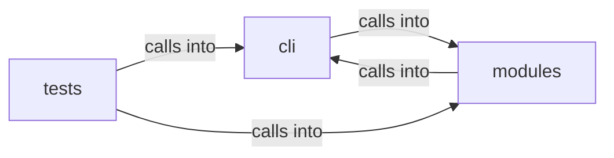

# modules: lazy_loop

modules: lazy_loop groups 25 files (py) around _now, _store_path, _load_json, _save_json, _slug. Database commands — workspace isolation, host/service/vuln management, nmap import...

## cli (10.1)

cli groups 6 files (py) around _slug_host, _slug_port, SurfaceNode, to_dict, SurfaceEdge. Database commands — workspace isolation, host/service/vuln management, nmap import...

## modules (10.2)

modules groups 10 files (py) around _now, _store_path, _load_json, _save_json, _slug. Attack-surface 3D intel module: C2-centred campaign graph.

## tests (10.3)

tests groups 9 files (py) around gate_env, test_gate_exact_and_fuzzy_match, test_gate_cidr_match, test_gate_task_allow_is_closed_whitelist, test_gate_blocks_asset_insert. Asset gate + un-nerfed outputs + IntelGraph CSP regression tests.

**Files**:

- cli/commands/database.py
- cli/commands/lazyops.py
- cli/commands/mcp_bridge.py
- cli/commands/surface.py
- cli/surface_graph.py
- cli/surface_tui.py
- modules/attack_surface3d.py
- modules/auto_registry.py
- modules/estorides_fusion.py
- modules/finding_lifecycle.py
- modules/intel_fusion.py
- modules/lazy_engine.py
- modules/lazy_loop.py
- modules/loop_progress.py
- modules/osint_enrich.py
- modules/surface_ops.py
- tests/test_asset_gate.py
- tests/test_attack_surface3d.py
- tests/test_auto_registry.py
- tests/test_estorides_fusion.py
- tests/test_finding_lifecycle.py
- tests/test_intel_fusion.py
- tests/test_lazy_engine.py
- tests/test_loop_progress.py
- tests/test_surface_graph.py
