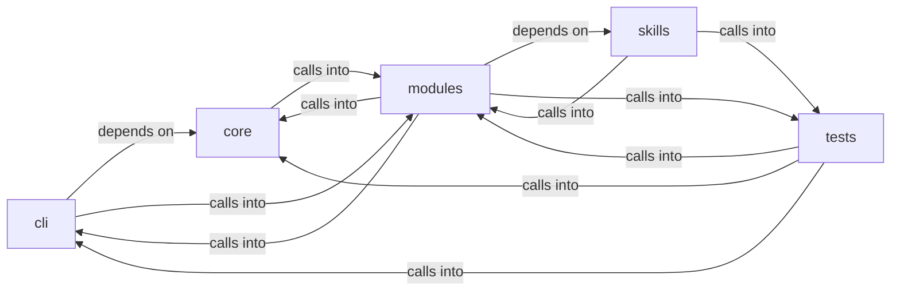

# modules: lazy_loop

modules: lazy_loop groups 138 files (py) around _record_deviation, planner_temperature, wire_capture_enabled, plausible_command, looks_like_prose. exploit commands migrated from lazyown.py.

## cli (4.1)

cli groups 5 files (py) around ExploitMigratedCommandSet, do_cp, do_createcookie, do_py3ttyup, do_pyautomate. exploit commands migrated from lazyown.py.

## core (4.2)

core groups 3 files (py) around _unique_tmp, _ensure_parent, write_bytes_atomic, write_text_atomic, file_lock. Shared atomic file primitives for the loop's small JSON and blob stores.

## modules (4.3)

modules groups 58 files (py) around _record_deviation, planner_temperature, wire_capture_enabled, plausible_command, looks_like_prose. Active Directory Certificate Services (AD CS) attack module.

## skills (4.4)

skills groups 10 files (py) around handle, handle, handle, handle, handle. MCP tool ``lazyown_auto_loop`` (migrated from the call_tool dispatch chain).

## tests (4.5)

tests groups 62 files (py) around TestFailureMemory, test_counts_persist_across_reload, test_blocked_after_threshold_by_base, test_veto_blocks_immediately_and_persists, test_trims_to_capacity. BDD tests for the auto-loop persistent memory and selector cascade.

**Files**:

- cli/commands/exploit_migrated.py
- cli/commands/lazyops.py
- cli/commands/mcp_bridge.py
- cli/lazy_monitor.py
- cli/session_brief.py
- core/atomic_store.py
- core/autonomous.py
- core/terminal_guard.py
- modules/adcs_attacks.py
- modules/auto_loop_memory.py
- modules/chain_family.py
- modules/custom_tools.py
- modules/digest.py
- modules/evidence_store.py
- modules/exploit_chain.py
- modules/finding_enrich.py
- modules/guard_rules.py
- modules/jsonl_tail.py
- modules/lazy_blindspot.py
- modules/lazy_cli_bridge.py
- modules/lazy_commander.py
- modules/lazy_drafts.py
- modules/lazy_engine.py
- modules/lazy_installer.py
- modules/lazy_intel.py
- modules/lazy_loop.py
- modules/lazy_mentions.py
- modules/lazy_objective_queue.py
- modules/lazy_orchestrator_feedback.py
- modules/lazy_proxy.py
- modules/lazy_reaper.py
- modules/lazy_roles.py
- modules/lazy_runner.py
- modules/lazy_sandbox.py
- modules/lazy_skill_mirror.py
- modules/lazy_skills.py
- modules/loop/__init__.py
- modules/loop/engine_proxy.py
- modules/loop/triage_scheduler.py
- modules/loop/worker_agentic.py
- modules/loop/worker_execution.py
- modules/loop/worker_memory.py
- modules/loop_guardrails.py
- modules/loop_progress.py
- modules/mediation/__init__.py
- modules/mediation/chain_mediator.py
- modules/mediation/feedback_mediator.py
- modules/mediation/hub.py
- modules/mediation/intel_mediator.py
- modules/mediation/telemetry_mediator.py
- modules/notify.py
- modules/outcome_attribution.py
- modules/progress_ledger.py
- modules/reaction_bridge.py
- modules/scan_brief.py
- modules/selector_manager.py
- modules/sidequest.py
- modules/sinks/chain_feed.py
- modules/threat_model.py
- modules/tools/__init__.py
- modules/tools/loop_smoke.py
- modules/tools/monitor_smoke.py
- modules/traffic_recorder.py
- modules/verb_catalog.py
- modules/wire_capture.py
- modules/workspace.py
- skills/mcp_tools/auto_loop.py
- skills/mcp_tools/lazy_board.py
- skills/mcp_tools/lazy_compact.py
- skills/mcp_tools/lazy_delete.py
- skills/mcp_tools/lazy_finding.py
- skills/mcp_tools/lazy_hint.py
- skills/mcp_tools/lazy_mention.py
- skills/mcp_tools/lazy_proxy.py
- skills/mcp_tools/lazy_trace.py
- skills/mcp_tools/loop_smoke.py
- tests/test_auto_loop_memory.py
- tests/test_chain_family.py
- tests/test_chain_list_command.py
- tests/test_evidence_store.py
- tests/test_exploration_graph_concurrency.py
- tests/test_failure_memory_veto.py
- tests/test_finding_enrich.py
- tests/test_guard_rules.py
- tests/test_harness_mode.py
- tests/test_lazy_agent.py
- tests/test_lazy_blindspot.py
- tests/test_lazy_bridge_traffic.py
- tests/test_lazy_commander.py
- tests/test_lazy_continuation.py
- tests/test_lazy_engine.py
- tests/test_lazy_evidence.py
- tests/test_lazy_loop.py
- tests/test_lazy_proxy.py
- tests/test_lazy_reaper.py
- tests/test_lazy_runner.py
- tests/test_lazy_scope.py
- tests/test_loop_auto_orchestrator.py
- tests/test_loop_broadcast.py
- tests/test_loop_budget.py
- tests/test_loop_cli_catalog.py
- tests/test_loop_cold_overview.py
- tests/test_loop_decision_log.py
- tests/test_loop_deterministic_mode.py
- tests/test_loop_force_graph.py
- tests/test_loop_guard_audit.py
- tests/test_loop_guardrails.py
- tests/test_loop_intent_delete.py
- tests/test_loop_llm_resilience.py
- tests/test_loop_multi_target.py
- tests/test_loop_nmap_guard.py
- tests/test_loop_objective_wiring.py
- tests/test_loop_preflight.py
- tests/test_loop_progress.py
- tests/test_loop_scope_traffic_evidence.py
- tests/test_loop_spawn_side.py
- tests/test_loop_store_race.py
- tests/test_loop_supervision.py
- tests/test_loop_target_authority.py
- tests/test_loop_worker_traces.py
- tests/test_mediation.py
- tests/test_orchestrator_pacing.py
- tests/test_outcome_attribution.py
- tests/test_pacing.py
- tests/test_pi_leg.py
- tests/test_policy_planner_signal.py
- tests/test_progress_ledger.py
- tests/test_reaction_bridge.py
- tests/test_repeat_shapes.py
- tests/test_scan_brief.py
- tests/test_security_codeql_batch.py
- tests/test_session_brief.py
- tests/test_sidequest.py
- tests/test_sink_chain_feed.py
- tests/test_stall_dump.py
- tests/test_triage_scheduler.py
- tests/test_wire_capture.py
- tests/test_writeback_hygiene.py
