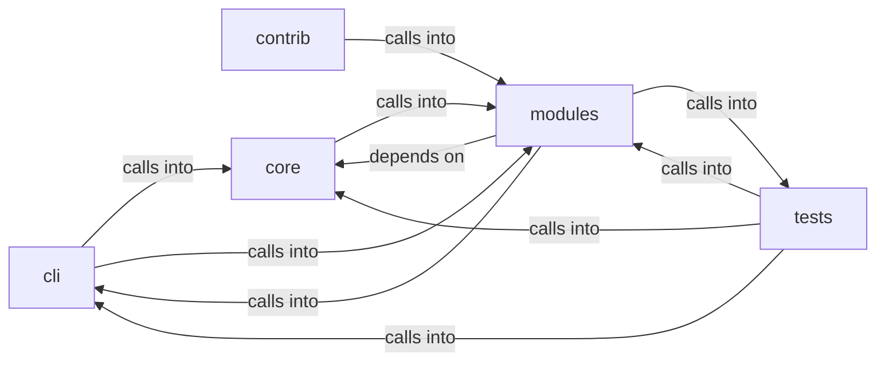

# modules: lazy_loop

modules: lazy_loop groups 109 files (py) around plausible_command, _sudo_unavailable, _is_ip_literal, _valid_nmap_port_spec, repair_worker_command. Lazy queue and misc command set.

## cli (5.1)

cli groups 4 files (py) around PromptModal, __init__, compose, on_input_submitted, action_dismiss. Lazy queue and misc command set.

## contrib (5.2)

contrib groups 2 files (py) around parse_github_url, github_api_get, fetch_repo_metadata, fetch_readme, fetch_root_files. parse_github_url: Extrae (owner, repo) de una URL de GitHub.

## core (5.3)

core groups 2 files (py) around check_go_tool_installed, is_binary_present, handle_multiple_rhosts, wrapper, check_sudo. Process and subprocess utilities for the LazyOwn framework.

## modules (5.4)

modules groups 56 files (py) around plausible_command, _sudo_unavailable, _is_ip_literal, _valid_nmap_port_spec, repair_worker_command. LazyOwn AI Agent - Ultimate Edition Improvements: anti-hang timeout, memory...

## tests (5.5)

tests groups 45 files (py) around _isolated_llm_health, _isolated_path, _fast_llm_connect_backoff, _reset_world_model_singleton, _reset_guard_harness. Global pytest isolation hooks.

**Files**:

- cli/commands/lazyloop.py
- cli/commands/lazyops.py
- cli/commands/retry_ops.py
- cli/lazy_monitor.py
- contrib/legacy/lazyaddon_creator.py
- contrib/legacy/lazyllmchat.py
- core/process.py
- core/terminal_guard.py
- modules/agent_runner.py
- modules/ai_model.py
- modules/auto_loop_memory.py
- modules/auto_registry.py
- modules/custom_tools.py
- modules/digest.py
- modules/jsonl_tail.py
- modules/lazy_agent.py
- modules/lazy_bridge.py
- modules/lazy_cli_bridge.py
- modules/lazy_engine.py
- modules/lazy_installer.py
- modules/lazy_intel.py
- modules/lazy_ledger.py
- modules/lazy_loop.py
- modules/lazy_mentions.py
- modules/lazy_orchestrator_feedback.py
- modules/lazy_osinfer.py
- modules/lazy_proxy.py
- modules/lazy_reaper.py
- modules/lazy_roles.py
- modules/lazy_runner.py
- modules/lazy_sandbox.py
- modules/lazy_skill_mirror.py
- modules/lazy_skills.py
- modules/lazy_verify.py
- modules/llm_client.py
- modules/llm_factory.py
- modules/llm_orchestrator.py
- modules/loop_ai_bridge.py
- modules/loop_guardrails.py
- modules/loop_progress.py
- modules/mediation/__init__.py
- modules/mediation/chain_mediator.py
- modules/mediation/contracts.py
- modules/mediation/feedback_mediator.py
- modules/mediation/hub.py
- modules/mediation/intel_mediator.py
- modules/mediation/telemetry_mediator.py
- modules/notify.py
- modules/progress_ledger.py
- modules/reaction_bridge.py
- modules/selector_manager.py
- modules/selfupdate.py
- modules/sinks/__init__.py
- modules/sinks/chain_feed.py
- modules/sinks/findings.py
- modules/sinks/routing.py
- modules/tools/__init__.py
- modules/tools/loop_smoke.py
- modules/tools/monitor_smoke.py
- modules/traffic_recorder.py
- modules/vuln_bot_cli.py
- modules/vulnbot.py
- modules/workspace.py
- modules/yaml_generator.py
- tests/conftest.py
- tests/test_asset_gate.py
- tests/test_auto_loop_memory.py
- tests/test_auto_registry.py
- tests/test_failure_memory_veto.py
- tests/test_guardrails.py
- tests/test_harness_mode.py
- tests/test_lazy_agent.py
- tests/test_lazy_engine.py
- tests/test_lazy_evidence.py
- tests/test_lazy_ledger.py
- tests/test_lazy_loop.py
- tests/test_lazy_proxy.py
- tests/test_lazy_reaper.py
- tests/test_lazy_runner.py
- tests/test_lazy_streaming.py
- tests/test_lazy_worker_safety.py
- tests/test_llm_orchestrator.py
- tests/test_loop_ai_bridge.py
- tests/test_loop_auto_orchestrator.py
- tests/test_loop_broadcast.py
- tests/test_loop_budget.py
- tests/test_loop_cold_overview.py
- tests/test_loop_force_graph.py
- tests/test_loop_guard_audit.py
- tests/test_loop_guardrails.py
- tests/test_loop_intent_delete.py
- tests/test_loop_llm_resilience.py
- tests/test_loop_multi_target.py
- tests/test_loop_nmap_guard.py
- tests/test_loop_progress.py
- tests/test_loop_scope_traffic_evidence.py
- tests/test_loop_spawn_side.py
- tests/test_loop_store_race.py
- tests/test_loop_supervision.py
- tests/test_loop_worker_traces.py
- tests/test_mediation.py
- tests/test_module_registry_bridge.py
- tests/test_policy_planner_signal.py
- tests/test_progress_ledger.py
- tests/test_reaction_bridge.py
- tests/test_repeat_shapes.py
- tests/test_security_codeql_batch.py
- tests/test_sink_chain_feed.py
- tests/test_vulnbot_fallback.py
