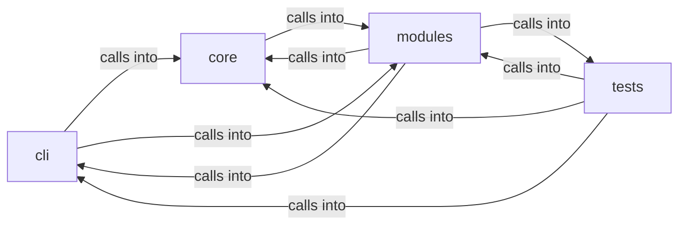

# modules: lazy_loop

modules: lazy_loop groups 99 files (py) around plausible_command, looks_like_prose, _is_host_like_target, _sudo_unavailable, _is_ip_literal. exploit commands migrated from lazyown.py.

## cli (5.1)

cli groups 5 files (py) around ExploitMigratedCommandSet, do_cp, do_createcookie, do_py3ttyup, do_pyautomate. exploit commands migrated from lazyown.py.

## core (5.2)

core groups 2 files (py) around is_autonomous, autonomous_mode, _guarded_input, _tty_fd, emit_restore_sequences. Autonomous-run mode for the loop engine.

## modules (5.3)

modules groups 48 files (py) around plausible_command, looks_like_prose, _is_host_like_target, _sudo_unavailable, _is_ip_literal. Active Directory Certificate Services (AD CS) attack module.

## tests (5.4)

tests groups 44 files (py) around gate_env, test_gate_exact_and_fuzzy_match, test_gate_cidr_match, test_gate_task_allow_is_closed_whitelist, test_gate_blocks_asset_insert. Asset gate + un-nerfed outputs + IntelGraph CSP regression tests.

**Files**:

- cli/commands/exploit_migrated.py
- cli/commands/lazyloop.py
- cli/commands/lazyops.py
- cli/commands/retry_ops.py
- cli/lazy_monitor.py
- core/autonomous.py
- core/terminal_guard.py
- modules/adcs_attacks.py
- modules/auto_loop_memory.py
- modules/auto_registry.py
- modules/custom_tools.py
- modules/digest.py
- modules/exploit_chain.py
- modules/intercept.py
- modules/jsonl_tail.py
- modules/lazy_bridge.py
- modules/lazy_cli_bridge.py
- modules/lazy_engine.py
- modules/lazy_installer.py
- modules/lazy_intel.py
- modules/lazy_ledger.py
- modules/lazy_loop.py
- modules/lazy_mentions.py
- modules/lazy_orchestrator_feedback.py
- modules/lazy_osinfer.py
- modules/lazy_proxy.py
- modules/lazy_reaper.py
- modules/lazy_roles.py
- modules/lazy_runner.py
- modules/lazy_sandbox.py
- modules/lazy_skill_mirror.py
- modules/lazy_skills.py
- modules/loop_guardrails.py
- modules/loop_progress.py
- modules/mediation/__init__.py
- modules/mediation/chain_mediator.py
- modules/mediation/contracts.py
- modules/mediation/feedback_mediator.py
- modules/mediation/hub.py
- modules/mediation/intel_mediator.py
- modules/mediation/telemetry_mediator.py
- modules/notify.py
- modules/progress_ledger.py
- modules/reaction_bridge.py
- modules/selector_manager.py
- modules/selfupdate.py
- modules/sinks/__init__.py
- modules/sinks/chain_feed.py
- modules/sinks/findings.py
- modules/sinks/routing.py
- modules/tools/__init__.py
- modules/tools/loop_smoke.py
- modules/tools/monitor_smoke.py
- modules/traffic_recorder.py
- modules/workspace.py
- tests/test_asset_gate.py
- tests/test_auto_loop_memory.py
- tests/test_auto_registry.py
- tests/test_chain_list_command.py
- tests/test_engage_gates.py
- tests/test_failure_memory_veto.py
- tests/test_guardrails.py
- tests/test_harness_mode.py
- tests/test_lazy_agent.py
- tests/test_lazy_engine.py
- tests/test_lazy_evidence.py
- tests/test_lazy_ledger.py
- tests/test_lazy_loop.py
- tests/test_lazy_parity.py
- tests/test_lazy_proxy.py
- tests/test_lazy_reaper.py
- tests/test_lazy_runner.py
- tests/test_lazy_worker_safety.py
- tests/test_loop_auto_orchestrator.py
- tests/test_loop_broadcast.py
- tests/test_loop_budget.py
- tests/test_loop_cold_overview.py
- tests/test_loop_force_graph.py
- tests/test_loop_guard_audit.py
- tests/test_loop_guardrails.py
- tests/test_loop_intent_delete.py
- tests/test_loop_llm_resilience.py
- tests/test_loop_multi_target.py
- tests/test_loop_nmap_guard.py
- tests/test_loop_progress.py
- tests/test_loop_scope_traffic_evidence.py
- tests/test_loop_spawn_side.py
- tests/test_loop_store_race.py
- tests/test_loop_supervision.py
- tests/test_loop_worker_traces.py
- tests/test_mediation.py
- tests/test_module_registry_bridge.py
- tests/test_policy_planner_signal.py
- tests/test_progress_ledger.py
- tests/test_reaction_bridge.py
- tests/test_repeat_shapes.py
- tests/test_safety_gates.py
- tests/test_security_codeql_batch.py
- tests/test_sink_chain_feed.py
