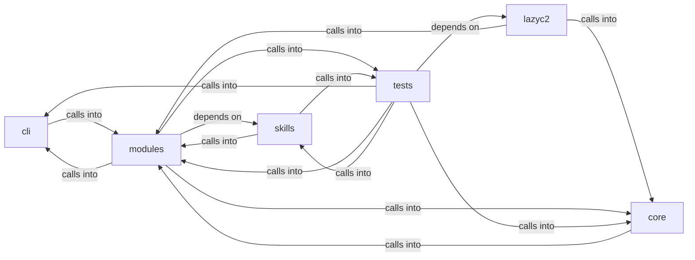

# modules: lazy_loop

modules: lazy_loop groups 152 files (py) around _record_deviation, planner_temperature, wire_capture_enabled, _auto_pwn_cover_all, plausible_command. Lazy autonomous loop commands (single orchestrator, lazy_* surface).

## cli (4.1)

cli groups 4 files (py) around PromptModal, __init__, compose, on_input_submitted, action_dismiss. Lazy autonomous loop commands (single orchestrator, lazy_* surface).

## core (4.2)

core groups 3 files (py) around _unique_tmp, _ensure_parent, write_bytes_atomic, write_text_atomic, file_lock. Tenant-bound API authorization for the LazyOwn C2 dashboard.

## lazyc2 (4.3)

lazyc2 groups 2 files (py) around HealthConfig, _health_status, _listener_alive, health, ping. API blueprint for the LazyOwn C2 server.

## modules (4.4)

modules groups 61 files (py) around _record_deviation, planner_temperature, wire_capture_enabled, _auto_pwn_cover_all, plausible_command. Persistent memory for the auto loop.

## skills (4.5)

skills groups 10 files (py) around _loop_line, _render, handle, handle, handle. MCP tool ``lazyown_auto_loop`` (single runner, one path with the CLI).

## tests (4.6)

tests groups 72 files (py) around TestApiAuthzConfig, test_defaults_are_secure_by_default, test_custom_overrides_preserve_typed_semantics, TestApiKey, test_serialization_roundtrip_preserves_all_fields. Tests for ``core.api_authz`` — tenant-bound API authorization.

**Files**:

- cli/commands/lazyops.py
- cli/headless.py
- cli/lazy_monitor.py
- cli/session_brief.py
- core/api_authz.py
- core/atomic_store.py
- core/terminal_guard.py
- lazyc2/blueprints/api.py
- lazyc2/blueprints/orchestrator.py
- modules/auto_loop_memory.py
- modules/custom_tools.py
- modules/digest.py
- modules/evidence_store.py
- modules/finding_enrich.py
- modules/guard_rules.py
- modules/jsonl_tail.py
- modules/lazy_blindspot.py
- modules/lazy_cli_bridge.py
- modules/lazy_commander.py
- modules/lazy_drafts.py
- modules/lazy_engine.py
- modules/lazy_installer.py
- modules/lazy_intel.py
- modules/lazy_loop.py
- modules/lazy_mentions.py
- modules/lazy_objective_queue.py
- modules/lazy_orchestrator_feedback.py
- modules/lazy_proxy.py
- modules/lazy_reaper.py
- modules/lazy_roles.py
- modules/lazy_runner.py
- modules/lazy_sandbox.py
- modules/lazy_skill_mirror.py
- modules/lazy_skills.py
- modules/loop/__init__.py
- modules/loop/engine_proxy.py
- modules/loop/triage_scheduler.py
- modules/loop/worker_agentic.py
- modules/loop/worker_execution.py
- modules/loop/worker_memory.py
- modules/loop_guardrails.py
- modules/loop_limits.py
- modules/loop_progress.py
- modules/loop_triggers.py
- modules/mediation/__init__.py
- modules/mediation/chain_mediator.py
- modules/mediation/contracts.py
- modules/mediation/engine_mediator.py
- modules/mediation/feedback_mediator.py
- modules/mediation/hub.py
- modules/mediation/intel_mediator.py
- modules/mediation/telemetry_mediator.py
- modules/notify.py
- modules/outcome_attribution.py
- modules/progress_ledger.py
- modules/reaction_bridge.py
- modules/scan_brief.py
- modules/selector_manager.py
- modules/selfupdate.py
- modules/sidequest.py
- modules/sidequestion.py
- modules/sinks/chain_feed.py
- modules/tools/__init__.py
- modules/tools/loop_smoke.py
- modules/tools/monitor_smoke.py
- modules/traffic_recorder.py
- modules/trigger_policy.py
- modules/verb_catalog.py
- modules/wire_capture.py
- modules/workspace.py
- skills/mcp_tools/auto_loop.py
- skills/mcp_tools/lazy_board.py
- skills/mcp_tools/lazy_compact.py
- skills/mcp_tools/lazy_delete.py
- skills/mcp_tools/lazy_finding.py
- skills/mcp_tools/lazy_hint.py
- skills/mcp_tools/lazy_mention.py
- skills/mcp_tools/lazy_proxy.py
- skills/mcp_tools/lazy_trace.py
- skills/mcp_tools/loop_smoke.py
- tests/test_api_authz.py
- tests/test_auto_loop_memory.py
- tests/test_autonomous_ops.py
- tests/test_core_defaults.py
- tests/test_engine_mediator.py
- tests/test_evidence_store.py
- tests/test_exploration_graph_concurrency.py
- tests/test_failure_memory_veto.py
- tests/test_finding_enrich.py
- tests/test_guard_rules.py
- tests/test_harness_mode.py
- tests/test_lazy_agent.py
- tests/test_lazy_blindspot.py
- tests/test_lazy_bridge_traffic.py
- tests/test_lazy_commander.py
- tests/test_lazy_continuation.py
- tests/test_lazy_engine.py
- tests/test_lazy_evidence.py
- tests/test_lazy_loop.py
- tests/test_lazy_proxy.py
- tests/test_lazy_reaper.py
- tests/test_lazy_runner.py
- tests/test_lazy_scope.py
- tests/test_loop_broadcast.py
- tests/test_loop_budget.py
- tests/test_loop_cli_catalog.py
- tests/test_loop_cold_overview.py
- tests/test_loop_decision_log.py
- tests/test_loop_deterministic_mode.py
- tests/test_loop_exit_gate.py
- tests/test_loop_force_graph.py
- tests/test_loop_guard_audit.py
- tests/test_loop_guardrails.py
- tests/test_loop_intent_delete.py
- tests/test_loop_llm_resilience.py
- tests/test_loop_multi_target.py
- tests/test_loop_nmap_guard.py
- tests/test_loop_objective_wiring.py
- tests/test_loop_preflight.py
- tests/test_loop_progress.py
- tests/test_loop_scope_traffic_evidence.py
- tests/test_loop_spawn_side.py
- tests/test_loop_store_race.py
- tests/test_loop_supervision.py
- tests/test_loop_target_authority.py
- tests/test_loop_technique_deterministic.py
- tests/test_loop_trigger_hints.py
- tests/test_loop_worker_traces.py
- tests/test_mcp_auto_loop_wrapper.py
- tests/test_mediation.py
- tests/test_orchestrator_api.py
- tests/test_orchestrator_pacing.py
- tests/test_orchestrator_triggers.py
- tests/test_outcome_attribution.py
- tests/test_pacing.py
- tests/test_pi_leg.py
- tests/test_planner_initial_access.py
- tests/test_policy_planner_signal.py
- tests/test_progress_ledger.py
- tests/test_reaction_bridge.py
- tests/test_repeat_shapes.py
- tests/test_scan_brief.py
- tests/test_security_codeql_batch.py
- tests/test_session_brief.py
- tests/test_sidequest.py
- tests/test_sink_chain_feed.py
- tests/test_stall_dump.py
- tests/test_target_os.py
- tests/test_triage_scheduler.py
- tests/test_trigger_policy.py
- tests/test_wire_capture.py
- tests/test_writeback_hygiene.py
