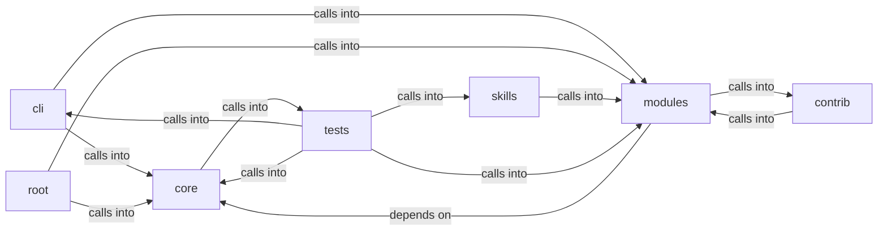

# modules: lazy_sentinel4

modules: lazy_sentinel4 groups 64 files (py) around _sanitize, colors_enabled, _paint, format_line, print_error. Interactive command explorer by phase and goal for the LazyOwn shell.

## cli (4.1)

cli groups 12 files (py) around BinarySpec, BinaryStatus, ReadinessItem, WizardResult, run. Interactive command explorer by phase and goal for the LazyOwn shell.

## contrib (4.2)

contrib groups 3 files (py) around truncate_message, configure_logging, _load_payload_kv, _load_report_context, _prompt_redteam. Unified Ollama/DeepSeek client for LazyOwn — merges lazydeepseekcli_local +...

## core (4.3)

core groups 10 files (py) around _sanitize, colors_enabled, _paint, format_line, print_error. Core primitives for the LazyOwn framework.

## modules (4.4)

modules groups 19 files (py) around LLMBackendUnavailableError, LLMBackendNotSupportedError, default_model_for, model_config_key, api_key_config_key. LazyOwn AI Agent - Ultimate Edition Mejoras: Anti-Hang (Timeout), Gestión de Memoria...

## root (4.5)

root groups 5 files (py) around SecureSessionManager, __init__, register_failed_attempt, check_lockout, check_rate_limit. RAGManager: Manages RAG functionality with CAG caching for document processing and...

## skills (4.6)

skills groups 1 files (py) around ACIGoal, AttackPhase, to_dict, from_dict, ACIPlan. Autonomous Campaign Intelligence (ACI) Planner

## tests (4.7)

tests groups 14 files (py) around _make_goal, _patched_paths, _start_patches, _stop_patches, _make_planner. tests/test_aci_planner.py

**Files**:

- cli/command_explorer.py
- cli/commands/ai.py
- cli/commands/crystal_ball.py
- cli/commands/help_ui.py
- cli/commands/recon.py
- cli/config_status.py
- cli/doctor.py
- cli/exploit_advisor.py
- cli/splash.py
- cli/tutorial.py
- cli/wizard.py
- cli/wizard_scope.py
- contrib/legacy/lazydeepseekcli.py
- contrib/legacy/lazyllmchat.py
- contrib/legacy/lazyphishingai.py
- core/__init__.py
- core/console.py
- core/dependencies.py
- core/error_advice.py
- core/errors.py
- core/http.py
- core/llm_budget.py
- core/network.py
- core/parsers.py
- core/profiles.py
- discord_c2.py
- lazy_sentinel4.py
- modules/agent_runner.py
- modules/agent_tool.py
- modules/ai_model.py
- modules/ia_code_analysis.py
- modules/ia_logs_analysis.py
- modules/ia_network_analysis.py
- modules/lazyownerweb.py
- modules/lilsplunky.py
- modules/llm_adapter.py
- modules/llm_factory.py
- modules/llm_prompts.py
- modules/logging_config.py
- modules/privesc_predictor.py
- modules/sidequestion.py
- modules/tool_extractor.py
- modules/vuln_agent.py
- modules/vuln_bot_cli.py
- modules/vulnbot.py
- modules/yaml_generator.py
- skills/aci_planner.py
- slack_c2_bot.py
- telegram_c2.py
- telegram_hermes.py
- tests/test_aci_planner.py
- tests/test_ai_commands_llm.py
- tests/test_console_stdio.py
- tests/test_dependencies.py
- tests/test_doctor.py
- tests/test_llm_adapter_parity.py
- tests/test_llm_budget.py
- tests/test_llm_prompts.py
- tests/test_logging_config.py
- tests/test_profiles.py
- tests/test_scope_guard_integration.py
- tests/test_single_implementation.py
- tests/test_tui_splash.py
- tests/test_wizard_llm.py
