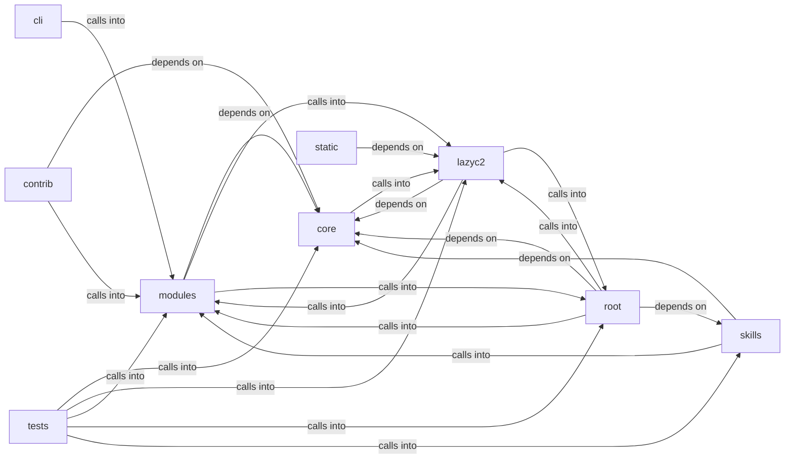

# modules: lazyc2

modules: lazyc2 groups 142 files (js, py) around StructuredLogConfig, _JsonLineFormatter, __init__, format, _ConsoleFormatter. Automation command set — credential reuse, conditional hooks, operator profiles.

## cli (3.1)

cli groups 3 files (py) around _load_score, _load_recent_results, _dataset_stats, _make_bar, _color_rate. Automation command set — credential reuse, conditional hooks, operator profiles.

## contrib (3.2)

contrib groups 9 files (py) around _ret_model, truncate_message, _configure_logging, _load_knowledge_base, _save_knowledge_base. Autor: Gris Iscomeback Correo electrónico: grisiscomeback[at]gmail[dot]com Fecha de...

## core (3.3)

core groups 5 files (py) around StructuredLogConfig, _JsonLineFormatter, __init__, format, _ConsoleFormatter. Centralised subprocess wrapper for the LazyOwn framework.

## lazyc2 (3.4)

lazyc2 groups 24 files (py) around CorsConfigError, CorsPolicy, __init__, env, resolve_origins. Flask Blueprints for lazydown C2.

## modules (3.5)

modules groups 48 files (py) around Role, valid_roles, Permission, _UsersFileUnreadable, RBACUser. Git update contract for lazyaddons.

## root (3.6)

root groups 1 files (py) around _env_tag, is_insecure_credential, _listen_address, _is_unspecified_bind_literal, _select_specific_bind_address. is_insecure_credential: Check for weak or default credentials

## skills (3.7)

skills groups 13 files (py) around Config, default, ollama_url, ActionCategory, OutcomeType. Daemon health monitor — watchdog for the autonomous daemon and C2 listeners.

## static (3.8)

static groups 2 files (js) around as, as, as, as, as. as: !

## tests (3.9)

tests groups 37 files (py) around test_autonomous_flow_integration, _valid_draft, TestConfig, test_name_pattern_rejects_traversal, test_patterns_accept_canonical_values. test_autonomous_flow_integration: Simulates a simplified autonomous flow to verify...

**Files**:

- cli/commands/automation.py
- cli/commands/purple_team.py
- cli/purple_tui.py
- contrib/legacy/lazygptcli.py
- contrib/legacy/lazygptcli_unified.py
- contrib/legacy/lazyhoneypot.py
- contrib/legacy/lazyopenssh77enum2.py
- contrib/legacy/lazyproxy.py
- contrib/legacy/lazysearch_bot.py
- contrib/legacy/lazyseo.py
- contrib/legacy/lazysmbrelay.py
- contrib/legacy/lazyssh.py
- core/executor.py
- core/logging.py
- core/scheduler.py
- core/security.py
- core/session_secrets.py
- lazyc2.py
- lazyc2/__init__.py
- lazyc2/blueprints/__init__.py
- lazyc2/blueprints/addons.py
- lazyc2/blueprints/api_v1.py
- lazyc2/blueprints/auth.py
- lazyc2/blueprints/beacon.py
- lazyc2/blueprints/operations.py
- lazyc2/blueprints/phishing.py
- lazyc2/blueprints/session_auth.py
- lazyc2/extensions/decoy.py
- lazyc2/extensions/short_urls.py
- lazyc2/extensions/storage.py
- lazyc2/extensions/users.py
- lazyc2/models.py
- lazyc2/security/__init__.py
- lazyc2/security/cli_credentials.py
- lazyc2/security/constants.py
- lazyc2/security/cors.py
- lazyc2/security/csrf.py
- lazyc2/security/html_sanitizer.py
- lazyc2/security/https_redirect.py
- lazyc2/security/services.py
- lazyc2/security/trusted_proxy.py
- lazyc2/security/validators.py
- modules/addon_updater.py
- modules/auto_purple.py
- modules/beacon_history.py
- modules/bsb_compat.py
- modules/c2_agent.py
- modules/c2_profile.py
- modules/collab_bp.py
- modules/colors.py
- modules/compliance.py
- modules/conditional_hooks.py
- modules/config_store.py
- modules/credential_reuse.py
- modules/dashboard_bp.py
- modules/db.py
- modules/detection_feed.py
- modules/detection_oracle.py
- modules/engagement_hooks.py
- modules/estorides_importer.py
- modules/event_bus.py
- modules/event_consumers.py
- modules/factsio.py
- modules/hive_invoke.py
- modules/ia_code_analysis.py
- modules/ia_logs_analysis.py
- modules/ia_network_analysis.py
- modules/integrations/__init__.py
- modules/integrations/misp_export.py
- modules/integrations/nuclei_bridge.py
- modules/integrations/nuclei_parser.py
- modules/integrations/searchsploit.py
- modules/intelligence_engine.py
- modules/lazy_rbac.py
- modules/lazy_search.py
- modules/lazyownerweb.py
- modules/lesson_ingestor.py
- modules/lilsplunky.py
- modules/logging_config.py
- modules/loop_manager.py
- modules/moe_router.py
- modules/operator_profiles.py
- modules/rl_trainer.py
- modules/sinks/campaign_db.py
- modules/sinks/event_bus.py
- modules/state_manager.py
- modules/sudo_tiocsti.py
- modules/toposwarm_bridge.py
- modules/unified_bridge.py
- modules/yara_scanner.py
- skills/daemon_health.py
- skills/lazyown_campaign.py
- skills/lazyown_policy.py
- skills/mcp_tools/campaign.py
- skills/mcp_tools/collab_publish.py
- skills/mcp_tools/db.py
- skills/mcp_tools/lazysearch.py
- skills/mcp_tools/swan_ensemble.py
- skills/mcp_tools/swan_route.py
- skills/mcp_tools/swan_run.py
- skills/mcp_tools/swan_status.py
- skills/swan_agent.py
- skills/toposwarm_autonomous.py
- static/js/socket.io-4.0.0.min.js
- static/js/socket.io-4.3.2.min.js
- tests/integration_autonomous_flow.py
- tests/test_addon_creator.py
- tests/test_addon_updater.py
- tests/test_api_v1.py
- tests/test_beacon_history.py
- tests/test_c2_credential_bootstrap.py
- tests/test_collab_and_onboarding.py
- tests/test_conditional_hooks_extended.py
- tests/test_core_executor.py
- tests/test_cors_behavior.py
- tests/test_cors_policy.py
- tests/test_cors_socketio_regression.py
- tests/test_csrf_behavior.py
- tests/test_csrf_policy.py
- tests/test_dashboard_routes.py
- tests/test_db.py
- tests/test_detection_dampening.py
- tests/test_detection_feed.py
- tests/test_engage_orchestrator.py
- tests/test_html_sanitizer.py
- tests/test_https_redirect.py
- tests/test_intelligence_engine.py
- tests/test_lazy_search.py
- tests/test_lesson_ingestor.py
- tests/test_logging_config.py
- tests/test_loop_manager.py
- tests/test_moe_rl_swan.py
- tests/test_moe_router_check_regression.py
- tests/test_mutation_verification.py
- tests/test_nuclei_parser.py
- tests/test_scope_bound_auto_gate.py
- tests/test_security_lazyc2.py
- tests/test_session_secrets.py
- tests/test_short_url_file_containment.py
- tests/test_single_source_of_truth.py
- tests/test_structured_logging.py
- tests/test_trusted_proxy.py
