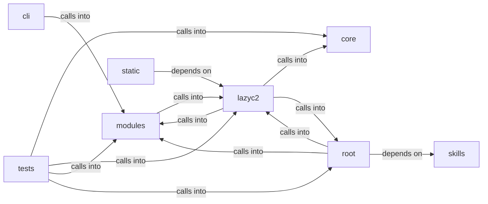

# modules: lazyc2

modules: lazyc2 groups 75 files (js, py) around Role, valid_roles, Permission, _UsersFileUnreadable, RBACUser. Automation command set — credential reuse, conditional hooks, operator profiles.

## cli (6.1)

cli groups 2 files (py) around AutomationCommandSet, do_cred_reuse, do_cred_mark_failed, do_hooks_list, do_hooks_enable. Automation command set — credential reuse, conditional hooks, operator profiles.

## core (6.2)

core groups 1 files (py) around ApiAuthzConfig, ApiKey, to_dict, from_dict, is_expired. Tenant-bound API authorization for the LazyOwn C2 dashboard.

## lazyc2 (6.3)

lazyc2 groups 26 files (py) around CorsConfigError, CorsPolicy, __init__, env, resolve_origins. Flask application factory for the LazyOwn C2 server.

## modules (6.4)

modules groups 18 files (py) around Role, valid_roles, Permission, _UsersFileUnreadable, RBACUser. Persistent beacon command/result history storage.

## root (6.5)

root groups 2 files (py) around _env_tag, is_insecure_credential, _listen_address, _is_unspecified_bind_literal, _select_specific_bind_address. is_insecure_credential: Check for weak or default credentials

## skills (6.6)

skills groups 1 files (py) around _health_path, is_daemon_alive, daemon_status, DaemonHealth, __init__. Daemon health monitor — watchdog for the autonomous daemon and C2 listeners.

## static (6.7)

static groups 2 files (js) around as, as, as, as, as. as: !

## tests (6.8)

tests groups 23 files (py) around _valid_draft, TestConfig, test_name_pattern_rejects_traversal, test_patterns_accept_canonical_values, test_os_options_cover_mitre_platforms. Tests for the LazyAddon creator contract and C2 blueprint.

**Files**:

- cli/commands/automation.py
- cli/commands/collaboration.py
- core/api_authz.py
- lazyc2.py
- lazyc2/__init__.py
- lazyc2/app_factory.py
- lazyc2/blueprints/__init__.py
- lazyc2/blueprints/addons.py
- lazyc2/blueprints/api_v1.py
- lazyc2/blueprints/auth.py
- lazyc2/blueprints/beacon.py
- lazyc2/blueprints/operations.py
- lazyc2/blueprints/phishing.py
- lazyc2/blueprints/session_auth.py
- lazyc2/extensions/__init__.py
- lazyc2/extensions/decoy.py
- lazyc2/extensions/short_urls.py
- lazyc2/extensions/storage.py
- lazyc2/extensions/users.py
- lazyc2/models.py
- lazyc2/security/__init__.py
- lazyc2/security/cli_credentials.py
- lazyc2/security/constants.py
- lazyc2/security/cors.py
- lazyc2/security/csrf.py
- lazyc2/security/html_sanitizer.py
- lazyc2/security/https_redirect.py
- lazyc2/security/services.py
- lazyc2/security/trusted_proxy.py
- lazyc2/security/validators.py
- modules/beacon_history.py
- modules/collab_bp.py
- modules/conditional_hooks.py
- modules/credential_reuse.py
- modules/dashboard_bp.py
- modules/db.py
- modules/event_bus.py
- modules/event_consumers.py
- modules/kill_chain_viz.py
- modules/lazy_rbac.py
- modules/lazyown_bprfuzzer.py
- modules/live_surface.py
- modules/loop_manager.py
- modules/operator_profiles.py
- modules/security_sanitizers.py
- modules/sinks/campaign_db.py
- modules/sinks/event_bus.py
- modules/state_manager.py
- pwntomate.py
- skills/daemon_health.py
- static/js/socket.io-4.0.0.min.js
- static/js/socket.io-4.3.2.min.js
- tests/test_addon_creator.py
- tests/test_api_authz.py
- tests/test_api_v1.py
- tests/test_beacon_history.py
- tests/test_c2_credential_bootstrap.py
- tests/test_collab_and_onboarding.py
- tests/test_conditional_hooks_extended.py
- tests/test_cors_behavior.py
- tests/test_cors_policy.py
- tests/test_cors_socketio_regression.py
- tests/test_csrf_behavior.py
- tests/test_csrf_policy.py
- tests/test_dashboard_routes.py
- tests/test_db.py
- tests/test_html_sanitizer.py
- tests/test_https_redirect.py
- tests/test_live_surface.py
- tests/test_loop_manager.py
- tests/test_mutation_verification.py
- tests/test_security_lazyc2.py
- tests/test_security_sanitizers.py
- tests/test_short_url_file_containment.py
- tests/test_trusted_proxy.py
