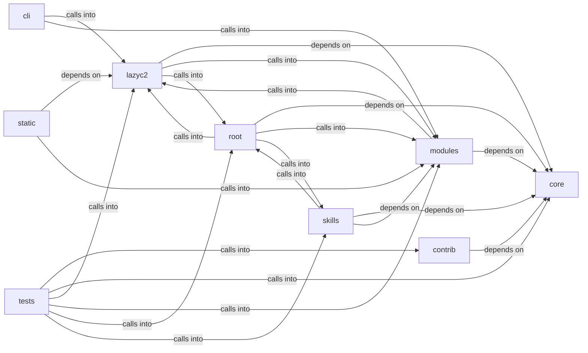

# modules: lazyc2

modules: lazyc2 groups 135 files (js, py) around StructuredLogConfig, _JsonLineFormatter, __init__, format, _ConsoleFormatter. Automation command set — credential reuse, conditional hooks, operator profiles.

## cli (2.1)

cli groups 4 files (py) around AutomationCommandSet, do_cred_reuse, do_cred_mark_failed, do_hooks_list, do_hooks_enable. Automation command set — credential reuse, conditional hooks, operator profiles.

## contrib (2.2)

contrib groups 5 files (py) around truncate_message, configure_logging, _load_payload_kv, _load_report_context, _prompt_redteam. Unified Ollama/DeepSeek client for LazyOwn — merges lazydeepseekcli_local +...

## core (2.3)

core groups 5 files (py) around StructuredLogConfig, _JsonLineFormatter, __init__, format, _ConsoleFormatter. Tenant-bound API authorization for the LazyOwn C2 dashboard.

## lazyc2 (2.4)

lazyc2 groups 28 files (py) around CorsConfigError, CorsPolicy, __init__, env, resolve_origins. LazyAddon creator contract for the LazyOwn C2 web interface.

## modules (2.5)

modules groups 46 files (py) around Role, valid_roles, Permission, _UsersFileUnreadable, RBACUser. LazyOwn AI Fallback Chain

## root (2.6)

root groups 2 files (py) around sanitize_content, RAGManager, __init__, initialize_cache_table, get_cache_key. RAGManager: Manages RAG functionality with CAG caching for document processing and...

## skills (2.7)

skills groups 9 files (py) around Config, default, ServiceFact, CredentialFact, ShareFact. Autonomous Campaign Intelligence (ACI) Planner

## static (2.8)

static groups 2 files (js) around as, as, as, as, as. as: !

## tests (2.9)

tests groups 34 files (py) around _make_goal, _patched_paths, _start_patches, _stop_patches, _make_planner. tests/test_aci_planner.py

**Files**:

- cli/commands/automation.py
- cli/commands/c2_session.py
- cli/commands/collaboration.py
- cli/commands/estorides.py
- contrib/legacy/lazydeepseekcli.py
- contrib/legacy/lazyhoneypot.py
- contrib/legacy/lazyopenssh77enum2.py
- contrib/legacy/lazysearch_bot.py
- contrib/legacy/lazyssh.py
- core/api_authz.py
- core/executor.py
- core/logging.py
- core/scheduler.py
- core/security.py
- lazy_sentinel4.py
- lazyc2.py
- lazyc2/__init__.py
- lazyc2/addon_creator.py
- lazyc2/app_factory.py
- lazyc2/blueprints/__init__.py
- lazyc2/blueprints/addons.py
- lazyc2/blueprints/api.py
- lazyc2/blueprints/api_v1.py
- lazyc2/blueprints/auth.py
- lazyc2/blueprints/beacon.py
- lazyc2/blueprints/operations.py
- lazyc2/blueprints/phishing.py
- lazyc2/blueprints/session_auth.py
- lazyc2/extensions/__init__.py
- lazyc2/extensions/decoy.py
- lazyc2/extensions/short_urls.py
- lazyc2/extensions/storage.py
- lazyc2/extensions/users.py
- lazyc2/models.py
- lazyc2/security/__init__.py
- lazyc2/security/command_allowlist.py
- lazyc2/security/constants.py
- lazyc2/security/cors.py
- lazyc2/security/csrf.py
- lazyc2/security/html_sanitizer.py
- lazyc2/security/https_redirect.py
- lazyc2/security/services.py
- lazyc2/security/trusted_proxy.py
- lazyc2/security/validators.py
- modules/ai_fallback.py
- modules/beacon_history.py
- modules/c2_agent.py
- modules/c2_profile.py
- modules/c2_surfaces.py
- modules/collab_bp.py
- modules/compliance.py
- modules/conditional_hooks.py
- modules/credential_reuse.py
- modules/dashboard_bp.py
- modules/db.py
- modules/engagement_hooks.py
- modules/estorides_importer.py
- modules/event_bus.py
- modules/event_consumers.py
- modules/event_engine.py
- modules/hive_invoke.py
- modules/ia_code_analysis.py
- modules/ia_logs_analysis.py
- modules/ia_network_analysis.py
- modules/integrations/__init__.py
- modules/integrations/misp_export.py
- modules/integrations/nuclei_bridge.py
- modules/integrations/nuclei_parser.py
- modules/integrations/searchsploit.py
- modules/intelligence_engine.py
- modules/lazy_rbac.py
- modules/lazyownerweb.py
- modules/lesson_ingestor.py
- modules/lilsplunky.py
- modules/live_surface.py
- modules/logging_config.py
- modules/mcp_agent_bridge.py
- modules/metrics.py
- modules/operator_profiles.py
- modules/pipeline_engine.py
- modules/playbook_executor.py
- modules/recommender.py
- modules/session_state.py
- modules/sinks/campaign_db.py
- modules/sinks/event_bus.py
- modules/state_manager.py
- modules/sudo_tiocsti.py
- modules/timeline_narrator.py
- modules/toposwarm_bridge.py
- modules/unified_bridge.py
- skills/aci_planner.py
- skills/daemon_health.py
- skills/heartbeat.py
- skills/lazyown_campaign.py
- skills/lazyown_daemon.py
- skills/lazyown_facts.py
- skills/sessions_watcher.py
- skills/tests/test_facts.py
- skills/toposwarm_autonomous.py
- static/js/socket.io-4.0.0.min.js
- static/js/socket.io-4.3.2.min.js
- tests/test_aci_planner.py
- tests/test_addon_creator.py
- tests/test_api_authz.py
- tests/test_api_v1.py
- tests/test_beacon_history.py
- tests/test_c2_surfaces.py
- tests/test_collab_and_onboarding.py
- tests/test_command_allowlist.py
- tests/test_command_allowlist_behavior.py
- tests/test_conditional_hooks_extended.py
- tests/test_core_defaults.py
- tests/test_core_executor.py
- tests/test_cors_behavior.py
- tests/test_cors_policy.py
- tests/test_cors_socketio_regression.py
- tests/test_csrf_behavior.py
- tests/test_csrf_policy.py
- tests/test_dashboard_routes.py
- tests/test_db.py
- tests/test_html_sanitizer.py
- tests/test_https_redirect.py
- tests/test_intelligence_engine.py
- tests/test_lesson_ingestor.py
- tests/test_live_surface.py
- tests/test_logging_config.py
- tests/test_metrics.py
- tests/test_mutation_verification.py
- tests/test_nuclei_parser.py
- tests/test_pipeline_engine.py
- tests/test_placeholder_coverage.py
- tests/test_security_lazyc2.py
- tests/test_short_url_file_containment.py
- tests/test_structured_logging.py
- tests/test_trusted_proxy.py
