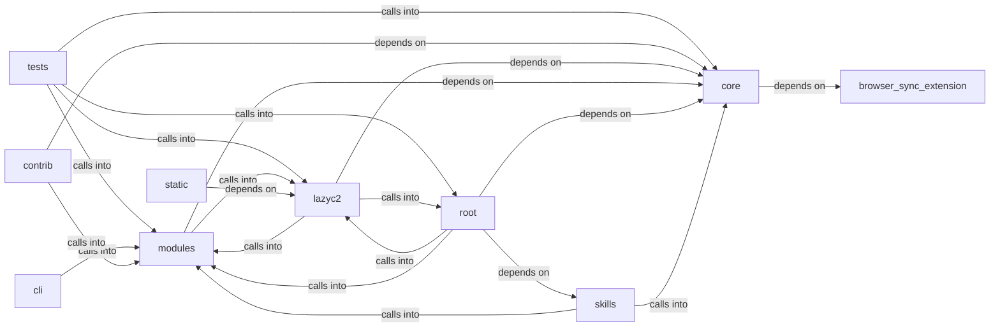

# modules: lazyc2

modules: lazyc2 groups 135 files (js, py) around StructuredLogConfig, _JsonLineFormatter, __init__, format, _ConsoleFormatter. Automation command set — credential reuse, conditional hooks, operator profiles.

## browser_sync_extension (5.1)

browser_sync_extension groups 1 files (js) around config, domainAllowed, highEntropyHints, sanitizeHeader, collectProfile.

## cli (5.2)

cli groups 1 files (py) around AutomationCommandSet, do_cred_reuse, do_cred_mark_failed, do_hooks_list, do_hooks_enable. Automation command set — credential reuse, conditional hooks, operator profiles.

## contrib (5.3)

contrib groups 9 files (py) around _ret_model, truncate_message, _configure_logging, _load_knowledge_base, _save_knowledge_base. Autor: Gris Iscomeback Correo electrónico: grisiscomeback[at]gmail[dot]com Fecha de...

## core (5.4)

core groups 5 files (py) around StructuredLogConfig, _JsonLineFormatter, __init__, format, _ConsoleFormatter. Tenant-bound API authorization for the LazyOwn C2 dashboard.

## lazyc2 (5.5)

lazyc2 groups 31 files (py) around CSRFPolicy, __init__, header, cookie_name, issue. Flask application factory for the LazyOwn C2 server.

## modules (5.6)

modules groups 38 files (py) around Role, valid_roles, Permission, _UsersFileUnreadable, RBACUser. Git update contract for lazyaddons.

## root (5.7)

root groups 1 files (py) around _env_tag, is_insecure_credential, _listen_address, _is_unspecified_bind_literal, _select_specific_bind_address. is_insecure_credential: Check for weak or default credentials

## skills (5.8)

skills groups 9 files (py) around _now_iso, is_ip_in_scope, Campaign, is_active, to_dict. Daemon health monitor — watchdog for the autonomous daemon and C2 listeners.

## static (5.9)

static groups 2 files (js) around as, as, as, as, as. as: !

## tests (5.10)

tests groups 38 files (py) around test_autonomous_flow_integration, _valid_draft, TestConfig, test_name_pattern_rejects_traversal, test_patterns_accept_canonical_values. test_autonomous_flow_integration: Simulates a simplified autonomous flow to verify...

**Files**:

- browser_sync_extension/background.js
- cli/commands/automation.py
- contrib/legacy/lazygptcli.py
- contrib/legacy/lazygptcli_unified.py
- contrib/legacy/lazyhoneypot.py
- contrib/legacy/lazyopenssh77enum2.py
- contrib/legacy/lazyproxy.py
- contrib/legacy/lazysearch_bot.py
- contrib/legacy/lazyseo.py
- contrib/legacy/lazysmbrelay.py
- contrib/legacy/lazyssh.py
- core/api_authz.py
- core/executor.py
- core/logging.py
- core/scheduler.py
- core/security.py
- lazyc2.py
- lazyc2/__init__.py
- lazyc2/app_factory.py
- lazyc2/blueprints/__init__.py
- lazyc2/blueprints/addons.py
- lazyc2/blueprints/api.py
- lazyc2/blueprints/api_v1.py
- lazyc2/blueprints/auth.py
- lazyc2/blueprints/beacon.py
- lazyc2/blueprints/gym.py
- lazyc2/blueprints/loops.py
- lazyc2/blueprints/operations.py
- lazyc2/blueprints/phishing.py
- lazyc2/blueprints/session_auth.py
- lazyc2/extensions/__init__.py
- lazyc2/extensions/decoy.py
- lazyc2/extensions/short_urls.py
- lazyc2/extensions/storage.py
- lazyc2/extensions/users.py
- lazyc2/models.py
- lazyc2/security/__init__.py
- lazyc2/security/cli_credentials.py
- lazyc2/security/constants.py
- lazyc2/security/cors.py
- lazyc2/security/csrf.py
- lazyc2/security/csrf_flow.py
- lazyc2/security/health.py
- lazyc2/security/html_sanitizer.py
- lazyc2/security/https_redirect.py
- lazyc2/security/services.py
- lazyc2/security/trusted_proxy.py
- lazyc2/security/validators.py
- modules/addon_updater.py
- modules/beacon_history.py
- modules/c2_profile.py
- modules/collab_bp.py
- modules/colors.py
- modules/conditional_hooks.py
- modules/config_store.py
- modules/credential_reuse.py
- modules/dashboard_bp.py
- modules/db.py
- modules/detection_feed.py
- modules/detection_oracle.py
- modules/engagement_hooks.py
- modules/event_bus.py
- modules/event_consumers.py
- modules/gym_winbox_runner.py
- modules/hash_cracker.py
- modules/hive_invoke.py
- modules/ia_code_analysis.py
- modules/ia_logs_analysis.py
- modules/ia_network_analysis.py
- modules/lazy_rbac.py
- modules/lazy_search.py
- modules/lazyownerweb.py
- modules/lesson_ingestor.py
- modules/lilsplunky.py
- modules/listener_manager.py
- modules/logging_config.py
- modules/loop_manager.py
- modules/moe_router.py
- modules/operator_profiles.py
- modules/rl_trainer.py
- modules/sinks/campaign_db.py
- modules/sinks/event_bus.py
- modules/state_manager.py
- modules/sudo_tiocsti.py
- modules/toposwarm_bridge.py
- modules/unified_bridge.py
- skills/daemon_health.py
- skills/lazyown_campaign.py
- skills/lazyown_daemon.py
- skills/mcp_tools/campaign.py
- skills/mcp_tools/collab_publish.py
- skills/mcp_tools/db.py
- skills/mcp_tools/lazysearch.py
- skills/sessions_watcher.py
- skills/toposwarm_autonomous.py
- static/js/socket.io-4.0.0.min.js
- static/js/socket.io-4.3.2.min.js
- tests/integration_autonomous_flow.py
- tests/test_addon_creator.py
- tests/test_addon_updater.py
- tests/test_api_authz.py
- tests/test_api_v1.py
- tests/test_beacon_history.py
- tests/test_c2_credential_bootstrap.py
- tests/test_collab_and_onboarding.py
- tests/test_conditional_hooks_extended.py
- tests/test_core_defaults.py
- tests/test_core_executor.py
- tests/test_cors_behavior.py
- tests/test_cors_policy.py
- tests/test_cors_socketio_regression.py
- tests/test_csrf_behavior.py
- tests/test_csrf_cookie_flags.py
- tests/test_csrf_flow_e2e.py
- tests/test_csrf_policy.py
- tests/test_dashboard_routes.py
- tests/test_db.py
- tests/test_detection_dampening.py
- tests/test_detection_feed.py
- tests/test_gym_blueprint.py
- tests/test_hash_cracker.py
- tests/test_health_report.py
- tests/test_html_sanitizer.py
- tests/test_https_redirect.py
- tests/test_lazy_search.py
- tests/test_lesson_ingestor.py
- tests/test_logging_config.py
- tests/test_loop_manager.py
- tests/test_moe_rl_swan.py
- tests/test_moe_router_check_regression.py
- tests/test_mutation_verification.py
- tests/test_security_lazyc2.py
- tests/test_short_url_file_containment.py
- tests/test_structured_logging.py
- tests/test_trusted_proxy.py
