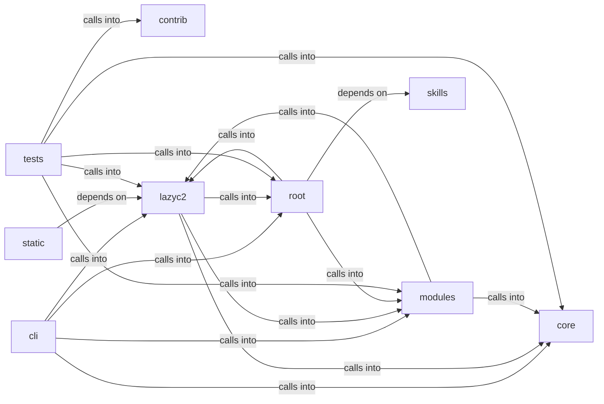

# modules: lazyc2

modules: lazyc2 groups 96 files (js, py) around Role, valid_roles, Permission, _UsersFileUnreadable, RBACUser. Automation command set — credential reuse, conditional hooks, operator profiles.

## cli (5.1)

cli groups 6 files (py) around AutomationCommandSet, do_cred_reuse, do_cred_mark_failed, do_hooks_list, do_hooks_enable. Automation command set — credential reuse, conditional hooks, operator profiles.

## contrib (5.2)

contrib groups 1 files (py) around truncate_message, configure_logging, _load_payload_kv, _load_report_context, _prompt_redteam. Unified Ollama/DeepSeek client for LazyOwn — merges lazydeepseekcli_local +...

## core (5.3)

core groups 2 files (py) around load_defaults, clear_cache, get, default_lport, default_rport. Tenant-bound API authorization for the LazyOwn C2 dashboard.

## lazyc2 (5.4)

lazyc2 groups 27 files (py) around CorsConfigError, CorsPolicy, __init__, env, resolve_origins. LazyAddon creator contract for the LazyOwn C2 web interface.

## modules (5.5)

modules groups 27 files (py) around Role, valid_roles, Permission, _UsersFileUnreadable, RBACUser. Persistent beacon command/result history storage.

## root (5.6)

root groups 2 files (py) around _env_tag, is_insecure_credential, _listen_address, _is_unspecified_bind_literal, _select_specific_bind_address. is_insecure_credential: Check for weak or default credentials

## skills (5.7)

skills groups 1 files (py) around _health_path, is_daemon_alive, daemon_status, DaemonHealth, __init__. Daemon health monitor — watchdog for the autonomous daemon and C2 listeners.

## static (5.8)

static groups 2 files (js) around as, as, as, as, as. as: !

## tests (5.9)

tests groups 28 files (py) around _valid_draft, TestConfig, test_name_pattern_rejects_traversal, test_patterns_accept_canonical_values, test_os_options_cover_mitre_platforms. Tests for the LazyAddon creator contract and C2 blueprint.

**Files**:

- cli/commands/automation.py
- cli/commands/c2_session.py
- cli/commands/collaboration.py
- cli/commands/defaults.py
- cli/commands/opsec_cleanup.py
- cli/commands/security.py
- contrib/legacy/lazydeepseekcli.py
- core/api_authz.py
- core/defaults.py
- lazyc2.py
- lazyc2/__init__.py
- lazyc2/addon_creator.py
- lazyc2/app_factory.py
- lazyc2/blueprints/__init__.py
- lazyc2/blueprints/addons.py
- lazyc2/blueprints/api.py
- lazyc2/blueprints/api_v1.py
- lazyc2/blueprints/auth.py
- lazyc2/blueprints/beacon.py
- lazyc2/blueprints/operations.py
- lazyc2/blueprints/phishing.py
- lazyc2/blueprints/session_auth.py
- lazyc2/extensions/__init__.py
- lazyc2/extensions/decoy.py
- lazyc2/extensions/short_urls.py
- lazyc2/extensions/storage.py
- lazyc2/extensions/users.py
- lazyc2/models.py
- lazyc2/security/__init__.py
- lazyc2/security/constants.py
- lazyc2/security/cors.py
- lazyc2/security/csrf.py
- lazyc2/security/html_sanitizer.py
- lazyc2/security/https_redirect.py
- lazyc2/security/services.py
- lazyc2/security/trusted_proxy.py
- lazyc2/security/validators.py
- modules/beacon_history.py
- modules/c2_agent.py
- modules/c2_surfaces.py
- modules/collab_bp.py
- modules/compliance.py
- modules/conditional_hooks.py
- modules/credential_reuse.py
- modules/dashboard_bp.py
- modules/db.py
- modules/event_bus.py
- modules/event_consumers.py
- modules/forensic_cleaner.py
- modules/hash_cracker.py
- modules/lazy_mentions.py
- modules/lazy_rbac.py
- modules/lazyown_bprfuzzer.py
- modules/live_surface.py
- modules/log_tamper.py
- modules/memory_cleaner.py
- modules/network_opsec.py
- modules/operator_profiles.py
- modules/opsec_scorer.py
- modules/security_sanitizers.py
- modules/sinks/campaign_db.py
- modules/sinks/event_bus.py
- modules/state_manager.py
- modules/timestomper.py
- pwntomate.py
- skills/daemon_health.py
- static/js/socket.io-4.0.0.min.js
- static/js/socket.io-4.3.2.min.js
- tests/test_addon_creator.py
- tests/test_api_authz.py
- tests/test_api_v1.py
- tests/test_beacon_history.py
- tests/test_c2_surfaces.py
- tests/test_collab_and_onboarding.py
- tests/test_conditional_hooks_extended.py
- tests/test_core_defaults.py
- tests/test_cors_behavior.py
- tests/test_cors_policy.py
- tests/test_cors_socketio_regression.py
- tests/test_csrf_behavior.py
- tests/test_csrf_policy.py
- tests/test_dashboard_routes.py
- tests/test_db.py
- tests/test_hash_cracker.py
- tests/test_html_sanitizer.py
- tests/test_https_redirect.py
- tests/test_live_surface.py
- tests/test_mutation_verification.py
- tests/test_opsec_scorer.py
- tests/test_opsec_scorer_consolidated.py
- tests/test_placeholder_coverage.py
- tests/test_security_codeql_batch.py
- tests/test_security_lazyc2.py
- tests/test_security_sanitizers.py
- tests/test_short_url_file_containment.py
- tests/test_trusted_proxy.py
