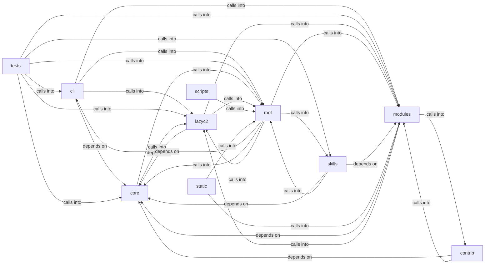

# modules: lazyc2

modules: lazyc2 groups 146 files (js, py) around StructuredLogConfig, _JsonLineFormatter, __init__, format, _ConsoleFormatter. Automatic encryption of sensitive session data on app open/close.

## cli (1.1)

cli groups 6 files (py) around AutoCryptoConfig, AutoCryptoEngine, __init__, enabled, is_encrypted. Automatic encryption of sensitive session data on app open/close.

## contrib (1.2)

contrib groups 10 files (py) around _ret_model, truncate_message, _configure_logging, _load_knowledge_base, _save_knowledge_base. Unified Ollama/DeepSeek client for LazyOwn — merges lazydeepseekcli_local +...

## core (1.3)

core groups 9 files (py) around StructuredLogConfig, _JsonLineFormatter, __init__, format, _ConsoleFormatter. Tenant-bound API authorization for the LazyOwn C2 dashboard.

## lazyc2 (1.4)

lazyc2 groups 17 files (py) around CorsConfigError, CorsPolicy, __init__, env, resolve_origins. Flask application factory for the LazyOwn C2 server.

## modules (1.5)

modules groups 47 files (py) around ColoredFormatter, format, JsonFormatter, format, CorrelationFilter. LazyOwn AI Fallback Chain

## root (1.6)

root groups 7 files (py) around _ux_debug, _parse_bool_setting, _PayloadSettableProxy, __init__, __getattr__. RAGManager: Manages RAG functionality with CAG caching for document processing and...

## scripts (1.7)

scripts groups 1 files (py) around AuditConfig, argparser_commands, audit, main. Audit every registered shell command for dispatch and parser errors.

## skills (1.8)

skills groups 9 files (py) around Config, default, ServiceFact, CredentialFact, ShareFact. Autonomous Campaign Intelligence (ACI) Planner

## static (1.9)

static groups 1 files (js) around P, S, a, a, a.

## tests (1.10)

tests groups 39 files (py) around _make_goal, _patched_paths, _start_patches, _stop_patches, _make_planner. tests/test_aci_planner.py

**Files**:

- cli/auto_crypto.py
- cli/commands/automation.py
- cli/commands/collaboration.py
- cli/commands/estorides.py
- cli/commands/security.py
- cli/headless.py
- contrib/legacy/lazydeepseekcli.py
- contrib/legacy/lazygptcli.py
- contrib/legacy/lazygptcli_unified.py
- contrib/legacy/lazyhoneypot.py
- contrib/legacy/lazyopenssh77enum2.py
- contrib/legacy/lazyphishingai.py
- contrib/legacy/lazyproxy.py
- contrib/legacy/lazysearch_bot.py
- contrib/legacy/lazyseo.py
- contrib/legacy/lazyssh.py
- core/api_authz.py
- core/command_bridge.py
- core/credential_vault.py
- core/executor.py
- core/logging.py
- core/parsers.py
- core/safe_exec.py
- core/scheduler.py
- core/security.py
- discord_c2.py
- lazy_sentinel4.py
- lazyc2.py
- lazyc2/app_factory.py
- lazyc2/blueprints/__init__.py
- lazyc2/blueprints/api.py
- lazyc2/blueprints/api_v1.py
- lazyc2/blueprints/beacon.py
- lazyc2/blueprints/phishing.py
- lazyc2/extensions/__init__.py
- lazyc2/extensions/short_urls.py
- lazyc2/security/__init__.py
- lazyc2/security/command_allowlist.py
- lazyc2/security/constants.py
- lazyc2/security/cors.py
- lazyc2/security/html_sanitizer.py
- lazyc2/security/https_redirect.py
- lazyc2/security/services.py
- lazyc2/security/trusted_proxy.py
- lazyc2/security/validators.py
- lazyown.py
- modules/ai_fallback.py
- modules/beacon_history.py
- modules/c2_profile.py
- modules/collab_bp.py
- modules/colors.py
- modules/command_executor.py
- modules/compliance.py
- modules/conditional_hooks.py
- modules/credential_reuse.py
- modules/dashboard_bp.py
- modules/db.py
- modules/engagement_hooks.py
- modules/estorides_importer.py
- modules/event_bus.py
- modules/event_consumers.py
- modules/event_engine.py
- modules/hash_cracker.py
- modules/hive_invoke.py
- modules/ia_code_analysis.py
- modules/ia_logs_analysis.py
- modules/ia_network_analysis.py
- modules/integrations/__init__.py
- modules/integrations/misp_export.py
- modules/integrations/nuclei_bridge.py
- modules/integrations/nuclei_parser.py
- modules/integrations/searchsploit.py
- modules/intelligence_engine.py
- modules/lazyownerweb.py
- modules/lesson_ingestor.py
- modules/lilsplunky.py
- modules/listener_manager.py
- modules/llm_adapter.py
- modules/llm_prompts.py
- modules/logging_config.py
- modules/metrics.py
- modules/operator_profiles.py
- modules/opsec_scorer.py
- modules/pipeline_engine.py
- modules/playbook_executor.py
- modules/recommender.py
- modules/session_state.py
- modules/state_manager.py
- modules/sudo_tiocsti.py
- modules/timeline_narrator.py
- modules/toposwarm_bridge.py
- modules/ttp_coverage.py
- modules/unified_bridge.py
- scripts/devtools/command_audit.py
- skills/aci_planner.py
- skills/daemon_health.py
- skills/heartbeat.py
- skills/lazyown_campaign.py
- skills/lazyown_daemon.py
- skills/lazyown_facts.py
- skills/sessions_watcher.py
- skills/tests/test_facts.py
- skills/toposwarm_autonomous.py
- slack_c2_bot.py
- static/js/xterm.js
- telegram_c2.py
- telegram_hermes.py
- tests/test_aci_planner.py
- tests/test_api_authz.py
- tests/test_api_v1.py
- tests/test_auto_crypto.py
- tests/test_beacon_history.py
- tests/test_collab_and_onboarding.py
- tests/test_command_allowlist.py
- tests/test_command_allowlist_behavior.py
- tests/test_conditional_hooks_extended.py
- tests/test_core_command_bridge.py
- tests/test_core_defaults.py
- tests/test_core_executor.py
- tests/test_cors_behavior.py
- tests/test_cors_policy.py
- tests/test_cors_socketio_regression.py
- tests/test_credential_vault.py
- tests/test_dashboard_routes.py
- tests/test_db.py
- tests/test_executor_kernel.py
- tests/test_hash_cracker.py
- tests/test_html_sanitizer.py
- tests/test_https_redirect.py
- tests/test_intelligence_engine.py
- tests/test_lesson_ingestor.py
- tests/test_llm_adapter_parity.py
- tests/test_llm_prompts.py
- tests/test_logging_config.py
- tests/test_metrics.py
- tests/test_mutation_verification.py
- tests/test_nuclei_parser.py
- tests/test_opsec_scorer.py
- tests/test_opsec_scorer_consolidated.py
- tests/test_pipeline_engine.py
- tests/test_security_hardening_v4.py
- tests/test_security_lazyc2.py
- tests/test_short_url_file_containment.py
- tests/test_single_implementation.py
- tests/test_structured_logging.py
- tests/test_trusted_proxy.py
