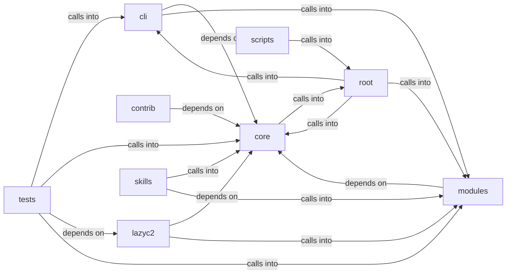

# modules: lazyown

modules: lazyown groups 70 files (c, py) around StructuredLogConfig, _JsonLineFormatter, __init__, format, _ConsoleFormatter. Automatic encryption of sensitive session data on app open/close.

## cli (3.1)

cli groups 6 files (py) around AutoCryptoConfig, AutoCryptoEngine, __init__, enabled, is_encrypted. Automatic encryption of sensitive session data on app open/close.

## contrib (3.2)

contrib groups 4 files (py) around parse_args, setup_logging, generate_rsa_key, Server, __init__. Autor: Gris Iscomeback Correo electrónico: grisiscomeback[at]gmail[dot]com Fecha de...

## core (3.3)

core groups 8 files (py) around StructuredLogConfig, _JsonLineFormatter, __init__, format, _ConsoleFormatter. Lightweight command execution bridge between C2 bots and the LazyOwn CLI shell.

## lazyc2 (3.4)

lazyc2 groups 2 files (py) around _sessions_dir, _db, _error, health, targets. Versioned REST API (``/api/v1``) for the LazyOwn C2 server.

## modules (3.5)

modules groups 27 files (c, py) around LazyOwnDB, __init__, _get_conn, db_path, _init_schema. Persistent beacon command/result history storage.

## root (3.6)

root groups 1 files (py) around _ux_debug, _parse_bool_setting, _PayloadSettableProxy, __init__, __getattr__. lazyown  Author: Gris Iscomeback Email: grisiscomeback at gmail dot com Creation Date...

## scripts (3.7)

scripts groups 1 files (py) around AuditConfig, argparser_commands, audit, main. Audit every registered shell command for dispatch and parser errors.

## skills (3.8)

skills groups 1 files (py) around PentestState, add_finding, summary, to_dict, _parse_output. skills/toposwarm_autonomous.py

## tests (3.9)

tests groups 20 files (py) around api_client, _auth, test_health_is_public, test_targets_requires_auth, test_targets_empty_workspace. Integration tests for the versioned C2 REST API (``/api/v1``).

**Files**:

- cli/auto_crypto.py
- cli/commands/automation.py
- cli/commands/collaboration.py
- cli/commands/estorides.py
- cli/commands/security.py
- cli/headless.py
- contrib/legacy/lazyhoneypot.py
- contrib/legacy/lazyopenssh77enum2.py
- contrib/legacy/lazysearch_bot.py
- contrib/legacy/lazyssh.py
- core/command_bridge.py
- core/credential_vault.py
- core/crypto.py
- core/executor.py
- core/logging.py
- core/safe_exec.py
- core/scheduler.py
- core/security.py
- lazyc2/blueprints/api_v1.py
- lazyc2/blueprints/beacon.py
- lazyown.py
- modules/beacon_history.py
- modules/c2_profile.py
- modules/collab_bp.py
- modules/command_executor.py
- modules/conditional_hooks.py
- modules/credential_reuse.py
- modules/db.py
- modules/engagement_hooks.py
- modules/estorides_importer.py
- modules/event_bus.py
- modules/event_consumers.py
- modules/hash_cracker.py
- modules/hive_invoke.py
- modules/integrations/nuclei_bridge.py
- modules/integrations/nuclei_parser.py
- modules/intelligence_engine.py
- modules/mcp_agent_bridge.py
- modules/metrics.py
- modules/operator_profiles.py
- modules/opsec_scorer.py
- modules/pipeline_engine.py
- modules/playbook_executor.py
- modules/rootkit/rootkit.c
- modules/state_manager.py
- modules/sudo_tiocsti.py
- modules/toposwarm_bridge.py
- modules/unified_bridge.py
- scripts/devtools/command_audit.py
- skills/toposwarm_autonomous.py
- tests/test_api_v1.py
- tests/test_auto_crypto.py
- tests/test_beacon_history.py
- tests/test_collab_and_onboarding.py
- tests/test_conditional_hooks_extended.py
- tests/test_core_command_bridge.py
- tests/test_core_executor.py
- tests/test_credential_vault.py
- tests/test_db.py
- tests/test_executor_kernel.py
- tests/test_hash_cracker.py
- tests/test_intelligence_engine.py
- tests/test_metrics.py
- tests/test_mutation_verification.py
- tests/test_nuclei_parser.py
- tests/test_opsec_scorer.py
- tests/test_opsec_scorer_consolidated.py
- tests/test_pipeline_engine.py
- tests/test_security_hardening_v4.py
- tests/test_structured_logging.py
