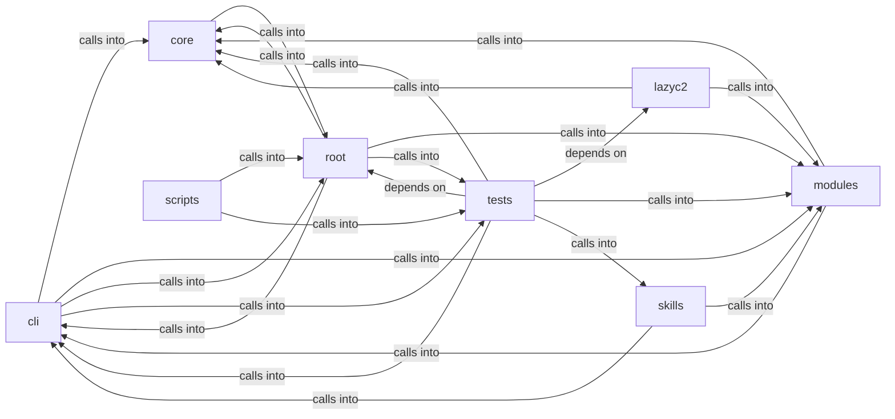

# modules: lazyown

modules: lazyown groups 103 files (py) around _apply_env_overrides, _coerce_env_value, _mask_if_sensitive, _log_config_change, _calling_frame. Declarative cmd2 alias loader.

## cli (6.1)

cli groups 21 files (py) around EngagementState, _load_state, _save_state, _load_index, _normalize_command. Declarative cmd2 alias loader.

## core (6.2)

core groups 5 files (py) around _apply_env_overrides, _coerce_env_value, _mask_if_sensitive, _log_config_change, _calling_frame. Tenant-bound API authorization for the LazyOwn C2 dashboard.

## lazyc2 (6.3)

lazyc2 groups 4 files (py) around HealthConfig, _health_status, _listener_alive, health, ping. Flask application factory for the LazyOwn C2 server.

## modules (6.4)

modules groups 25 files (py) around _derive_crypto_key, _machine_password, _master_password, _load_or_create_salt, _encrypt_payload. C2 agent builder with profile-driven compilation and safe templating.

## root (6.5)

root groups 1 files (py) around _ux_debug, _parse_bool_setting, _PayloadSettableProxy, __init__, __getattr__. lazyown  Author: Gris Iscomeback Email: grisiscomeback at gmail dot com Creation Date...

## scripts (6.6)

scripts groups 1 files (py) around AuditConfig, argparser_commands, audit, main. Audit every registered shell command for dispatch and parser errors.

## skills (6.7)

skills groups 4 files (py) around _sync_harness, _harness_result, _call_harness_tool, list_tools, call_tool. LazyOwn MCP OpenCode bridge.

## tests (6.8)

tests groups 42 files (py) around TestHexSource, test_valid_hex_decodes_to_32_bytes, test_wrong_length_raises, test_non_hex_raises, TestDiskSource. TDD tests for the AES key resolution contract.

**Files**:

- cli/aliases.py
- cli/auto_crypto.py
- cli/cli_enhancements.py
- cli/command_chain.py
- cli/commands/audit.py
- cli/commands/defaults.py
- cli/commands/diagnostics.py
- cli/commands/lazyloop.py
- cli/commands/recon_migrated.py
- cli/commands/redteam_gym.py
- cli/commands/security.py
- cli/engagement_hooks.py
- cli/exploration.py
- cli/headless.py
- cli/lazy_orchestrator.py
- cli/lazynmap_post.py
- cli/ops_commands.py
- cli/orchestrator_assets_tabs.py
- cli/recon_plan.py
- cli/session_brief.py
- cli/tui_forms.py
- core/api_authz.py
- core/command_bridge.py
- core/config.py
- core/credential_vault.py
- core/defaults.py
- lazyc2/app_factory.py
- lazyc2/blueprints/api.py
- lazyc2/blueprints/orchestrator.py
- lazyc2/extensions/__init__.py
- lazyown.py
- modules/c2_builder.py
- modules/cli_auth.py
- modules/golden_path.py
- modules/gym_cleanup.py
- modules/gym_registry.py
- modules/harness.py
- modules/hash_cracker.py
- modules/kill_chain_viz.py
- modules/killchain.py
- modules/lab_runtime.py
- modules/lazy_osinfer.py
- modules/lazy_surface_diff.py
- modules/lazy_timeline.py
- modules/loop_triggers.py
- modules/metasploitable_migrations.py
- modules/metrics.py
- modules/opsec_scorer.py
- modules/orchestrator_config.py
- modules/professional_report.py
- modules/redteam_gym.py
- modules/session_cleanup.py
- modules/sinks/findings.py
- modules/trigger_policy.py
- modules/verb_catalog.py
- modules/world_model.py
- scripts/devtools/command_audit.py
- skills/lazyown_mcp_opencode.py
- skills/mcp_tools/command_next.py
- skills/mcp_tools/command_prev.py
- skills/mcp_tools/metrics_summary.py
- tests/test_aes_key_propagation.py
- tests/test_api_authz.py
- tests/test_audit_remediation.py
- tests/test_bdd_infra_range_report.py
- tests/test_c2_agent.py
- tests/test_cli_auth_remember.py
- tests/test_cli_command_sets.py
- tests/test_cli_enhancements.py
- tests/test_command_chain.py
- tests/test_core_command_bridge.py
- tests/test_credential_vault.py
- tests/test_engagement_and_ping.py
- tests/test_engagement_command_gate.py
- tests/test_engagement_elo_and_methodology.py
- tests/test_golden_path.py
- tests/test_guardrails.py
- tests/test_gym_cli.py
- tests/test_gym_lifecycle.py
- tests/test_gym_matrix_ctf.py
- tests/test_gym_ms2_cli.py
- tests/test_hash_cracker.py
- tests/test_implant_session_secrets.py
- tests/test_infra_disposable.py
- tests/test_killchain_snapshot.py
- tests/test_killchain_unified.py
- tests/test_killchain_unified_v2.py
- tests/test_lazy_intel_wiring.py
- tests/test_lazy_orchestrator.py
- tests/test_lazynmap_post.py
- tests/test_loop_trigger_hints.py
- tests/test_metasploitable_migrations.py
- tests/test_metrics.py
- tests/test_opencode_mcp_harness.py
- tests/test_ops_loot_phase.py
- tests/test_opsec_scorer.py
- tests/test_opsec_scorer_consolidated.py
- tests/test_orchestrator_api.py
- tests/test_orchestrator_triggers.py
- tests/test_orchestrator_yaml.py
- tests/test_recon_plan.py
- tests/test_session_brief.py
- tests/test_world_model_extended.py
