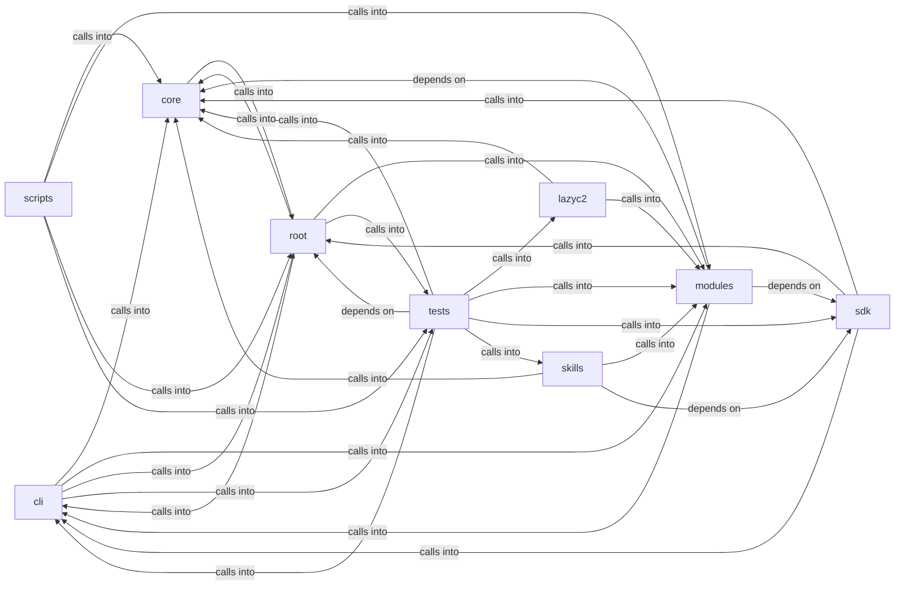

# modules: lazyown

modules: lazyown groups 151 files (py) around _apply_env_overrides, _coerce_env_value, _mask_if_sensitive, _log_config_change, _calling_frame. Declarative cmd2 alias loader.

## cli (5.1)

cli groups 19 files (py) around EngagementState, _load_state, _save_state, _load_index, _normalize_command. Declarative cmd2 alias loader.

## core (5.2)

core groups 18 files (py) around _apply_env_overrides, _coerce_env_value, _mask_if_sensitive, _log_config_change, _calling_frame. Core primitives for the LazyOwn framework.

## lazyc2 (5.3)

lazyc2 groups 3 files (py) around AddonCreatorConfig, live_placeholders, ParamSpec, to_dict, AddonDraft. LazyAddon creator contract for the LazyOwn C2 web interface.

## modules (5.4)

modules groups 29 files (py) around _load_users, _save_users, _load_payload, _save_payload, user_exists. Graphical sudo askpass helpers for desktop sudo prompts.

## root (5.5)

root groups 5 files (py) around _ux_debug, _parse_bool_setting, _PayloadSettableProxy, __init__, __getattr__. lazyown  Author: Gris Iscomeback Email: grisiscomeback at gmail dot com Creation Date...

## scripts (5.6)

scripts groups 2 files (py) around AuditConfig, argparser_commands, audit, main, SmokeConfig. Audit every registered shell command for dispatch and parser errors.

## sdk (5.7)

sdk groups 7 files (py) around _safe_session_name, ConfigApi, __init__, all, get. The LazyOwn programmatic SDK.

## skills (5.8)

skills groups 11 files (py) around _sync_harness, _harness_result, _call_harness_tool, list_tools, call_tool. LazyOwn MCP OpenCode bridge.

## tests (5.9)

tests groups 57 files (py) around TestHexSource, test_valid_hex_decodes_to_32_bytes, test_wrong_length_raises, test_non_hex_raises, TestDiskSource. TDD tests for the AES key resolution contract.

**Files**:

- cli/aliases.py
- cli/auto_crypto.py
- cli/cli_enhancements.py
- cli/commands/audit.py
- cli/commands/diagnostics.py
- cli/commands/lazyloop.py
- cli/commands/params_ops.py
- cli/commands/persist_migrated.py
- cli/commands/purple_team.py
- cli/commands/recon_migrated.py
- cli/commands/redteam_gym.py
- cli/commands/security.py
- cli/engagement_hooks.py
- cli/lazy_orchestrator.py
- cli/orchestrator_assets_tabs.py
- cli/plugin_tiers.py
- cli/purple_tui.py
- cli/scope_guard.py
- cli/tui_forms.py
- core/__init__.py
- core/api_authz.py
- core/command_bridge.py
- core/config.py
- core/credential_vault.py
- core/crypto.py
- core/dependencies.py
- core/errors.py
- core/hardening.py
- core/host_policy.py
- core/http.py
- core/network.py
- core/param_registry.py
- core/parsers.py
- core/payload_schema.py
- core/protocols.py
- core/reverse_shell_secret.py
- core/validators.py
- discord_c2.py
- lazyc2/addon_creator.py
- lazyc2/blueprints/api.py
- lazyc2/blueprints/orchestrator.py
- lazyown.py
- modules/askpass.py
- modules/auto_purple.py
- modules/c2_builder.py
- modules/cli_auth.py
- modules/ctf_signalman.py
- modules/domain_dominance.py
- modules/gym_cleanup.py
- modules/gym_registry.py
- modules/harness.py
- modules/lab_runtime.py
- modules/lazy_findings.py
- modules/lazy_handoff.py
- modules/lazymode_playbook.py
- modules/loop/worker_lazymode.py
- modules/loop_audit.py
- modules/loop_triggers.py
- modules/metrics.py
- modules/orchestrator_config.py
- modules/payload_factory.py
- modules/phishing_orchestrator.py
- modules/playbook_admin.py
- modules/professional_report.py
- modules/redteam_gym.py
- modules/session_cleanup.py
- modules/sinks/beacon_dispatch.py
- modules/sinks/findings.py
- modules/traffic_morpher.py
- modules/trigger_policy.py
- modules/websocket_beacon.py
- scripts/devtools/command_audit.py
- scripts/devtools/core_smoke.py
- sdk/__init__.py
- sdk/errors.py
- sdk/facade.py
- sdk/lazymode/__init__.py
- sdk/lazymode/_bootstrap.py
- sdk/lazymode/index.py
- sdk/lazymode/runner.py
- skills/lazyown_mcp_opencode.py
- skills/mcp_tools/create_param.py
- skills/mcp_tools/delete_param.py
- skills/mcp_tools/get_config.py
- skills/mcp_tools/lazymode_exec.py
- skills/mcp_tools/lazymode_playbook.py
- skills/mcp_tools/lazymode_search.py
- skills/mcp_tools/list_params.py
- skills/mcp_tools/metrics_summary.py
- skills/mcp_tools/read_session_file.py
- skills/mcp_tools/set_config.py
- slack_c2_bot.py
- telegram_c2.py
- telegram_hermes.py
- tests/test_aes_key_propagation.py
- tests/test_api_authz.py
- tests/test_askpass.py
- tests/test_audit_remediation.py
- tests/test_backdoor_random.py
- tests/test_bdd_infra_range_report.py
- tests/test_c2_agent.py
- tests/test_cli_auth_remember.py
- tests/test_cli_command_sets.py
- tests/test_cli_enhancements.py
- tests/test_core.py
- tests/test_core_command_bridge.py
- tests/test_core_config.py
- tests/test_core_defaults.py
- tests/test_credential_vault.py
- tests/test_dependencies.py
- tests/test_engagement_and_ping.py
- tests/test_engagement_command_gate.py
- tests/test_engagement_elo_and_methodology.py
- tests/test_findings_gate.py
- tests/test_guardrails.py
- tests/test_gym_cleanup_policy.py
- tests/test_gym_cli.py
- tests/test_gym_lifecycle.py
- tests/test_gym_matrix_ctf.py
- tests/test_gym_ms2_cli.py
- tests/test_host_policy.py
- tests/test_implant_session_secrets.py
- tests/test_infra_disposable.py
- tests/test_input_fuzz.py
- tests/test_lazy_findings.py
- tests/test_lazy_orchestrator.py
- tests/test_lazymode_playbook.py
- tests/test_lazymode_runner.py
- tests/test_loop_lazymode_first.py
- tests/test_loop_trigger_hints.py
- tests/test_metrics.py
- tests/test_opencode_mcp_harness.py
- tests/test_orchestrator_api.py
- tests/test_orchestrator_triggers.py
- tests/test_orchestrator_yaml.py
- tests/test_param_registry.py
- tests/test_payload_factory.py
- tests/test_payload_write_lock.py
- tests/test_php2shell_addon.py
- tests/test_placeholder_coverage.py
- tests/test_playbook_admin.py
- tests/test_plugin_tiers.py
- tests/test_require_guards.py
- tests/test_scope_guard.py
- tests/test_sdk_facade.py
- tests/test_security_alerts_fix.py
- tests/test_security_hardening_v3.py
- tests/test_shell_params_seeding.py
- tests/test_single_implementation.py
- tests/test_trigger_policy.py
- tests/test_winbox_gym.py
