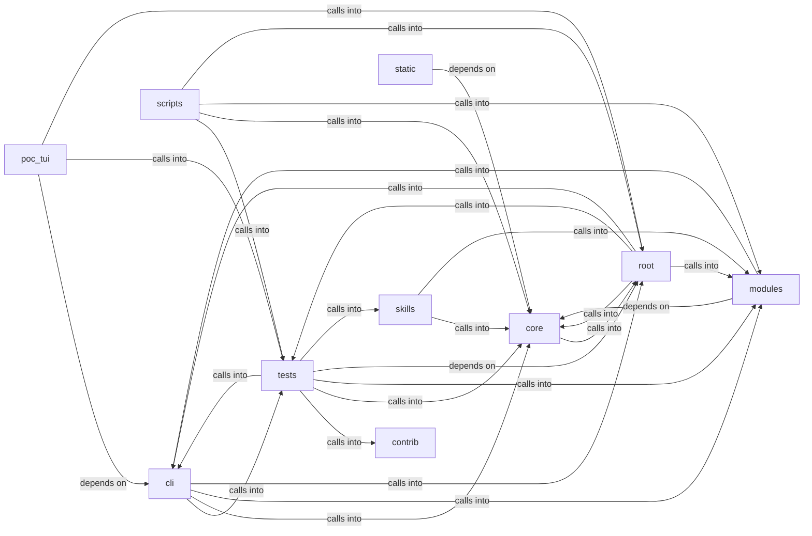

# modules: lazyown

modules: lazyown groups 139 files (js, py) around _apply_env_overrides, _coerce_env_value, _mask_if_sensitive, _log_config_change, _calling_frame. Declarative cmd2 alias loader.

## cli (4.1)

cli groups 19 files (py) around EngagementState, _load_state, _save_state, _load_index, _normalize_command. Declarative cmd2 alias loader.

## contrib (4.2)

contrib groups 1 files (py) around truncate_message, configure_logging, _load_payload_kv, _load_report_context, _prompt_redteam. Unified Ollama/DeepSeek client for LazyOwn — merges lazydeepseekcli_local +...

## core (4.3)

core groups 11 files (py) around _apply_env_overrides, _coerce_env_value, _mask_if_sensitive, _log_config_change, _calling_frame. Lightweight command execution bridge between C2 bots and the LazyOwn CLI shell.

## modules (4.4)

modules groups 45 files (py) around _load_users, _save_users, _load_payload, _save_payload, user_exists. AD lab gym catalogue (Docker Samba DC): index, exploits, chains.

## poc_tui (4.5)

poc_tui groups 3 files (py) around ShellBackend, __init__, import_shell_class, start, run. Entry point: python3 -m poc_tui

## root (4.6)

root groups 1 files (py) around _ux_debug, _parse_bool_setting, _PayloadSettableProxy, __init__, __getattr__. lazyown  Author: Gris Iscomeback Email: grisiscomeback at gmail dot com Creation Date...

## scripts (4.7)

scripts groups 2 files (py) around AuditConfig, argparser_commands, audit, main, SmokeConfig. Audit every registered shell command for dispatch and parser errors.

## skills (4.8)

skills groups 7 files (py) around _sync_harness, _harness_result, _call_harness_tool, list_tools, call_tool. LazyOwn MCP OpenCode bridge.

## static (4.9)

static groups 1 files (js) around pJS, draw, d, init, process.

## tests (4.10)

tests groups 49 files (py) around TestHexSource, test_valid_hex_decodes_to_32_bytes, test_wrong_length_raises, test_non_hex_raises, TestDiskSource. TDD tests for the AES key resolution contract.

**Files**:

- cli/aliases.py
- cli/auto_crypto.py
- cli/cli_enhancements.py
- cli/commands/audit.py
- cli/commands/containers.py
- cli/commands/diagnostics.py
- cli/commands/lazyloop.py
- cli/commands/persist_migrated.py
- cli/commands/purple_team.py
- cli/commands/recon_migrated.py
- cli/commands/redteam_gym.py
- cli/commands/security.py
- cli/engagement_hooks.py
- cli/headless.py
- cli/lazy_orchestrator.py
- cli/orchestrator_assets_tabs.py
- cli/purple_tui.py
- cli/surface_tui.py
- cli/tui_forms.py
- contrib/legacy/lazydeepseekcli.py
- core/command_bridge.py
- core/config.py
- core/credential_vault.py
- core/crypto.py
- core/hardening.py
- core/process.py
- core/protocols.py
- core/reverse_shell_secret.py
- core/safe_exec.py
- core/safe_subprocess.py
- core/session_secrets.py
- lazyown.py
- modules/ad_gym.py
- modules/ai_exploit_chain.py
- modules/askpass.py
- modules/atomic_exploit_bridge.py
- modules/auto_pivot.py
- modules/auto_purple.py
- modules/autonomous_exploit_engine.py
- modules/c2_agent.py
- modules/c2_surfaces.py
- modules/cli_auth.py
- modules/command_executor.py
- modules/ctf_capture.py
- modules/ctf_signalman.py
- modules/dns_beacon.py
- modules/domain_dominance.py
- modules/gym_cleanup.py
- modules/gym_registry.py
- modules/harness.py
- modules/lazy_findings.py
- modules/lazy_ledger.py
- modules/lazy_verify.py
- modules/lazyk8s.py
- modules/lazypoophish.py
- modules/lazyshortener.py
- modules/metasploitable_gym.py
- modules/metasploitable_migrations.py
- modules/orchestrator_config.py
- modules/outcome_bus.py
- modules/payload_factory.py
- modules/phishing_orchestrator.py
- modules/redteam_gym.py
- modules/resource_script.py
- modules/session_cleanup.py
- modules/sinks/__init__.py
- modules/sinks/attack_graph.py
- modules/sinks/beacon_dispatch.py
- modules/sinks/c2_surfaces.py
- modules/sinks/findings.py
- modules/sinks/intel_graph.py
- modules/sinks/killchain.py
- modules/sinks/objectives.py
- modules/sinks/routing.py
- modules/traffic_morpher.py
- modules/websocket_beacon.py
- modules/winbox_gym.py
- poc_tui/__main__.py
- poc_tui/app.py
- poc_tui/test_app.py
- scripts/devtools/command_audit.py
- scripts/devtools/core_smoke.py
- skills/lazyown_mcp_opencode.py
- skills/mcp_tools/atomic_clean.py
- skills/mcp_tools/atomic_shell.py
- skills/mcp_tools/auto_pwn.py
- skills/mcp_tools/exploit_chain.py
- skills/mcp_tools/pivot_status.py
- skills/mcp_tools/stealth.py
- static/js/particles.js
- tests/test_aes_key_propagation.py
- tests/test_askpass.py
- tests/test_atomic_exploit_bridge.py
- tests/test_audit_remediation.py
- tests/test_auto_pwn_success.py
- tests/test_backdoor_random.py
- tests/test_c2_agent.py
- tests/test_c2_surfaces.py
- tests/test_cli_auth_remember.py
- tests/test_cli_command_sets.py
- tests/test_cli_enhancements.py
- tests/test_core.py
- tests/test_core_command_bridge.py
- tests/test_credential_vault.py
- tests/test_ctf_signalman.py
- tests/test_engagement_and_ping.py
- tests/test_engagement_command_gate.py
- tests/test_engagement_elo_and_methodology.py
- tests/test_executor_kernel.py
- tests/test_findings_gate.py
- tests/test_group_kill.py
- tests/test_guardrails.py
- tests/test_gym_cleanup_policy.py
- tests/test_gym_cli.py
- tests/test_gym_lifecycle.py
- tests/test_gym_ms2_cli.py
- tests/test_gym_registry.py
- tests/test_lazy_findings.py
- tests/test_lazy_ledger.py
- tests/test_lazy_orchestrator.py
- tests/test_loop_evidence_wiring.py
- tests/test_loop_exit_gate.py
- tests/test_metasploitable_gym.py
- tests/test_metasploitable_migrations.py
- tests/test_opencode_mcp_harness.py
- tests/test_orchestrator_yaml.py
- tests/test_outcome_bus.py
- tests/test_payload_factory.py
- tests/test_resource_script.py
- tests/test_safe_subprocess.py
- tests/test_safe_subprocess_behavior.py
- tests/test_security_alerts_fix.py
- tests/test_security_hardening.py
- tests/test_security_hardening_v3.py
- tests/test_security_hardening_v4.py
- tests/test_session_secrets.py
- tests/test_shell_semantics.py
- tests/test_sink_lazy_intel.py
- tests/test_winbox_gym.py
