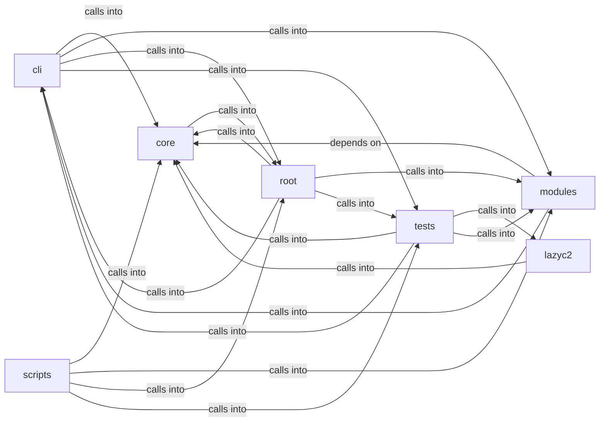

# modules: lazyown

modules: lazyown groups 80 files (c, py) around _apply_env_overrides, _coerce_env_value, _mask_if_sensitive, _log_config_change, _calling_frame. Declarative cmd2 alias loader.

## cli (6.1)

cli groups 17 files (py) around EngagementState, _load_state, _save_state, _load_index, _normalize_command. Declarative cmd2 alias loader.

## core (6.2)

core groups 10 files (py) around _apply_env_overrides, _coerce_env_value, _mask_if_sensitive, _log_config_change, _calling_frame. Lightweight command execution bridge between C2 bots and the LazyOwn CLI shell.

## lazyc2 (6.3)

lazyc2 groups 2 files (py) around AddonCreatorConfig, live_placeholders, ParamSpec, to_dict, AddonDraft. LazyAddon creator contract for the LazyOwn C2 web interface.

## modules (6.4)

modules groups 15 files (c, py) around _load_users, _save_users, _load_payload, _save_payload, user_exists. CLI authentication module — login against users.json with remember-me.

## root (6.5)

root groups 1 files (py) around _ux_debug, _parse_bool_setting, _PayloadSettableProxy, __init__, __getattr__. lazyown  Author: Gris Iscomeback Email: grisiscomeback at gmail dot com Creation Date...

## scripts (6.6)

scripts groups 2 files (py) around AuditConfig, argparser_commands, audit, main, SmokeConfig. Audit every registered shell command for dispatch and parser errors.

## tests (6.7)

tests groups 33 files (py) around TestHexSource, test_valid_hex_decodes_to_32_bytes, test_wrong_length_raises, test_non_hex_raises, TestDiskSource. TDD tests for the AES key resolution contract.

**Files**:

- cli/aliases.py
- cli/auto_crypto.py
- cli/cli_enhancements.py
- cli/commands/audit.py
- cli/commands/diagnostics.py
- cli/commands/lazy_poc.py
- cli/commands/params_ops.py
- cli/commands/persist_migrated.py
- cli/commands/recon_migrated.py
- cli/commands/redteam_gym.py
- cli/commands/security.py
- cli/engagement_hooks.py
- cli/headless.py
- cli/lazy_orchestrator.py
- cli/orchestrator_assets_tabs.py
- cli/palette.py
- cli/tui_forms.py
- core/command_bridge.py
- core/config.py
- core/credential_vault.py
- core/crypto.py
- core/hardening.py
- core/host_policy.py
- core/param_registry.py
- core/payload_schema.py
- core/protocols.py
- core/reverse_shell_secret.py
- lazyc2/addon_creator.py
- lazyc2/blueprints/api.py
- lazyown.py
- modules/cli_auth.py
- modules/config_store.py
- modules/domain_dominance.py
- modules/gym_cleanup.py
- modules/gym_registry.py
- modules/lazy_findings.py
- modules/payload_factory.py
- modules/phishing_orchestrator.py
- modules/redteam_gym.py
- modules/resource_script.py
- modules/rootkit/rootkit.c
- modules/session_cleanup.py
- modules/sinks/beacon_dispatch.py
- modules/traffic_morpher.py
- modules/websocket_beacon.py
- scripts/devtools/command_audit.py
- scripts/devtools/core_smoke.py
- tests/test_aes_key_propagation.py
- tests/test_audit_remediation.py
- tests/test_backdoor_random.py
- tests/test_cli_auth_remember.py
- tests/test_cli_command_sets.py
- tests/test_cli_enhancements.py
- tests/test_core.py
- tests/test_core_command_bridge.py
- tests/test_core_config.py
- tests/test_core_defaults.py
- tests/test_credential_vault.py
- tests/test_engagement_and_ping.py
- tests/test_engagement_command_gate.py
- tests/test_engagement_elo_and_methodology.py
- tests/test_findings_gate.py
- tests/test_guardrails.py
- tests/test_gym_cli.py
- tests/test_gym_lifecycle.py
- tests/test_gym_ms2_cli.py
- tests/test_host_policy.py
- tests/test_lazy_findings.py
- tests/test_lazy_orchestrator.py
- tests/test_orchestrator_yaml.py
- tests/test_param_registry.py
- tests/test_payload_factory.py
- tests/test_payload_schema.py
- tests/test_php2shell_addon.py
- tests/test_placeholder_coverage.py
- tests/test_resource_script.py
- tests/test_security_alerts_fix.py
- tests/test_security_hardening_v3.py
- tests/test_security_hardening_v5.py
- tests/test_winbox_gym.py
