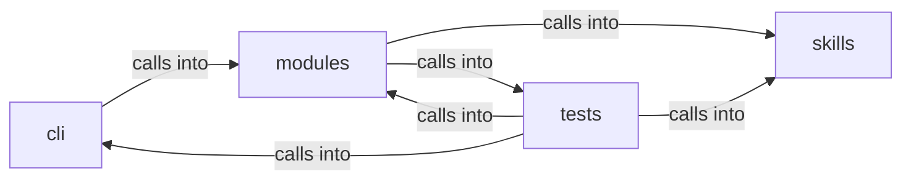

# modules: lazyown_facts

modules: lazyown_facts groups 22 files (py) around ChainStep, identifier, Chain, resolve, _render. Parsing, printing and replanning support for the ``apt_chain`` CLI.

## cli (10.1)

cli groups 2 files (py) around CommandAndControlMigratedCommandSet, do_msf, do_c2, do_listener, _api. Parsing, printing and replanning support for the ``apt_chain`` CLI.

## modules (10.2)

modules groups 9 files (py) around ChainStep, identifier, Chain, resolve, _render. APT Playbook Engine — map public APT reports to executable Atomic Red Team chains.

## skills (10.3)

skills groups 2 files (py) around Config, default, ServiceFact, CredentialFact, ShareFact. LazyOwn FactStore

## tests (10.4)

tests groups 9 files (py) around _make_shell, _Set, _Shell, __init__, _write_chain. apt_chain admin & run options BDD contract.

**Files**:

- cli/apt_chain_support.py
- cli/commands/command_and_control_migrated.py
- modules/apt_playbooks.py
- modules/atomic_cli.py
- modules/atomic_resolver.py
- modules/chain_registry.py
- modules/chain_runner.py
- modules/chain_state.py
- modules/chain_synth.py
- modules/chain_tokens.py
- modules/emulation_runner.py
- skills/lazyown_facts.py
- skills/tests/test_facts.py
- tests/test_apt_chain_admin.py
- tests/test_apt_chain_integration.py
- tests/test_atomic_loop.py
- tests/test_atomic_resolver.py
- tests/test_chain_registry.py
- tests/test_chain_runner.py
- tests/test_chain_synth.py
- tests/test_chain_v24_core.py
- tests/test_emulation_runner.py
