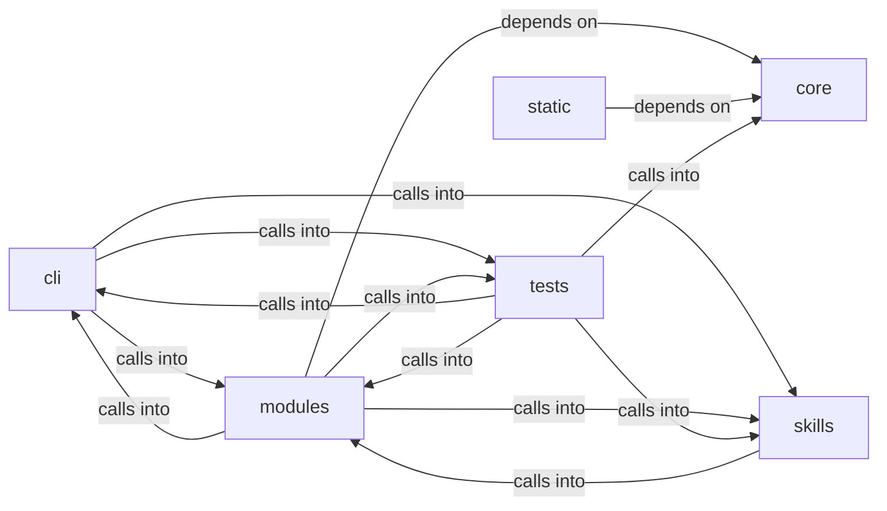

# modules: lazyown_facts

modules: lazyown_facts groups 103 files (js, py) around CommandInjectionError, UrlValidationError, needs_shell, safe_system, _kill_process_tree. Parsing, printing and replanning support for the ``apt_chain`` CLI.

## cli (6.1)

cli groups 4 files (py) around _apply_limit, _parse_admin_flags, _token_name_ok, ChainArgs, parse_chain_args. Parsing, printing and replanning support for the ``apt_chain`` CLI.

## core (6.2)

core groups 3 files (py) around CommandInjectionError, UrlValidationError, needs_shell, safe_system, _kill_process_tree. Process and subprocess utilities for the LazyOwn framework.

## modules (6.3)

modules groups 40 files (py) around skip_pending, ChainStep, identifier, Chain, resolve. AD lab gym catalogue (Docker Samba DC): index, exploits, chains.

## skills (6.4)

skills groups 9 files (py) around Config, default, ServiceFact, CredentialFact, ShareFact. LazyOwn FactStore

## static (6.5)

static groups 1 files (js) around pJS, draw, d, init, process.

## tests (6.6)

tests groups 46 files (py) around _make_shell, _Set, _Shell, __init__, _write_chain. apt_chain admin & run options BDD contract.

**Files**:

- cli/apt_chain_support.py
- cli/commands/command_and_control_migrated.py
- cli/commands/lazy_adaptive.py
- cli/retry_support.py
- core/process.py
- core/safe_exec.py
- core/safe_subprocess.py
- modules/ad_gym.py
- modules/ai_exploit_chain.py
- modules/apt_playbooks.py
- modules/atomic_cli.py
- modules/atomic_exploit_bridge.py
- modules/atomic_resolver.py
- modules/auto_pivot.py
- modules/autonomous_exploit_engine.py
- modules/chain_approval.py
- modules/chain_distill.py
- modules/chain_facts.py
- modules/chain_loop.py
- modules/chain_registry.py
- modules/chain_runner.py
- modules/chain_state.py
- modules/chain_synth.py
- modules/chain_tokens.py
- modules/command_executor.py
- modules/ctf_capture.py
- modules/dns_beacon.py
- modules/emulation_runner.py
- modules/failure_verdict.py
- modules/gym_matrix_runner.py
- modules/lazy_deviations.py
- modules/lazy_fallback.py
- modules/lazy_finalizer.py
- modules/lazy_scope.py
- modules/lazy_verify.py
- modules/lazypoophish.py
- modules/lazyshortener.py
- modules/metasploitable_gym.py
- modules/metasploitable_migrations.py
- modules/playbook_admin.py
- modules/playbook_chain.py
- modules/resource_script.py
- modules/retry_session.py
- modules/shell_session_store.py
- modules/ttpscope_bridge.py
- modules/verb_manifest.py
- modules/winbox_gym.py
- skills/lazyown_facts.py
- skills/mcp_tools/atomic_clean.py
- skills/mcp_tools/atomic_shell.py
- skills/mcp_tools/auto_pwn.py
- skills/mcp_tools/exploit_chain.py
- skills/mcp_tools/pivot_status.py
- skills/mcp_tools/stealth.py
- skills/mcp_tools/ttp_chain.py
- skills/tests/test_facts.py
- static/js/particles.js
- tests/test_apt_chain_admin.py
- tests/test_apt_chain_integration.py
- tests/test_atomic_exploit_bridge.py
- tests/test_atomic_loop.py
- tests/test_atomic_resolver.py
- tests/test_auto_pwn_coverage.py
- tests/test_auto_pwn_success.py
- tests/test_chain_approval_c2.py
- tests/test_chain_approval_cli_wiring.py
- tests/test_chain_distill.py
- tests/test_chain_distill_custody.py
- tests/test_chain_distill_scope.py
- tests/test_chain_evidence.py
- tests/test_chain_finalizer.py
- tests/test_chain_freshness_guard.py
- tests/test_chain_loop.py
- tests/test_chain_parallel_fallback.py
- tests/test_chain_registry.py
- tests/test_chain_runner.py
- tests/test_chain_step_streaming.py
- tests/test_chain_synth.py
- tests/test_chain_token_hardening.py
- tests/test_chain_v24_core.py
- tests/test_codeql_alert_fixes.py
- tests/test_command_control_agent.py
- tests/test_ctf_signalman.py
- tests/test_emulation_runner.py
- tests/test_executor_kernel.py
- tests/test_f4_hardening.py
- tests/test_failure_verdict.py
- tests/test_group_kill.py
- tests/test_lazy_adaptive_replan.py
- tests/test_lazy_deviations.py
- tests/test_lazy_fallback.py
- tests/test_metasploitable_gym.py
- tests/test_metasploitable_migrations.py
- tests/test_playbook_admin.py
- tests/test_playbook_chain.py
- tests/test_resource_script.py
- tests/test_retry_session.py
- tests/test_safe_subprocess.py
- tests/test_safe_subprocess_behavior.py
- tests/test_security_hardening.py
- tests/test_security_hardening_v4.py
- tests/test_shell_semantics.py
- tests/test_verb_manifest.py
