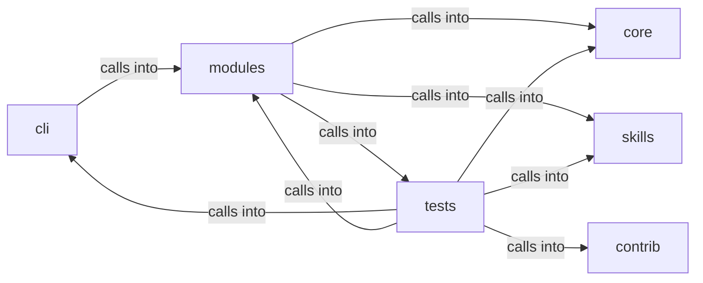

# modules: lazyown_facts

modules: lazyown_facts groups 75 files (py) around CommandInjectionError, UrlValidationError, needs_shell, safe_system, safe_run_argv. Parsing, printing and replanning support for the ``apt_chain`` CLI.

## cli (5.1)

cli groups 6 files (py) around select_agent_flavour, CommandAndControlMigratedCommandSet, do_msf, do_c2, do_listener. Parsing, printing and replanning support for the ``apt_chain`` CLI.

## contrib (5.2)

contrib groups 1 files (py) around truncate_message, configure_logging, _load_payload_kv, _load_report_context, _prompt_redteam. Unified Ollama/DeepSeek client for LazyOwn — merges lazydeepseekcli_local +...

## core (5.3)

core groups 1 files (py) around CommandInjectionError, UrlValidationError, needs_shell, safe_system, safe_run_argv. Centralized safe command execution for the LazyOwn framework.

## modules (5.4)

modules groups 37 files (py) around ChainStep, identifier, Chain, resolve, _render. APT Playbook Engine — map public APT reports to executable Atomic Red Team chains.

## skills (5.5)

skills groups 2 files (py) around Config, default, ServiceFact, CredentialFact, ShareFact. LazyOwn FactStore

## tests (5.6)

tests groups 28 files (py) around _make_shell, _Set, _Shell, __init__, _write_chain. apt_chain admin & run options BDD contract.

**Files**:

- cli/apt_chain_support.py
- cli/commands/c2_session.py
- cli/commands/command_and_control_migrated.py
- cli/commands/redteam_gym.py
- cli/commands/retry_ops.py
- cli/retry_support.py
- contrib/legacy/lazydeepseekcli.py
- core/safe_exec.py
- modules/apt_playbooks.py
- modules/atomic_cli.py
- modules/atomic_exploit_bridge.py
- modules/atomic_resolver.py
- modules/beacon_recon.py
- modules/c2_agent.py
- modules/c2_surfaces.py
- modules/chain_distill.py
- modules/chain_facts.py
- modules/chain_registry.py
- modules/chain_runner.py
- modules/chain_state.py
- modules/chain_synth.py
- modules/chain_tokens.py
- modules/command_executor.py
- modules/ctf_capture.py
- modules/emulation_runner.py
- modules/gym_matrix_runner.py
- modules/gym_registry.py
- modules/gym_winbox_runner.py
- modules/lazy_cve_feed.py
- modules/lazy_heat.py
- modules/listener_manager.py
- modules/metasploitable_gym.py
- modules/outcome_bus.py
- modules/redteam_gym.py
- modules/retry_session.py
- modules/sinks/attack_graph.py
- modules/sinks/beacon_dispatch.py
- modules/sinks/c2_surfaces.py
- modules/sinks/intel_graph.py
- modules/sinks/killchain.py
- modules/sinks/objectives.py
- modules/sinks/world_diff.py
- modules/sinks/world_model.py
- modules/verb_manifest.py
- modules/winbox_gym.py
- skills/lazyown_facts.py
- skills/tests/test_facts.py
- tests/test_apt_chain_admin.py
- tests/test_apt_chain_integration.py
- tests/test_atomic_exploit_bridge.py
- tests/test_atomic_loop.py
- tests/test_atomic_resolver.py
- tests/test_beacon_recon_sink.py
- tests/test_c2_surfaces.py
- tests/test_chain_distill.py
- tests/test_chain_evidence.py
- tests/test_chain_parallel_fallback.py
- tests/test_chain_registry.py
- tests/test_chain_runner.py
- tests/test_chain_synth.py
- tests/test_chain_v24_core.py
- tests/test_codeql_alert_fixes.py
- tests/test_command_control_agent.py
- tests/test_emulation_runner.py
- tests/test_executor_kernel.py
- tests/test_f4_hardening.py
- tests/test_gym_cli.py
- tests/test_gym_ms2_cli.py
- tests/test_gym_registry.py
- tests/test_metasploitable_gym.py
- tests/test_outcome_bus.py
- tests/test_retry_session.py
- tests/test_security_hardening_v4.py
- tests/test_verb_manifest.py
- tests/test_winbox_gym.py
