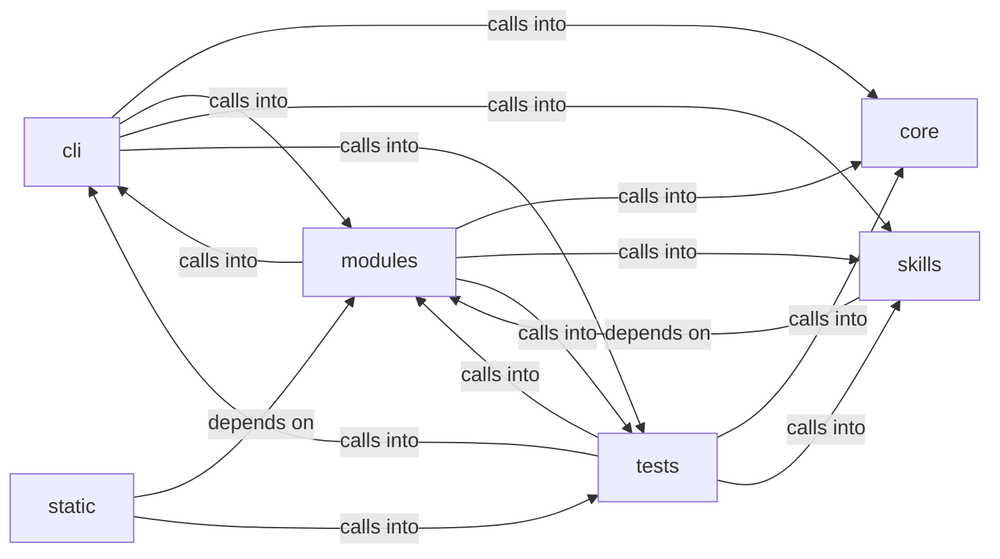

# modules: lazyown_facts

modules: lazyown_facts groups 110 files (c, js, py) around skip_pending, ChainStep, identifier, Chain, resolve. Parsing, printing and replanning support for the ``apt_chain`` CLI.

## cli (6.1)

cli groups 6 files (py) around _apply_limit, _parse_admin_flags, _token_name_ok, ChainArgs, parse_chain_args. Parsing, printing and replanning support for the ``apt_chain`` CLI.

## core (6.2)

core groups 1 files (py) around is_autonomous, autonomous_mode, _guarded_input. Autonomous-run mode for the loop engine.

## modules (6.3)

modules groups 50 files (c, py) around skip_pending, ChainStep, identifier, Chain, resolve. Active Directory Certificate Services (AD CS) attack module.

## skills (6.4)

skills groups 4 files (py) around Config, default, ServiceFact, CredentialFact, ShareFact. LazyOwn FactStore

## static (6.5)

static groups 1 files (js) around d, e, t. !

## tests (6.6)

tests groups 48 files (py) around _make_shell, _Set, _Shell, __init__, _write_chain. apt_chain admin & run options BDD contract.

**Files**:

- cli/apt_chain_support.py
- cli/commands/command_and_control_migrated.py
- cli/commands/exploit_migrated.py
- cli/commands/lazy_adaptive.py
- cli/exploit_advisor.py
- cli/retry_support.py
- core/autonomous.py
- modules/adcs_attacks.py
- modules/apt_playbooks.py
- modules/atomic_cli.py
- modules/atomic_resolver.py
- modules/auto_registry.py
- modules/campaign_blacklist.py
- modules/chain_approval.py
- modules/chain_distill.py
- modules/chain_facts.py
- modules/chain_loop.py
- modules/chain_match.py
- modules/chain_registry.py
- modules/chain_runner.py
- modules/chain_state.py
- modules/chain_synth.py
- modules/chain_tokens.py
- modules/exploit_chain.py
- modules/failure_verdict.py
- modules/gym_matrix_runner.py
- modules/lazy_deviations.py
- modules/lazy_fallback.py
- modules/lazy_finalizer.py
- modules/lazy_osinfer.py
- modules/lazy_scope.py
- modules/nmap_fingerprint.py
- modules/playbook_chain.py
- modules/retry_session.py
- modules/reverse-shell.c
- modules/rootkit/rootkit.c
- modules/selection/__init__.py
- modules/selection/_phase_categories.py
- modules/selection/adversary.py
- modules/selection/atomic.py
- modules/selection/base.py
- modules/selection/bridge.py
- modules/selection/chain.py
- modules/selection/cred_spray.py
- modules/selection/edb.py
- modules/selection/intel.py
- modules/selection/lazyscript.py
- modules/selection/module.py
- modules/selection/parquet.py
- modules/selection/playbook.py
- modules/selection/poc.py
- modules/selection/registry.py
- modules/selection/technique.py
- modules/selection/technique_chain.py
- modules/service_aliases.py
- modules/ttpscope_bridge.py
- modules/verb_manifest.py
- skills/lazyown_facts.py
- skills/mcp_tools/lazy_addon.py
- skills/mcp_tools/ttp_chain.py
- skills/tests/test_facts.py
- static/js/select2-4.1.0.min.js
- tests/test_apt_chain_admin.py
- tests/test_apt_chain_integration.py
- tests/test_atomic_headless.py
- tests/test_atomic_loop.py
- tests/test_atomic_resolver.py
- tests/test_auto_registry.py
- tests/test_chain_approval_c2.py
- tests/test_chain_approval_cli_wiring.py
- tests/test_chain_distill.py
- tests/test_chain_distill_custody.py
- tests/test_chain_distill_scope.py
- tests/test_chain_evidence.py
- tests/test_chain_finalizer.py
- tests/test_chain_freshness_guard.py
- tests/test_chain_list_command.py
- tests/test_chain_loop.py
- tests/test_chain_match_determinism.py
- tests/test_chain_parallel_fallback.py
- tests/test_chain_registry.py
- tests/test_chain_runner.py
- tests/test_chain_selector.py
- tests/test_chain_step_streaming.py
- tests/test_chain_synth.py
- tests/test_chain_token_hardening.py
- tests/test_chain_v24_core.py
- tests/test_codeql_alert_fixes.py
- tests/test_command_control_agent.py
- tests/test_f4_hardening.py
- tests/test_failure_verdict.py
- tests/test_intel_selector.py
- tests/test_lazy_adaptive_replan.py
- tests/test_lazy_deviations.py
- tests/test_lazy_fallback.py
- tests/test_lazy_handoff.py
- tests/test_loop_fire_pending.py
- tests/test_playbook_chain.py
- tests/test_poc_registry.py
- tests/test_retry_session.py
- tests/test_selection_bridge.py
- tests/test_selection_lazyscript.py
- tests/test_selection_module.py
- tests/test_selection_parquet.py
- tests/test_selection_technique.py
- tests/test_selection_technique_chain.py
- tests/test_selection_wiring.py
- tests/test_selectors_base.py
- tests/test_selectors_capabilities.py
- tests/test_verb_manifest.py
