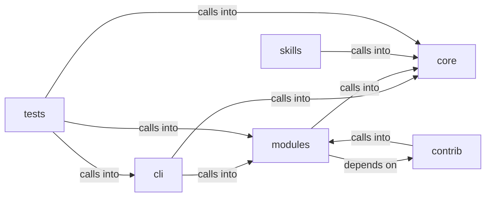

# modules: llm_budget

modules: llm_budget groups 43 files (py) around is_model_missing_error, groq_model_chain, LLMBackendUnavailableError, LLMBackendNotSupportedError, default_model_for. Artificial Intelligence command set.

## cli (12.1)

cli groups 2 files (py) around AiCommandSet, do_ask, do_groq, do_poolcheck, _serve. Artificial Intelligence command set.

## contrib (12.2)

contrib groups 3 files (py) around clean_think, clean_yaml, truncate_message, configure_logging, create_complex_prompt. parse_github_url: Extrae (owner, repo) de una URL de GitHub.

## core (12.3)

core groups 2 files (py) around BudgetExceeded, LLMBackendLike, generate, stream_generate, complete. LLM budget cap and per call token counter.

## modules (12.4)

modules groups 23 files (py) around is_model_missing_error, groq_model_chain, LLMBackendUnavailableError, LLMBackendNotSupportedError, default_model_for. LazyOwn AI Agent - Ultimate Edition Improvements: anti-hang timeout, memory...

## skills (12.5)

skills groups 1 files (py) around handle. MCP tool ``lazyown_get_llm_budget``: read the LLM cost budget status.

## tests (12.6)

tests groups 12 files (py) around _isolated_llm_health, _isolated_path, _fast_llm_connect_backoff, _reset_world_model_singleton, _isolated_loop_state_db. Global pytest isolation hooks.

**Files**:

- cli/commands/ai.py
- cli/commands/opsec_cleanup.py
- contrib/legacy/lazyaddon_creator.py
- contrib/legacy/lazyllmchat.py
- contrib/legacy/lazyphishingai.py
- core/llm_budget.py
- core/llm_key_pool.py
- modules/agent_runner.py
- modules/ai_fallback.py
- modules/ai_model.py
- modules/forensic_cleaner.py
- modules/lazy_agent.py
- modules/lazyllmchat.py
- modules/llm_adapter.py
- modules/llm_client.py
- modules/llm_factory.py
- modules/llm_orchestrator.py
- modules/llm_pool.py
- modules/llm_prompts.py
- modules/log_tamper.py
- modules/loop_ai_bridge.py
- modules/memory_cleaner.py
- modules/network_opsec.py
- modules/opsec_scorer.py
- modules/recommender.py
- modules/session_state.py
- modules/timestomper.py
- modules/vuln_bot_cli.py
- modules/vulnbot.py
- modules/yaml_generator.py
- skills/mcp_tools/get_llm_budget.py
- tests/conftest.py
- tests/test_ai_commands_llm.py
- tests/test_lazy_streaming.py
- tests/test_llm_adapter_parity.py
- tests/test_llm_budget.py
- tests/test_llm_key_pool.py
- tests/test_llm_orchestrator.py
- tests/test_llm_prompts.py
- tests/test_loop_ai_bridge.py
- tests/test_opsec_scorer.py
- tests/test_opsec_scorer_consolidated.py
- tests/test_vulnbot_fallback.py
