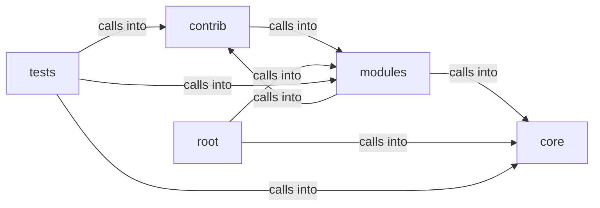

# modules: llm_budget

modules: llm_budget groups 33 files (py) around is_model_missing_error, groq_model_chain, LLMBackendUnavailableError, LLMBackendNotSupportedError, default_model_for. parse_github_url: Extrae (owner, repo) de una URL de GitHub.

## contrib (10.1)

contrib groups 8 files (py) around truncate_message, configure_logging, _load_payload_kv, _load_report_context, _prompt_redteam. parse_github_url: Extrae (owner, repo) de una URL de GitHub.

## core (10.2)

core groups 2 files (py) around strip_ansi, BudgetExceeded, LLMBackendLike, generate, stream_generate. LLM budget cap and per call token counter.

## modules (10.3)

modules groups 11 files (py) around is_model_missing_error, groq_model_chain, LLMBackendUnavailableError, LLMBackendNotSupportedError, default_model_for. LazyOwn AI Agent - Ultimate Edition Improvements: anti-hang timeout, memory...

## root (10.4)

root groups 4 files (py) around SecureSessionManager, __init__, register_failed_attempt, check_lockout, check_rate_limit. download_c2: Handle the /download_c2 command to download a file from the C2.

## tests (10.5)

tests groups 8 files (py) around _command_set, TestDoAsk, test_empty_question_prints_usage, test_question_forwarded_with_session_context, test_backend_error_surfaces_as_message. Behavioural tests for the resurrected ``ask``/``groq`` commands.

**Files**:

- contrib/legacy/lazyaddon_creator.py
- contrib/legacy/lazydeepseekcli.py
- contrib/legacy/lazygptcli.py
- contrib/legacy/lazygptcli_unified.py
- contrib/legacy/lazyllmchat.py
- contrib/legacy/lazyphishingai.py
- contrib/legacy/lazyproxy.py
- contrib/legacy/lazyseo.py
- core/llm_budget.py
- core/parsers.py
- discord_c2.py
- modules/agent_runner.py
- modules/ai_model.py
- modules/colors.py
- modules/llm_adapter.py
- modules/llm_client.py
- modules/llm_factory.py
- modules/llm_prompts.py
- modules/privesc_predictor.py
- modules/vuln_bot_cli.py
- modules/vulnbot.py
- modules/yaml_generator.py
- slack_c2_bot.py
- telegram_c2.py
- telegram_hermes.py
- tests/test_ai_commands_llm.py
- tests/test_c2_surfaces.py
- tests/test_lazy_streaming.py
- tests/test_llm_adapter_parity.py
- tests/test_llm_budget.py
- tests/test_llm_prompts.py
- tests/test_single_implementation.py
- tests/test_vulnbot_fallback.py
