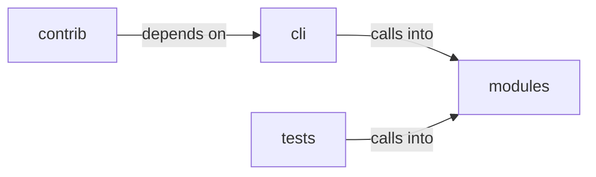

# modules/mediation

modules/mediation groups 22 files (py) around _now, _log_path, _mask, _append, infer_source. Autonomous exploitation and LOLBAS command set.

## cli (12.1)

cli groups 1 files (py) around PwnCommandSet, do_auto_pwn, do_rich_tui, do_exploit_chain, do_lolbas_list. Autonomous exploitation and LOLBAS command set.

## contrib (12.2)

contrib groups 3 files (py) around BinaryFinder, __init__, find_suid_binaries, find_capabilities_binaries, find_executable_binaries.

## modules (12.3)

modules groups 15 files (py) around _now, _log_path, _mask, _append, infer_source. AI-Driven Exploit Chaining Engine.

## tests (12.4)

tests groups 3 files (py) around TestRouting, test_engine_domain_registered_in_default_hub, test_resolve_returns_engine_mediator, test_domain_key_in_all_contract, test_describe_shape. Engine mediator contract tests.

**Files**:

- cli/commands/pwn.py
- contrib/legacy/lazypwn.py
- contrib/legacy/lazyvsftp.py
- contrib/legacy/sql.py
- modules/ai_exploit_chain.py
- modules/auto_pivot.py
- modules/autonomous_exploit_engine.py
- modules/dashboard_engine.py
- modules/lazy_intel.py
- modules/lazy_orchestrator_feedback.py
- modules/mediation/__init__.py
- modules/mediation/chain_mediator.py
- modules/mediation/contracts.py
- modules/mediation/engine_mediator.py
- modules/mediation/feedback_mediator.py
- modules/mediation/hub.py
- modules/mediation/intel_mediator.py
- modules/mediation/telemetry_mediator.py
- modules/rich_tui.py
- tests/test_engine_mediator.py
- tests/test_loop_supervision.py
- tests/test_mediation.py
