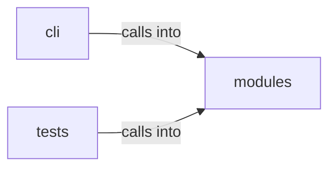

# modules: opsec_scorer

modules: opsec_scorer groups 9 files (py) around RiskLevel, GateAction, _risk_bucket, _risk_label, _risk_level. OPSEC and cleanup commands — scoring, log tamper, forensic cleaner, timestomp, memory...

## cli (13.1)

cli groups 1 files (py) around OpsecCleanupCommandSet, do_opsec_score, do_log_tamper, do_forensic_clean, do_timestomp. OPSEC and cleanup commands — scoring, log tamper, forensic cleaner, timestomp, memory...

## modules (13.2)

modules groups 6 files (py) around RiskLevel, GateAction, _risk_bucket, _risk_label, _risk_level. Forensic artifact cleaner — Prefetch, Shimcache, Amcache, MFT/USN cleanup.

## tests (13.3)

tests groups 2 files (py) around TestOpsecScorer, test_score_high_noise_command, test_score_low_noise_command, test_score_unknown_command, test_score_with_evasion. Tests for modules/opsec_scorer.py

**Files**:

- cli/commands/opsec_cleanup.py
- modules/forensic_cleaner.py
- modules/log_tamper.py
- modules/memory_cleaner.py
- modules/network_opsec.py
- modules/opsec_scorer.py
- modules/timestomper.py
- tests/test_opsec_scorer.py
- tests/test_opsec_scorer_consolidated.py
