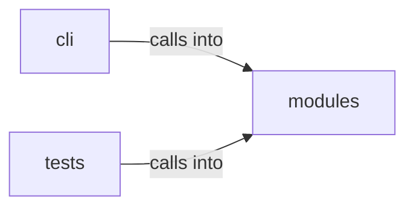

# modules: opsec_scorer

modules: opsec_scorer groups 12 files (py) around RiskLevel, GateAction, _risk_bucket, _risk_label, _risk_level. OPSEC and cleanup commands — scoring, log tamper, forensic cleaner, timestomp, memory...

## cli (12.1)

cli groups 2 files (py) around OpsecCleanupCommandSet, do_opsec_score, do_log_tamper, do_forensic_clean, do_timestomp. OPSEC and cleanup commands — scoring, log tamper, forensic cleaner, timestomp, memory...

## modules (12.2)

modules groups 7 files (py) around RiskLevel, GateAction, _risk_bucket, _risk_label, _risk_level. Forensic artifact cleaner — Prefetch, Shimcache, Amcache, MFT/USN cleanup.

## tests (12.3)

tests groups 3 files (py) around TestHashIdentification, test_identify_ntlm, test_identify_ntlm_from_secretsdump, test_identify_sha512crypt, test_identify_unknown. Tests for modules/hash_cracker.py

**Files**:

- cli/commands/opsec_cleanup.py
- cli/commands/security.py
- modules/forensic_cleaner.py
- modules/hash_cracker.py
- modules/log_tamper.py
- modules/memory_cleaner.py
- modules/network_opsec.py
- modules/opsec_scorer.py
- modules/timestomper.py
- tests/test_hash_cracker.py
- tests/test_opsec_scorer.py
- tests/test_opsec_scorer_consolidated.py
