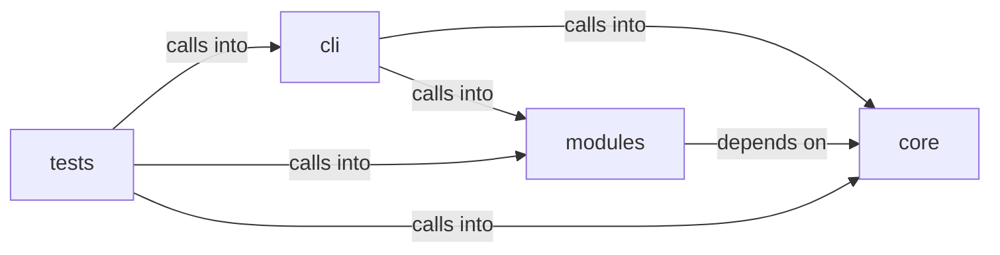

# modules: opsec_scorer

modules: opsec_scorer groups 20 files (c, py) around generate_salt, derive_key, xor_encrypt_decrypt, generate_xor_key, AESencrypt. Automatic encryption of sensitive session data on app open/close.

## cli (11.1)

cli groups 3 files (py) around AutoCryptoConfig, AutoCryptoEngine, __init__, enabled, is_encrypted. Automatic encryption of sensitive session data on app open/close.

## core (11.2)

core groups 3 files (py) around generate_salt, derive_key, xor_encrypt_decrypt, generate_xor_key, AESencrypt. Credential vault — AES-256-GCM encryption for sensitive config values.

## modules (11.3)

modules groups 8 files (c, py) around RiskLevel, GateAction, _risk_bucket, _risk_label, _risk_level. Forensic artifact cleaner — Prefetch, Shimcache, Amcache, MFT/USN cleanup.

## tests (11.4)

tests groups 6 files (py) around crypto_module, tmp_sessions, TestAutoCryptoConfig, test_default_config, test_custom_config. Tests for cli.auto_crypto — automatic session data encryption.

**Files**:

- cli/auto_crypto.py
- cli/commands/opsec_cleanup.py
- cli/commands/security.py
- core/credential_vault.py
- core/crypto.py
- core/protocols.py
- modules/forensic_cleaner.py
- modules/hash_cracker.py
- modules/log_tamper.py
- modules/memory_cleaner.py
- modules/network_opsec.py
- modules/opsec_scorer.py
- modules/rootkit/rootkit.c
- modules/timestomper.py
- tests/test_auto_crypto.py
- tests/test_core.py
- tests/test_credential_vault.py
- tests/test_hash_cracker.py
- tests/test_opsec_scorer.py
- tests/test_opsec_scorer_consolidated.py
