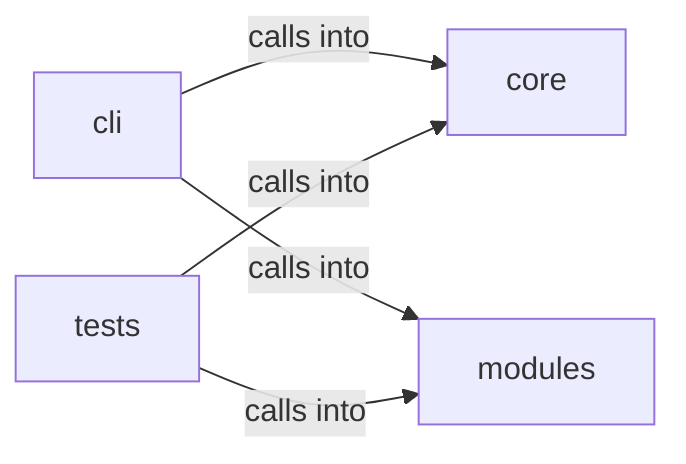

# modules: opsec_scorer

modules: opsec_scorer groups 14 files (py) around check_dangerous_defaults, _get_aes_key, seal_value, unseal_value, seal_payload. OPSEC and cleanup commands — scoring, log tamper, forensic cleaner, timestomp, memory...

## cli (12.1)

cli groups 2 files (py) around OpsecCleanupCommandSet, do_opsec_score, do_log_tamper, do_forensic_clean, do_timestomp. OPSEC and cleanup commands — scoring, log tamper, forensic cleaner, timestomp, memory...

## core (12.2)

core groups 1 files (py) around check_dangerous_defaults, _get_aes_key, seal_value, unseal_value, seal_payload. Credential vault — AES-256-GCM encryption for sensitive config values.

## modules (12.3)

modules groups 7 files (py) around RiskLevel, GateAction, _risk_bucket, _risk_label, _risk_level. Forensic artifact cleaner — Prefetch, Shimcache, Amcache, MFT/USN cleanup.

## tests (12.4)

tests groups 4 files (py) around TestCheckDefaults, test_default_values_detected, test_clean_payload_no_warnings, test_empty_keys_flagged, test_changeme_variants. Tests for core/credential_vault.py

**Files**:

- cli/commands/opsec_cleanup.py
- cli/commands/security.py
- core/credential_vault.py
- modules/forensic_cleaner.py
- modules/hash_cracker.py
- modules/log_tamper.py
- modules/memory_cleaner.py
- modules/network_opsec.py
- modules/opsec_scorer.py
- modules/timestomper.py
- tests/test_credential_vault.py
- tests/test_hash_cracker.py
- tests/test_opsec_scorer.py
- tests/test_opsec_scorer_consolidated.py
