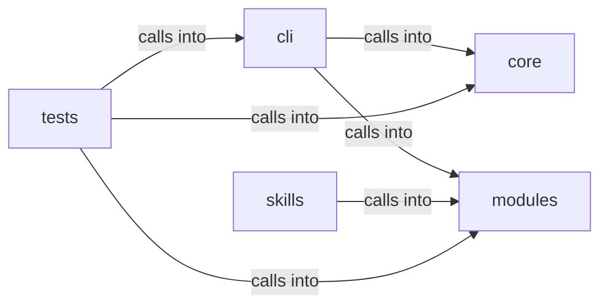

# modules: opsec_scorer

modules: opsec_scorer groups 27 files (py) around KillChainConfig, world_model_path, phase_index, is_valid_phase, PhaseStatus. OPSEC and cleanup commands — scoring, log tamper, forensic cleaner, timestomp, memory...

## cli (9.1)

cli groups 3 files (py) around PhaseProgress, _phase_from_event, _detect_current_phase, compute_killchain, OpsecCleanupCommandSet. OPSEC and cleanup commands — scoring, log tamper, forensic cleaner, timestomp, memory...

## core (9.2)

core groups 1 files (py) around check_dangerous_defaults, _get_aes_key, seal_value, unseal_value, seal_payload. Credential vault — AES-256-GCM encryption for sensitive config values.

## modules (9.3)

modules groups 9 files (py) around KillChainConfig, world_model_path, phase_index, is_valid_phase, PhaseStatus. Forensic artifact cleaner — Prefetch, Shimcache, Amcache, MFT/USN cleanup.

## skills (9.4)

skills groups 7 files (py) around ConfigKeys, EnvKeys, Defaults, PhaseNames, Paths. Dynamic Claude.md rule generator for the Hermes-LazyOwn integration.

## tests (9.5)

tests groups 7 files (py) around TestCheckDefaults, test_default_values_detected, test_clean_payload_no_warnings, test_empty_keys_flagged, test_changeme_variants. Tests for core/credential_vault.py

**Files**:

- cli/commands/opsec_cleanup.py
- cli/commands/security.py
- cli/killchain.py
- core/credential_vault.py
- modules/forensic_cleaner.py
- modules/hash_cracker.py
- modules/kill_chain_viz.py
- modules/killchain.py
- modules/log_tamper.py
- modules/memory_cleaner.py
- modules/network_opsec.py
- modules/opsec_scorer.py
- modules/timestomper.py
- skills/hermes-lazyown/claudemd_rules.py
- skills/hermes-lazyown/config_bridge.py
- skills/hermes-lazyown/constants.py
- skills/hermes-lazyown/executor.py
- skills/hermes-lazyown/hermes_sync.py
- skills/hermes-lazyown/mcp_server.py
- skills/hermes-lazyown/output_compactor.py
- tests/test_credential_vault.py
- tests/test_hash_cracker.py
- tests/test_killchain.py
- tests/test_killchain_snapshot.py
- tests/test_killchain_unified_v2.py
- tests/test_opsec_scorer.py
- tests/test_opsec_scorer_consolidated.py
