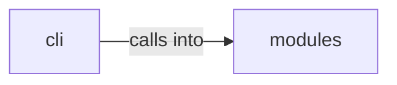

# modules: polymorphic_engine

modules: polymorphic_engine groups 6 files (py) around DotNetPayloadConfig, DotNetPayloadFactory, __init__, _detect_compiler, list_templates. Payload arsenal commands — dotnet, reflective DLL, staged delivery, polymorphic...

## cli (17.1)

cli groups 1 files (py) around PayloadArsenalCommandSet, do_dotnet_payload, do_arsenal_show, do_staged_delivery, do_polymorphic. Payload arsenal commands — dotnet, reflective DLL, staged delivery, polymorphic...

## modules (17.2)

modules groups 5 files (py) around DotNetPayloadConfig, DotNetPayloadFactory, __init__, _detect_compiler, list_templates. .NET/C# payload generation — execute-assembly, inline-assembly, Roslyn compilation.

**Files**:

- cli/commands/payload_arsenal.py
- modules/dotnet_payload.py
- modules/linux_advanced_payloads.py
- modules/macos_payloads.py
- modules/polymorphic_engine.py
- modules/staged_delivery.py
