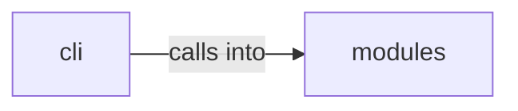

# modules: saas_attacks

modules: saas_attacks groups 7 files (py) around AWSConfig, AWSAttackEngine, __init__, enumerate_iam_permissions, lambda_backdoor. Cloud attack commands — Azure AD/Entra ID, AWS, GCP, Kubernetes, cross-cloud, SaaS.

## cli (13.1)

cli groups 1 files (py) around CloudAttackCommandSet, do_entra_attack, do_aws_privesc, do_gcp_privesc, do_k8s_attack. Cloud attack commands — Azure AD/Entra ID, AWS, GCP, Kubernetes, cross-cloud, SaaS.

## modules (13.2)

modules groups 6 files (py) around AWSConfig, AWSAttackEngine, __init__, enumerate_iam_permissions, lambda_backdoor. AWS privilege escalation — IAM enumeration, Lambda backdoors, STS role chaining.

**Files**:

- cli/commands/cloud_attacks.py
- modules/aws_attacks.py
- modules/cross_cloud.py
- modules/entra_id_attacks.py
- modules/gcp_attacks.py
- modules/k8s_attacks.py
- modules/saas_attacks.py
