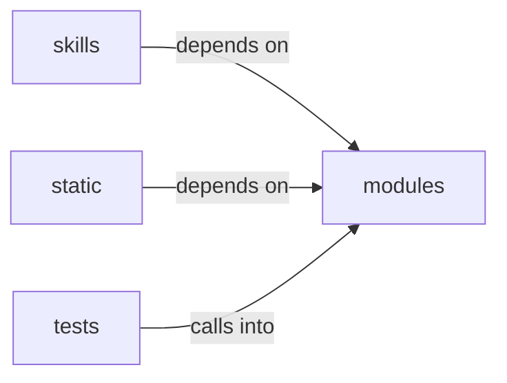

# modules/selection

modules/selection groups 40 files (c, js, py) around SelectionContext, ActionDecision, Selector, propose, _looks_like_target. Registry of loop-ready automation verbs (the ``auto_*`` family plus read-only staging...

## modules (12.1)

modules groups 25 files (c, py) around SelectionContext, ActionDecision, Selector, propose, _looks_like_target. Registry of loop-ready automation verbs (the ``auto_*`` family plus read-only staging...

## skills (12.2)

skills groups 1 files (py) around handle. MCP tool ``lazyown_lazy_addon``: list or match lazyaddon triggers.

## static (12.3)

static groups 1 files (js) around d, e, t. !

## tests (12.4)

tests groups 13 files (py) around test_registry_covers_auto_family, test_build_command_binds_target, test_is_shell_verb_matches_first_token, test_verbs_for_matches_keywords, test_propose_and_translate_roundtrip. Auto-verb registry: loop-ready automation commands.

**Files**:

- modules/auto_registry.py
- modules/chain_match.py
- modules/chain_synth.py
- modules/custom_tools.py
- modules/lazy_autofire.py
- modules/loop/worker_execution.py
- modules/notify.py
- modules/reverse-shell.c
- modules/rootkit/rootkit.c
- modules/selection/__init__.py
- modules/selection/adversary.py
- modules/selection/atomic.py
- modules/selection/base.py
- modules/selection/chain.py
- modules/selection/cred_spray.py
- modules/selection/edb.py
- modules/selection/intel.py
- modules/selection/lazyscript.py
- modules/selection/module.py
- modules/selection/playbook.py
- modules/selection/poc.py
- modules/selection/registry.py
- modules/selection/technique.py
- modules/selection/technique_chain.py
- modules/workspace.py
- skills/mcp_tools/lazy_addon.py
- static/js/select2-4.1.0.min.js
- tests/test_auto_registry.py
- tests/test_chain_synth.py
- tests/test_intel_selector.py
- tests/test_lazy_loop.py
- tests/test_loop_fire_pending.py
- tests/test_poc_registry.py
- tests/test_selection_lazyscript.py
- tests/test_selection_module.py
- tests/test_selection_technique.py
- tests/test_selection_technique_chain.py
- tests/test_selection_wiring.py
- tests/test_selectors_base.py
- tests/test_selectors_capabilities.py
